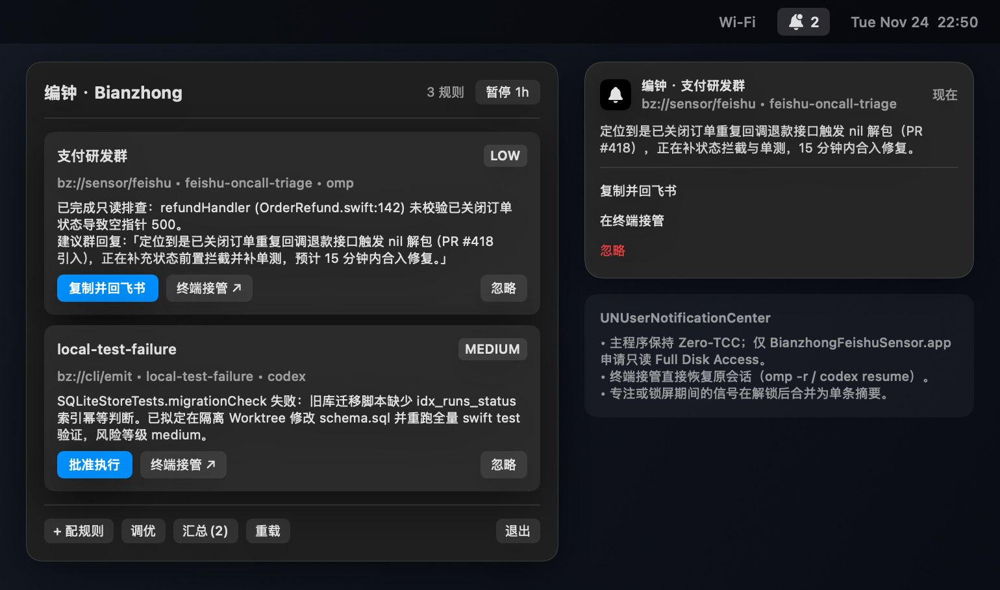
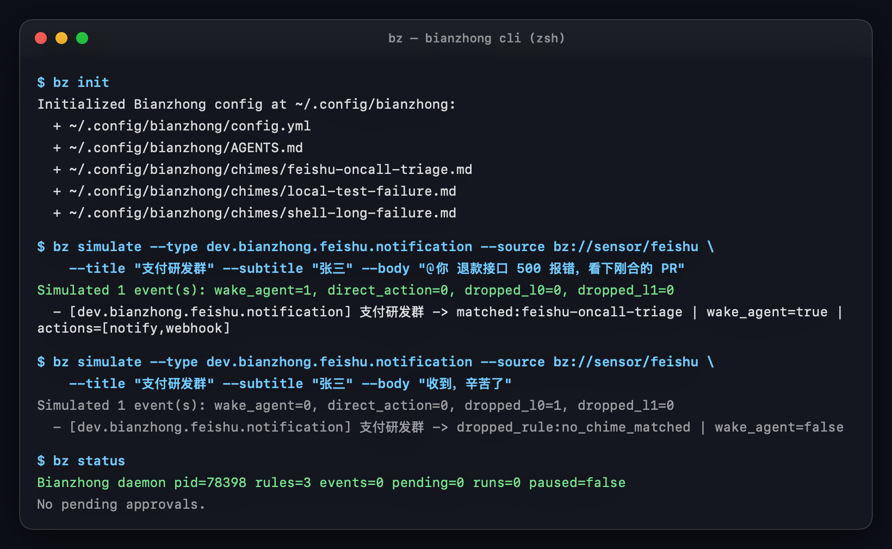

<h1 align="center">Bianzhong</h1>

<p align="center">
  
</p>

<p align="center">
  <a href="README.md">简体中文</a> · <a href="README.en.md">English</a>
</p>

**Aggregate macOS notifications and local signals to wake your existing CLI agents on demand.**

*Every signal, a call to action.*

Bianzhong connects local event sources to CLI agents you already use, such as `omp` and `codex`. Event filtering, SQLite state persistence, and subprocess orchestration stay local by default with no relay service, no custom agent harness, and no patches to upstream agent codebases.

The project currently ships the menu bar and daemon app `Bianzhong.app`, the `bz` CLI, the isolated read-only Feishu notification sensor `BianzhongFeishuSensor.app`, and the shared `BianzhongCore` library. **Clipboard watching, FSEvents workspace monitoring, built-in cron schedules, and LaunchAgent auto-start are not yet implemented** and belong to later milestones; the current release focuses on read-only Notification Center capture for Feishu, failed slow-command hooks in Zsh, and script ingestion via `bz emit`.

<p align="center">
  <a href="docs/00-mvp-architecture-and-roadmap.md">Architecture & roadmap</a> · <a href="docs/research/01-macos-perception-and-hammerspoon2.md">macOS perception notes</a><br>
  <a href="docs/research/03-agent-dispatch-and-lifecycle.md">Agent dispatch & lifecycle</a> · <a href="docs/research/04-trigger-funnel-permissions-and-hitl.md">Funnel & approval model</a>
</p>

The latest published release is **v0.1.0** (macOS 26 Apple Silicon preview). The installation examples below reference the **v0.1.0** release artifacts on GitHub.

[Features](#features) · [Screenshots](#screenshots) · [Install](#install) · [Usage](#usage) · [Project and licensing](#project-and-licensing) · [Dev](#dev)

## Features

- Multi-source local perception: `BianzhongFeishuSensor.app` reads `com.electron.lark` notification records read-only from `usernoted`, `bz shell-hook zsh` reports slow failed shell commands, and `bz emit` or the `ingest.sock` Unix Domain Socket accepts custom scripts and webhooks.
- Deterministic L0 funnel: drops `restricted` privacy events before any database write, blocks feedback loops across four layers (causal depth, self-source exclusion, active write leases, and echo hashes), and filters noise via wildcard/keyword rules, TTL dedup, trailing debounce coalescing, and cooldown locks without touching an LLM.
- Pluggable L1 triage: supports on-device macOS 26 `FoundationModels` (`apple_fm`), a lightweight model via `omp` or `codex` (`agent_cli`), an external HTTP `decision_api` gateway, or rule pass-through (`none`).
- Two-phase agent execution: spawns `omp` or `codex` on demand in an isolated process group (`posix_spawn`) with zero idle daemon footprint; Phase 1 runs read-only investigation and drafting, while Phase 2 enters `workspace-write` or an isolated Git worktree only after human approval.
- Menu bar inbox and interactive notifications: `Bianzhong.app` and `UNUserNotificationCenter` actions support background approval, approval comments, copying a reply and activating Feishu, or resuming the exact session in Ghostty, iTerm2, Warp, or Terminal (`omp -r` / `codex resume`); signals arriving during Focus or screen lock can defer into a single wake digest.
- Post-actions and runtime governance: conditional `on_complete` pipelines (`notify`, `webhook`, `shortcut`, `append_markdown`, `shell`, `clipboard`, `chime_sound`) alongside daily cost/run caps, circuit breakers on consecutive failures, and retention GC that preserves dirty Git worktrees.
- Offline simulation and tuning: dry-run single signals with `bz simulate`, replay recorded history with `bz replay`, and inspect rejected samples with `bz tune` to tighten noisy chimes.

## Screenshots

<p align="center">
  
</p>

<p align="center">
  <em>Menu bar inbox and macOS notification actions rendered from sample events, showing a Feishu reply draft, a test-failure review card, and interactive notification controls.</em>
</p>

<p align="center">
  
</p>

<p align="center">
  <em>Local output from <code>bz init</code>, <code>bz simulate</code>, and <code>bz status</code> demonstrating rule matching and noise suppression.</em>
</p>

## Install

Requires **macOS 26** (Apple Silicon / `arm64`). Building from source requires Swift **6.2+** (Xcode 26 or Apple Command Line Tools).

### .pkg installer

Download the verified `v0.1.0` installer package, verify its SHA-256 digest, and install both apps into `/Applications/` and `bz` into `/usr/local/bin/bz`:

```bash
workdir="$(mktemp -d)"
cd "$workdir"
curl -fL -O https://github.com/chorust/bianzhong/releases/download/v0.1.0/Bianzhong-0.1.0-macos26-arm64.pkg
curl -fL -O https://github.com/chorust/bianzhong/releases/download/v0.1.0/SHA256SUMS.txt
shasum -a 256 --ignore-missing -c SHA256SUMS.txt
sudo installer -pkg Bianzhong-0.1.0-macos26-arm64.pkg -target /
```

### Standalone archive and .dmg

You can also drag the apps out of the `.dmg` image, or verify and unpack the `.tar.gz` archive directly:

```bash
mkdir -p "$HOME/.local/bin"
workdir="$(mktemp -d)"
cd "$workdir"
curl -fL -O https://github.com/chorust/bianzhong/releases/download/v0.1.0/Bianzhong-0.1.0-macos26-arm64.tar.gz
curl -fL -O https://github.com/chorust/bianzhong/releases/download/v0.1.0/SHA256SUMS.txt
shasum -a 256 --ignore-missing -c SHA256SUMS.txt
tar -xzf Bianzhong-0.1.0-macos26-arm64.tar.gz
cp -R "Bianzhong-0.1.0/Bianzhong.app" /Applications/
cp -R "Bianzhong-0.1.0/BianzhongFeishuSensor.app" /Applications/
install -m 755 "Bianzhong-0.1.0/bz" "$HOME/.local/bin/bz"
```

The `v0.1.0` prebuilt bundles use ad-hoc signing (`codesign -s -`) and are not notarized by Apple. After verifying checksums, clear quarantine attributes before first launch if Gatekeeper prompts:

```bash
xattr -cr /Applications/Bianzhong.app /Applications/BianzhongFeishuSensor.app
```

CLI-only hooks and `bz emit` require no extra macOS privacy permissions. For Feishu Notification Center monitoring, grant Full Disk Access solely to `/Applications/BianzhongFeishuSensor.app` in System Settings -> Privacy & Security -> Full Disk Access; `Bianzhong.app` and spawned agents remain Zero-TCC.

### Build from source

From the repository root:

```bash
git clone https://github.com/chorust/bianzhong.git
cd bianzhong
bash scripts/setup-signing-cert.sh
bash scripts/bundle-app.sh
```

`setup-signing-cert.sh` creates a local self-signed code-signing identity in your login keychain so macOS privacy grants survive rebuilds. If skipped, `bundle-app.sh` falls back to ad-hoc signing.

## Usage

### Config

Initialize default templates in `~/.config/bianzhong/` and start the menu bar app:

```bash
bz init
open /Applications/Bianzhong.app
```

Global settings live in `~/.config/bianzhong/config.yml` and trigger rules live in `~/.config/bianzhong/chimes/*.md`:

```yaml
terminal: auto
max_concurrent_runs: 2
max_causal_depth: 1

governance:
  daily_max_cost_usd: 3.0
  daily_max_runs: 30
  circuit_breaker_failures: 3
  retention_days: 7

triage:
  provider: apple_fm          # apple_fm | agent_cli | decision_api | none
  agent_cli_driver: omp
  agent_cli_model: smol

workspaces:
  - name: demo-api
    path: ~/code/demo-api
    summary: "Order and refund service"
```

Run `bz config` (or click `+ 配规则` in the menu bar) to open `omp` or `codex` in `~/.config/bianzhong` with `AGENTS.md` preloaded, then apply changes with:

```bash
bz reload
```

### Scenarios

- **Feishu on-call triage & reply drafting**

  Start `BianzhongFeishuSensor.app` after granting it Full Disk Access. Bursts of group messages matching your keywords coalesce within the debounce window, trigger a read-only investigation paired with the last 20 minutes of local timeline context, and surface a short reply draft:

  ```bash
  open /Applications/BianzhongFeishuSensor.app
  bz status
  ```

  Clicking "复制并回飞书" copies the draft with `org.nspasteboard.TransientType` metadata and brings Feishu forward.

- **Slow shell command failure diagnosis**

  Source the Zsh hook in `~/.zshrc` to report commands that run for at least 15 seconds and exit non-zero (excluding `Ctrl+C` exit code `130`):

  ```bash
  eval "$(bz shell-hook zsh)"
  ```

  Bianzhong surfaces the failure summary in the menu bar so you can jump straight into the underlying agent session with "终端接管 ↗".

- **CI or test failure investigation with worktree execution**

  Push build or test failures from scripts or hooks with `bz emit`, review the Phase 1 analysis, and approve Phase 2 execution in an isolated Git worktree:

  ```bash
  bz emit --type dev.bianzhong.ci.failed --cwd "$PWD" --title "swift test failed" --body "testMigration failed"
  bz status
  bz approve <approval-id> --note "Fix migration idempotency and add a regression test"
  bz takeover <approval-id>
  ```

- **Away-from-keyboard webhooks, dry-run simulation & rule tuning**

  Chime playbooks support conditional `on_complete` actions and Focus deferral:

  ```yaml
  funnel:
    debounce: 8s
    defer_on_focus: true
    triage:
      enabled: true
      provider: apple_fm
  on_complete:
    - type: notify
    - type: webhook
      url_env: BIANZHONG_WEBHOOK_URL
      when: "screen_locked == true || idle_seconds > 600"
  ```

  Test rules offline against past events or review rejected notifications before deploying changes:

  ```bash
  bz simulate --type dev.bianzhong.feishu.notification --source bz://sensor/feishu --title "支付研发群" --body "@你 退款接口 500 报错"
  bz replay --last 50
  bz tune feishu-oncall-triage
  bz digest
  ```

## Project and licensing

Bianzhong keeps its own runtime thin and delegates tool execution, compaction, and sandboxing to external CLI agents. Architecture notes and research reports:

[Architecture & roadmap](docs/00-mvp-architecture-and-roadmap.md) · [macOS perception & Hammerspoon 2](docs/research/01-macos-perception-and-hammerspoon2.md) · [Prior art](docs/research/02-ecosystem-and-prior-art.md) · [Agent dispatch & lifecycle](docs/research/03-agent-dispatch-and-lifecycle.md) · [Funnel & HITL](docs/research/04-trigger-funnel-permissions-and-hitl.md)

Linked architecture and research documents under `docs/` are currently in Chinese.

The software is licensed under [Apache-2.0](LICENSE), allowing commercial use. Licensing, API usage, and local permissions for external CLI agents (`omp`, `codex`), upstream model endpoints, and monitored local data sources remain governed by their respective providers.

## Dev

Build all four Swift targets, run the test suite, and package release installers locally:

```bash
swift build
bash scripts/test.sh
bash scripts/package-release.sh 0.1.0
```

The default suite contains 18 unit and integration tests running offline in isolated temporary directories without network calls or live LLM requests. GitHub Actions runs [CI](.github/workflows/ci.yml) on pushes/PRs and [Release](.github/workflows/release.yml) on `v*` tags using `macos-26` runners. Live `usernoted` database reads, interactive system notification callbacks, terminal handoff launches, and live model triage must be verified locally on macOS 26.
