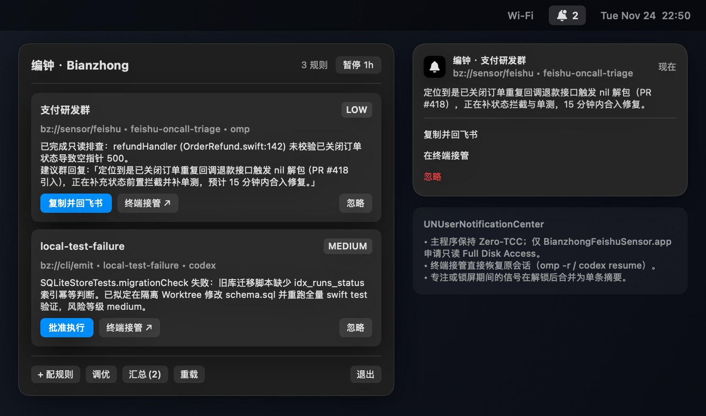
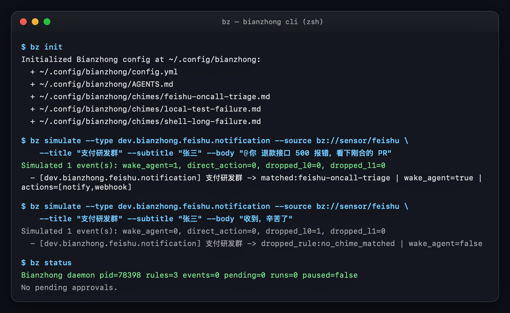

<h1 align="center">Bianzhong</h1>

<p align="center">
  
</p>

<p align="center">
  <a href="README.md">简体中文</a> · <a href="README.en.md">English</a>
</p>

**在 macOS 上聚合系统通知与本地信号，按需唤醒你已有的 CLI Agent 执行勘察与行动。**

*Every signal, a call to action.*

Bianzhong（编钟）连接本机事件源与你自备的 CLI Agent（如 `omp`、`codex`）。所有事件过滤、SQLite 状态记录和子进程调度均在本地完成，不依赖中转服务，也不自研 Agent Harness 或修改上游 Agent 源码。

当前提供菜单栏与守护进程应用 `Bianzhong.app`、命令行工具 `bz`、独立只读飞书通知传感器 `BianzhongFeishuSensor.app` 以及共用核心库 `BianzhongCore`。**剪贴板监听、工作区 FSEvents 监听、内置 Cron 调度与 LaunchAgent 开机自启尚未实现**，属于后续里程碑；当前版本聚焦飞书通知中心只读读取、Zsh 慢命令失败钩子与 `bz emit` 脚本接入。

<p align="center">
  <a href="docs/00-mvp-architecture-and-roadmap.md">架构与路线图</a> · <a href="docs/research/01-macos-perception-and-hammerspoon2.md">macOS 感知调研</a><br>
  <a href="docs/research/03-agent-dispatch-and-lifecycle.md">Agent 调度机制</a> · <a href="docs/research/04-trigger-funnel-permissions-and-hitl.md">触发漏斗与审批</a>
</p>

最新已发布版本为 **v0.1.0**（macOS 26 Apple Silicon 预览版）；下方安装示例对应 GitHub Release 上的 **v0.1.0** 产物。

[Features](#features) · [Screenshots](#screenshots) · [Install](#install) · [Usage](#usage) · [项目与许可](#项目与许可) · [Dev](#dev)

## Features

- 多源本地信号接入：通过 `BianzhongFeishuSensor.app` 只读读取 `usernoted` 中的 `com.electron.lark` 飞书通知、接入 Zsh 慢命令失败钩子，或经 `bz emit` 与 Unix Domain Socket `ingest.sock` 接入外部事件。
- L0 确定性漏斗：`restricted` 隐私事件落库前直接丢弃；通过因果深度、自源排除、写路径租约与回声指纹阻断循环触发，再经通配符与关键词匹配、TTL 去重、尾随防抖合并及冷却锁过滤噪声，这一层不调用大模型。
- 可选 L1 语义分诊：支持 macOS 26 本地 `FoundationModels`（`apple_fm`）、指定轻量模型的 `omp` / `codex`（`agent_cli`）、外部 HTTP 接口（`decision_api`）以及直通放行（`none`）。
- 两阶段 Agent 调度：按需通过 `posix_spawn` 在独立进程组拉起 `omp` 或 `codex`，空闲时无常驻进程；Phase 1 限制只读工具集或 `read-only` 沙箱完成勘察与拟稿，批准后再进入可写模式的 Phase 2，并可为修复任务创建独立 Git Worktree。
- 菜单栏与交互通知审批：通过 `Bianzhong.app` 听音台与 `UNUserNotificationCenter` 通知按钮完成后台批准、附言执行、复制回复并唤起飞书，或在 Ghostty、iTerm2、Warp、Terminal 中直接接管原会话（`omp -r` / `codex resume`）；专注或锁屏期间的信号可暂存，解锁后合并为单条摘要。
- 后置动作与运行治理：`on_complete` 按 `when` 条件触发 `notify`、`webhook`、`shortcut`、`append_markdown`、`shell`、`clipboard` 与 `chime_sound`；内置日度花费和运行次数上限、连续失败熔断，以及保护未提交改动的 Worktree 清理。
- 离线试跑与误报调优：`bz simulate` 支持单条信号试跑，`bz replay` 重放历史事件，`bz tune` 导出被忽略样本并拉起配置助手收紧规则。

## Screenshots

<p align="center">
  
</p>

<p align="center">
  <em>菜单栏听音台与 macOS 交互通知视图（基于示例事件渲染，展示飞书群排查草稿、测试失败审批卡片与通知操作）。</em>
</p>

<p align="center">
  
</p>

<p align="center">
  <em><code>bz init</code>、<code>bz simulate</code> 与 <code>bz status</code> 的本地运行输出，展示内置规则命中与无关消息拦截结果。</em>
</p>

## Install

需要 **macOS 26**（Apple Silicon / `arm64`）；从源码编译还需要 Swift **6.2+**（Xcode 26 或 Apple Command Line Tools）。

### .pkg 安装包

下载 `v0.1.0` 安装包，校验 SHA-256 后安装到 `/Applications/` 与 `/usr/local/bin/bz`：

```bash
workdir="$(mktemp -d)"
cd "$workdir"
curl -fL -O https://github.com/chorust/bianzhong/releases/download/v0.1.0/Bianzhong-0.1.0-macos26-arm64.pkg
curl -fL -O https://github.com/chorust/bianzhong/releases/download/v0.1.0/SHA256SUMS.txt
shasum -a 256 --ignore-missing -c SHA256SUMS.txt
sudo installer -pkg Bianzhong-0.1.0-macos26-arm64.pkg -target /
```

安装完成后，`Bianzhong.app` 与 `BianzhongFeishuSensor.app` 位于 `/Applications/`，`bz` 位于 `/usr/local/bin/bz`。

### 独立预编译包与 .dmg

如果不想使用系统安装器，可以直接下载 `.dmg` 镜像拖拽安装，或通过 `.tar.gz` 解压到用户目录：

```bash
mkdir -p "$HOME/.local/bin"
workdir="$(mktemp -d)"
cd "$workdir"
curl -fL -O https://github.com/chorust/bianzhong/releases/download/v0.1.0/Bianzhong-0.1.0-macos26-arm64.tar.gz
curl -fL -O https://github.com/chorust/bianzhong/releases/download/v0.1.0/SHA256SUMS.txt
shasum -a 256 --ignore-missing -c SHA256SUMS.txt
tar -xzf Bianzhong-0.1.0-macos26-arm64.tar.gz
cp -R "Bianzhong-0.1.0/Bianzhong.app" /Applications/
cp -R "Bianzhong-0.1.0/BianzhongFeishuSensor.app" /Applications/
install -m 755 "Bianzhong-0.1.0/bz" "$HOME/.local/bin/bz"
```

`v0.1.0` 预编译包当前使用 Ad-hoc 签名且未经过 Apple 公证，首次启动可能触发 Gatekeeper 拦截。确认校验和无误后，可执行：

```bash
xattr -cr /Applications/Bianzhong.app /Applications/BianzhongFeishuSensor.app
```

如果只测试终端钩子与 `bz emit`，不需要额外系统权限；若需读取飞书通知，只需在「系统设置 -> 隐私与安全性 -> 完全磁盘访问权限」中授予 `/Applications/BianzhongFeishuSensor.app`，主程序与下游 Agent 不申请该权限。

### 从源码构建

在仓库根目录编译并打包本地 `.app`（调试阶段可加 `--debug`）：

```bash
git clone https://github.com/chorust/bianzhong.git
cd bianzhong
bash scripts/setup-signing-cert.sh
bash scripts/bundle-app.sh
```

`setup-signing-cert.sh` 会在登录钥匙串创建本地自签名代码签名证书，避免重编后丢失已授予的系统权限。如果不需要本地签名，跳过这一步会默认回退到 Ad-hoc 签名。

## Usage

### Config

先初始化配置目录并启动守护进程：

```bash
bz init
open /Applications/Bianzhong.app
```

配置位于 `~/.config/bianzhong/config.yml`，规则位于 `~/.config/bianzhong/chimes/*.md`。下面是一个常用 `config.yml` 示例：

```yaml
terminal: auto
max_concurrent_runs: 2
max_causal_depth: 1

governance:
  daily_max_cost_usd: 3.0
  daily_max_runs: 30
  circuit_breaker_failures: 3
  retention_days: 7

triage:
  provider: apple_fm          # apple_fm | agent_cli | decision_api | none
  agent_cli_driver: omp
  agent_cli_model: smol

workspaces:
  - name: demo-api
    path: ~/code/demo-api
    summary: "Order and refund service"
```

如果需要调整或新增规则，运行 `bz config` 会以 `~/.config/bianzhong` 为工作目录打开 `omp` 或 `codex`（也可点击菜单栏「+ 配规则」）。修改完成后点击菜单栏「重载」或执行：

```bash
bz reload
```

### 使用场景

- **飞书告警群排查与回复拟稿**

  开启飞书传感器后，群内的报错、`500` 或 `@` 通知会先经 `debounce` 窗口合并连续消息，再拉起只读 Agent 结合最近 20 分钟本地关联时间线排查原因，最后在听音台和系统通知里生成可直接复制的中文回复草稿：

  ```bash
  open /Applications/BianzhongFeishuSensor.app
  bz status
  ```

  在通知或菜单栏点击「复制并回飞书」，草稿会带上 `TransientType` 标记写入剪贴板并切回飞书窗口。

- **终端慢命令失败诊断**

  在 `~/.zshrc` 加入钩子后，终端里耗时达到 15 秒且非手动 `Ctrl+C` 中断（`exit_code != 130`）的失败命令会在后台静默上报目录与退出码：

  ```bash
  eval "$(bz shell-hook zsh)"
  ```

  当测试或构建长时间执行失败时，听音台会自动列出失败归因摘要，点击「终端接管 ↗」可在你配置的终端里直接恢复对应 `omp` 或 `codex` 会话。

- **CI 失败与人工批准后隔离修复**

  外部脚本或 Git Hook 可以通过 `bz emit` 推送失败事件；查看 Phase 1 方案后在终端或菜单栏附言批准，Phase 2 会在独立 Git Worktree 中执行修改：

  ```bash
  bz emit --type dev.bianzhong.ci.failed --cwd "$PWD" --title "swift test failed" --body "testMigration failed"
  bz status
  bz approve <approval-id> --note "只修迁移脚本并补一条回归单测"
  bz takeover <approval-id>
  ```

- **规则试跑、离席推送与误报调优**

  每条 `~/.config/bianzhong/chimes/*.md` 规则支持组合后置动作与专注期延后：

  ```yaml
  funnel:
    debounce: 8s
    defer_on_focus: true
    triage:
      enabled: true
      provider: apple_fm
  on_complete:
    - type: notify
    - type: webhook
      url_env: BIANZHONG_WEBHOOK_URL
      when: "screen_locked == true || idle_seconds > 600"
  ```

  上线前或遇到误触发时，可以用离线试跑和误报调优命令收紧条件，或手动汇总暂存摘要：

  ```bash
  bz simulate --type dev.bianzhong.feishu.notification --source bz://sensor/feishu --title "支付研发群" --body "@你 退款接口 500 报错"
  bz replay --last 50
  bz tune feishu-oncall-triage
  bz digest
  ```

## 项目与许可

Bianzhong 专注于保持核心运行时足够薄，把模型工具循环、上下文压缩与沙箱能力留给下游 CLI Agent 自身承担。各模块与后续演进说明见：

[架构设计与路线图](docs/00-mvp-architecture-and-roadmap.md) · [macOS 感知与 Hammerspoon 2 调研](docs/research/01-macos-perception-and-hammerspoon2.md) · [同类生态调研](docs/research/02-ecosystem-and-prior-art.md) · [Agent 调度与生命周期](docs/research/03-agent-dispatch-and-lifecycle.md) · [触发漏斗与 HITL 设计](docs/research/04-trigger-funnel-permissions-and-hitl.md)

软件采用标准 [Apache-2.0](LICENSE) 许可，允许商业使用。Bianzhong 调度的第三方 CLI Agent（如 `omp`、`codex`）、外部模型网关以及本机通知与仓库数据的权限管理与使用条款，各自归属对应软件与数据来源。

## Dev

在仓库根目录编译、运行测试并打包本地安装包：

```bash
swift build
bash scripts/test.sh
bash scripts/package-release.sh 0.1.0
```

默认测试套件包含 18 项单元与集成测试，全部在临时目录离线运行，不访问公网也不调用线上大模型。GitHub Actions 的 [CI 工作流](.github/workflows/ci.yml) 和 [Release 发布工作流](.github/workflows/release.yml) 均运行在 `macos-26` Runner 上，分别用于每次推送验证和 `v*` 标签自动发布安装包。真实通知中心数据库读取、系统通知操作回调与在线模型分诊需要在本地 macOS 26 环境单独验收。
