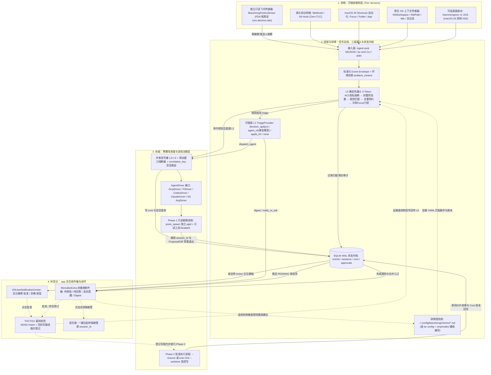

# 00｜Bianzhong（编钟）MVP 架构设计与渐进式路线图

> **“Every signal, a call to action. 诸声汇聚，应声而动。”**  
> **定位**：macOS 上的轻量级 Agent 信号总线与环境收件箱（*`systemd` + `Hammerspoon` + `Agent Inbox` for BYO CLI Harnesses*）。  
> **适用读者**：Bianzhong 核心开发者、感知插件贡献者与 CLI Agent 运行时集成者。

---

## 执行摘要

1. **目标平台基线锁定 macOS 26 (`arm64`, Swift 6.3)**：充分利用 macOS 26 原生 `FoundationModels`（端侧 0 费推理）、macOS 26 Shortcuts 桌面静默自动化及 Swift 6.3 编译期并发安全。因 Hammerspoon 2（`1.0.0-beta.1`）强制要求 macOS 27+，macOS 26 基线下直接排除 HS2 依赖，仅保留成熟的 Hammerspoon v1（`1.1.1`）作为可选 UDS 插件。
2. **绝不重造 Agent，绝不魔改上游**：Bianzhong 不是新的编码 Agent，而是外部 CLI Agent（`omp`、`pi`、`codex`、`claude` 及后续 ACP 兼容工具）的**事件驱动调度总线与审批收件箱**。配置规则亦通过 `bz config` 直接在 `~/.config/bianzhong` 拉起 `omp`/`codex` 对话生成（内置 `AGENTS.md`），Bianzhong 内部**零自研 Chat UI**。
3. **Zero-TCC 核心 + 独立只读飞书传感器 + 可插拔 L1 分诊**：核心以零权限 OS 上下文 + Shortcuts + 可选 **独立只读飞书通知传感器（`BianzhongFeishuSensor.app`，唯一需单独授 FDA 只读查 `com.electron.lark` 记录）** 接入，`Bianzhong.app` 主体与下游 Agent 保持 **Zero-TCC**。L1 分诊支持 `decision_api`（外部 `jev`/Decision API）、`agent_cli`（复用自备 `omp`/`codex` 便宜模型）、`apple_fm`（端侧）与 `none` 四种可插拔 `TriageProvider`。
4. **MVP 技术栈明确推荐**：采用**纯 Swift 单语言工程（`BianzhongCore` + `Bianzhong.app` `MenuBarExtra` + `bz` CLI + `bz-feishu-sensor` + 内嵌 SQLite WAL + Unix Domain Socket）**。单一 `.app` 包原生承载 macOS 26 `UNUserNotificationCenter` 交互式按钮（后台静默批准、内联回复框、`Copy & Open Feishu`、一键跳默认终端 `--resume` 接管）与 TCC 签名持久化。

---

## 1. 总体愿景与“薄架构”设计哲学

### 1.1 为什么需要 Bianzhong？

当前 macOS 主动式 AI 工具分化为两极：一端是重型全天候录屏/录音方案（如 Screenpipe、已关停的 Limitless/Rewind），功耗与隐私爆炸半径极高；另一端是绑定单一闭源生态或服务端重型 DAG 的引擎（如 n8n、Temporal、OpenClaw 单体网关），既难以复用开发者本机早已调教好的 CLI Agent（`omp`/`pi`/`codex`/`claude`），也缺乏贴合 macOS 桌面心流的原生中断审批体验。

Bianzhong 填补了中间空白——它只做**连接“macOS 环境信号”与“BYO CLI Harness”之间最薄的一层确定性胶水与人机收件箱**。

### 1.2 “编钟”隐喻与核心架构组件映射

| 编钟隐喻 | 架构层级 | 核心职责 | 关键设计约束 |
| :--- | :--- | :--- | :--- |
| **钟枚（Sensors）** | 可插拔感知层 | 采集协议源（Webhook/WS/Shortcuts）、零权限桌面状态（前台 App/空闲/专注模式/会议态）及可选桌面热键胶水 | 与核心物理隔离；核心 Sensor 保持 **Zero-TCC**；高敏通知兜底默认关闭 |
| **钟架（Event Bus & Funnel）** | 事件总线与漏斗内核 | 通过 Unix Domain Socket / `bz emit` 收拢标准化事件，依次执行 L0 六段确定性过滤（含四重防自激）、可选 L1 分诊与 SQLite WAL 持久化 | 90%+ 噪音 0 Token 拦截；单机内嵌 SQLite WAL 替代外置数据库 |
| **钟律（Declarative Rules）** | 声明式规则剧本 | 位于 `~/.config/bianzhong/chimes/*.md`，以 YAML Frontmatter 声明触发/漏斗/自治度/预算，以 Markdown 描述行动意图 | 兼顾确定性过滤与自然语言灵活性，用户可直接用 Git 版本化管理 |
| **执槌（Agent Drivers）** | 零魔改驱动与进程治理 | 通过极薄 `AgentDriver` 按需 `posix_spawn` 独立进程组拉起 `omp`/`pi`/`codex`/`claude`，管理会话路由、超时、预算与孤儿回收 | **M0 空闲 0 MB Agent 常驻内存**；严格外部只读/Worktree 权限边界 |
| **听音台（MenuBar Inbox）** | `.app` 交互收件箱 | 极薄 `LSUIElement` SwiftUI `MenuBarExtra` 应用，承载 `UNUserNotificationCenter` 静默审批按钮、四象限收件箱与一键终端接管 | 唯一具备 `CFBundleIdentifier` 的桌面实体，提供“零锁定逃生舱” |

### 1.3 对 Agent 零魔改与对系统低侵入的三大铁律

1. **对 Agent 零魔改（Harness-Agnostic）**：
   - 不自研 Tool Loop、Compaction 或 MCP 客户端，不维护上游 Fork 补丁。
   - 所有安全边界完全通过外部 CLI 参数强制下发（例如 `omp --tools=read,grep,glob --no-extensions`、`pi --tools read,grep,find,ls`、`codex exec -s read-only`），借助标准 `stdin` + 临时 `event.json` 注入上下文，绝不污染用户全局 `AGENTS.md` 或 `config.toml`。
2. **对系统低侵入（Zero-TCC Core & Anti-Bloat）**：
   - **源头协议优于逆向抓取**：macOS 不存在跨 App 读取 `UNUserNotificationCenter` 通知的公开 API；用 AX 抓横幅在专注模式/锁屏下必漏且易卡死 `NotificationCenter`，监听 `usernoted` 的 `db2/db` 在 macOS 15+ 强索 Full Disk Access（FDA）。因此业务消息（What）优先走飞书/Slack/GitHub Webhook 与 macOS 26+ Shortcuts 自动化；OS 感知（Context）仅用无权限弹窗 API 判定“此刻是否适合打扰”。
   - **剪贴板隐私硬红线**：读取剪贴板前先检 `NSPasteboard.general.types`，命中 `org.nspasteboard.ConcealedType` / `TransientType` / `AutoGeneratedType` 立即原地丢弃，严禁落盘与进模型。
3. **人机协同优先（Human-on-the-Loop）**：
   - 借鉴 LangChain Agent Inbox 四原语（`Ignore` / `Notify` / `Question` / `Review`），通过两阶段 `--resume` 让高风险写入动作始终经过人类批准，且随时可一键在本地终端接管已预热的原会话。

---

## 2. 端到端系统架构图

下图展示了 Bianzhong 四个核心层级之间的**数据流（实线：信号上行、状态入库、草案/Diff 回写）**与**控制流（虚线：审批放行、写租约防自激、进程治理与规则调优）**：



**核心数据流与控制流说明**：
- **数据上行（Sensor -> L0 -> L1 -> Phase 1）**：事件经 `ingest.sock` 或 `bz emit` 标准化后过 L0 六级漏斗；大载荷不进命令行，而是写入受控 `runs/<run_id>/event.json`。Phase 1 仅在只读沙箱内生成结构化 Proposal 与 `session_id` 后即刻退出。
- **控制闭环（Inbox -> TOCTOU -> Phase 2 -> Feedback）**：人类在通知横幅或 MenuBar 收件箱批准后，内核先核对仓库 `HEAD` 与拟改文件哈希防 TOCTOU 漂移，随即向 L0 注册**活跃写路径租约**并触发 Phase 2 `--resume` / `fork --worktree`；连续拒绝行为会反向建议修改 `chimes/*.md` 的确定性 YAML 过滤条件，使系统越用越安静。

---

## 3. MVP 技术选型对比与明确推荐

### 3.1 为什么前端通知与常驻控制面必须依托 `.app` Bundle？

调研 macOS TCC（Transparency, Consent, and Control）与 `UserNotifications` 框架的实证约束，得出两项决定工程骨架的硬性事实：

1. **`UNUserNotificationCenter` 拒绝裸二进制与 `-sectcreate` 变通**：
   - `UNUserNotificationCenter.current()` 依赖 Launch Services 与通知守护进程 `usernoted` 追踪通知归属与交互回调。裸 Mach-O CLI 二进制缺乏 `NSBundle.main` 的应用包上下文，运行时会直接抛出 `bundleIdentifier != nil` 断言崩溃；即便在链接期使用 `-sectcreate __TEXT __info_plist` 向 `__TEXT` 段硬嵌入 `Info.plist`，仍因缺少标准 `.app` 目录结构与 Launch Services 注册实体而在请求授权时失败（`UNErrorDomain Code=1`），无法注册 `UNNotificationCategory` / `UNNotificationAction` 实现通知横幅“后台静默批准”。
   - 必须构建标准 `Bianzhong.app/Contents/Info.plist`（配置 `CFBundleIdentifier` 与 `LSUIElement = true` 隐藏 Dock 图标），并通过 Launch Services（`open` 或 macOS 13+ `SMAppService.mainApp` 开机自启）运行。
2. **TCC Designated Requirement（DR）与责任链稳定性**：
   - macOS TCC 权限（Accessibility / Automation / FDA）并非按路径授权，而是绑定加密规则 **Designated Requirement**。若采用 Ad-hoc 签名（`codesign -s -`），DR 会退化为锁死单次编译产物的 **`cdhash`**，每次重新编译升级都会静默吊销权限；只有带稳定 `CFBundleIdentifier` 与持久化证书（Developer ID 或本地自签名证书）的 `.app` Bundle，才能将权限稳定绑定到 `identifier "..." and certificate leaf = ...`。
   - 此外，从 Terminal/iTerm2 直接拉起的脚本会继承终端宿主的 TCC 责任链（Code Responsibility），引发权限污染；独立 `.app` Bundle 可将核心控制在 **Zero-TCC** 最小边界内。

### 3.2 三大候选工程技术栈客观对比

| 评估维度 | 方案 ①：纯 Swift `MenuBarExtra` `.app` + 内嵌 SQLite + UDS + `bz` CLI | 方案 ②：极薄 Swift MenuBar 壳 + TypeScript/Bun 或 Rust 守护进程 | 方案 ③：纯 Hammerspoon 2 脚本方案 |
| :--- | :--- | :--- | :--- |
| **工程结构与 MVP 代码量** | 单一 SwiftPM 多 Target 仓库（`BianzhongCore` + `BianzhongApp` + `bz` CLI），**总计约 1,800–2,800 行 Swift** | Swift 壳（~500 行）+ TS/Bun 或 Rust Daemon（~1,800–2,500 行）+ 跨进程 IPC 协议层 | 全量 JS（`init.js` + `.spoon2`），表面约 800 行但需自造大量状态与进程轮子 |
| **打包、签名与 TCC 现实** | **单一签名主体**，无跨进程 TCC 责任链分裂；`LSUIElement` + `SMAppService.mainApp` 开箱原生 | 须将 Bun/Rust 二进制嵌入 `.app/Contents/MacOS/` 并**从内向外严格逐层签名**；Bun 在 Hardened Runtime 下还需申请 JIT Entitlement（`allow-unsigned-executable-memory`）且附加 50–100 MB 体积；Rust 需跨语言维持心跳 | TCC 全部归属 `Hammerspoon 2.app` 自身，**无法实现 Zero-TCC 核心隔离** |
| **原生系统能力与端侧 AI** | **零胶水直调**：`UNUserNotificationCenter`、`NSWorkspace`、`FSEvents`、`NWPathMonitor`、`CGEventSource`、`FoundationModels`（macOS 26+） | TS/Bun 或 Rust 无法直接调用部分 Cocoa/Swift-only API（如 `FoundationModels`），仍须在 Swift 壳内采集并经 IPC 转发，导致逻辑割裂 | 缺失 `hs.window.filter`、`hs.distributednotifications` 与原生 `hs.socket`；无 `FoundationModels` 封装 |
| **内存占用与启动特性** | 单体常驻约 **20–40 MB**；独立 `bz` CLI 启动仅数毫秒至十几毫秒 | Swift 壳 + Rust Daemon 约 30–50 MB；Swift 壳 + Bun 常驻约 80–150+ MB | 共享 HS2 进程内存，但主线程卡顿会直接冻结用户桌面快捷键 |
| **长期维护成本** | **最低**（单语言、单工具链、单进程内 UI 直接响应状态变更） | **中高**（双工具链构建、跨进程状态同步、断线重连与协议版本漂移） | **风险极高**（依赖实验性 Beta 运行时且强锁 macOS 27+） |

### 3.3 MVP 明确推荐：纯 Swift 单仓三产物（macOS 26 基线，方案 ①）

Bianzhong MVP 将 `Package.swift` 目标平台锁定为 **`.macOS(.v26)`（`arm64`, Swift 6.3）**，零外部 Swift 包依赖，单一工程输出三个职责正交的产物：
1. **`Bianzhong.app`（`BianzhongApp`，非沙箱，`LSUIElement = true`）**：内置 `BianzhongCore` 引擎（Unix Domain Socket `ingest.sock`、L0/L1 漏斗、SQLite WAL、会话路由与 `posix_spawn` 进程组调度）和极薄 SwiftUI `MenuBarExtra` 听音台与 `UNUserNotificationCenter` 交互通知代理（注册 `BZ_APPROVAL_READY` 后台批准/内联附言/终端接管与 `BZ_REPLY_READY` 复制回飞书/接管分类）。支持 `--daemon` / `--headless` 无头模式。
2. **`bz` CLI（`~/.local/bin/bz`）**：毫秒级短生命工具，支持 `bz init`、`bz emit`、`bz status` / `bz inbox`、`bz approve` / `bz reject` / `bz takeover` 与 **`bz config`**（确保 `~/.config/bianzhong/AGENTS.md` 存在后在默认终端拉起 `omp`/`codex` 对话增改规则）。
3. **`BianzhongFeishuSensor.app`（`bz-feishu-sensor`，M0 独立只读隔离包）**：约百余行独立二进制，通过 `FSEvents` 监听 `~/Library/Group Containers/group.com.apple.usernoted/db2`，以 `SQLITE_OPEN_READONLY` 仅筛选 `app.identifier = 'com.electron.lark'` 并用 `PropertyListSerialization` 解包 `bplist` 推送至 `ingest.sock`。Full Disk Access 权限**严格隔离在此只读传感器上**，主控 `Bianzhong.app` 与下属 Agent 保持 Zero-TCC。

**统一标准目录契约**：
- 规则配置（用户可编辑，可入 Git，支持 `BIANZHONG_CONFIG_DIR` 覆盖）：`~/.config/bianzhong/chimes/*.md`、`~/.config/bianzhong/config.yml`、`~/.config/bianzhong/AGENTS.md`
- 运行态与持久化（支持 `BIANZHONG_STATE_DIR` 覆盖）：`~/Library/Application Support/bianzhong/`
  - `bianzhong.db`（SQLite WAL 账本）
  - `ingest.sock`（Unix Domain Socket，权限 `0600`）
  - `runs/<run_id>/event.json`（每次触发隔离上下文，`0700`/`0600`）
  - `sessions/<driver>/`（传递给各 CLI 的隔离 `--session-dir`，不污染日常终端历史）

### 3.4 Hammerspoon 2 在 macOS 26 下的明确定位

基于对 `Hammerspoon/Hammerspoon2`（原 `cmsj/Hammerspoon2`）`1.0.0-beta.1` 的实证调研，其现行 Beta **强制要求 macOS 27+**，且移除了 `hs.window.filter`、`hs.distributednotifications` 与原始 TCP/UDP/UDS `hs.socket`，`hs.ipc` 也改为同 Team ID 校验的 XPC Broker。因此：

- **在 macOS 26 (Tahoe) MVP 阶段直接排除 Hammerspoon 2**：`Bianzhong.app` 内置的 Zero-TCC 感知器 + `BianzhongFeishuSensor.app` + macOS 26 Shortcuts 自动化已完全满足核心信号采集，无需强依赖任何 Hammerspoon。
- **可选桌面胶水定位**：若用户本机已安装经典 **Hammerspoon v1（`1.1.1`，支持 macOS 13+）**，可通过约 80 行的 `bianzhong.spoon` 直接使用其原生 `hs.socket` 连接 `ingest.sock` 上报热键或窗口事件；未来升级至 macOS 27 时再按需补充通过 `hs.task` + `bz emit` 或本地 HTTP Token 接入的 `bianzhong.spoon2`。

---

## 4. 极简核心契约设计（可直接落地编码的蓝图）

### 4.1 统一事件信封（Event Envelope）

参照 CloudEvents v1.0 核心四元组扩展本地主动运行时所需关联键与安全语义（Sensor 通过 `ingest.sock` 以 NDJSON 行发送）：

```json
{
  "specversion": "1.0",
  "id": "01JDY9M2X4K7Q8Z3N5R6V8W0PY",
  "source": "bz://sensor/fsevents/workspace",
  "type": "dev.bianzhong.fs.modified",
  "ts": "2026-11-24T09:15:32.418Z",
  "correlation_key": "repo:/Users/blizhan/code/app-core",
  "dedup_key": "sha256:9f86d081884c7d659a2feaa0c55ad015",
  "privacy_level": "internal",
  "causality": { "emitter_pid": 41820, "parent_run_id": null, "depth": 0 },
  "payload": {
    "root": "/Users/blizhan/code/app-core",
    "paths": ["src/auth/token.ts", "tests/auth.test.ts"],
    "coalesced_count": 12
  },
  "ambient_context": {
    "frontmost_bundle_id": "com.microsoft.VSCode",
    "focus_active": false,
    "idle_seconds": 3.4,
    "screen_locked": false,
    "meeting_active": false
  }
}
```

- **`privacy_level` 强制语义**：`public`（全可进）｜ `internal`（本地落盘，L1 本地优先）｜ `sensitive`（加密/TTL 暂存，禁未脱敏直传云端）｜ `restricted`（如 `org.nspasteboard.ConcealedType` 密码剪贴板：**禁止落盘、禁止记日志、L0 原地销毁**）。
- **因果深度 `causality.depth`**：Bianzhong 拉起任何 Agent 子进程时注入 `BIANZHONG_RUN_ID`、`BIANZHONG_DEPTH=<d+1>` 与 `BIANZHONG_ORIGIN_MARKER=1`；`bz emit` 检测到 `depth >= MAX_CAUSAL_DEPTH`（默认 `1`）即拒绝入队，物理阻断自激递归。

### 4.2 声明式规则剧本格式（`~/.config/bianzhong/chimes/*.md`）

借鉴 GitHub Agentic Workflows（`gh-aw`）的“YAML 声明边界 + Markdown 自然语言意图”，每条“钟律”规则即一个独立 `.md` 文件：

```markdown
---
id: ci-failure-autofix
enabled: true
description: 监听本地测试或 GitHub CI 失败，只读定位根因并拟定隔离修复补丁

match:
  type: ["dev.bianzhong.ci.failed", "dev.bianzhong.fs.test_failed"]
  glob:
    include: ["src/**", "tests/**"]
    exclude: ["**/*.generated.*", ".git/**", "node_modules/**"]
  where: "payload.exit_code != 0 && payload.branch != 'release/*'"

funnel:
  dedup_ttl: 300s
  debounce: 5s
  max_wait: 30s
  cooldown: 15m
  defer_on_focus: true
  triage:
    enabled: false              # 确定性失败直通 Phase 1；高噪自然语言事件设为 true

session:
  policy: threaded              # ephemeral | threaded | rolling_daily
  ttl: 24h
  max_turns: 12

execution:
  autonomy: draft_approve       # observe_digest | notify | draft_approve | bounded_auto
  driver: omp                   # omp | pi | codex | claude
  model: null                   # 留空复用用户默认；L1 可设 smol
  cwd_from: "payload.root"
  worktree_on_phase2: true
  inherit_project_context: true # 允许加载项目级 AGENTS.md / Skills
  budget:
    phase1_max_time_sec: 180
    phase1_max_cost_usd: 0.25
    phase2_max_time_sec: 600
    phase2_max_cost_usd: 1.00
---

## Phase 1：只读勘察与方案拟稿
你正被 Bianzhong 事件总线唤醒，当前处于 **只读勘察阶段**（严禁尝试修改文件或运行写命令）。
1. 先读取环境变量 `$BIANZHONG_EVENT_FILE` 获取完整事件元数据与失败堆栈。
2. 阅读相关源码与测试文件，定位根本原因与最小修复范围。
3. 在最终回复中给出结构化摘要：根因分析、拟修改文件清单、补丁思路与风险评估（`low/medium/high`）。

## Phase 2：批准后隔离执行（仅在人类批准并 --resume 后生效）
人类审批意见：{{approval.user_comment}}
你当前位于独立的 Git Worktree 中，已开放工作区读写权限。请按 Phase 1 方案与补充意见完成修复，运行受影响模块的单元测试验证通过，并输出最终 `git diff --stat` 与测试结果摘要。
```

### 4.3 SQLite WAL 极简存储表结构（4 张核心表）

初始化连接必选参数：`PRAGMA journal_mode=WAL; PRAGMA synchronous=NORMAL; PRAGMA foreign_keys=ON; PRAGMA busy_timeout=5000;`

```sql
-- 1. 事件流水与 L0/L1 漏斗审计账本（restricted 隐私级事件绝不入库）
CREATE TABLE IF NOT EXISTS events (
    id                TEXT PRIMARY KEY,              -- ULID / UUIDv7
    source            TEXT NOT NULL,
    type              TEXT NOT NULL,
    ts                TEXT NOT NULL,                 -- 源头 RFC3339 时间
    received_at       INTEGER NOT NULL,              -- 入库 Unix 毫秒
    correlation_key   TEXT NOT NULL,
    dedup_key         TEXT NOT NULL,
    privacy_level     TEXT NOT NULL CHECK (privacy_level IN ('public','internal','sensitive')),
    causality_depth   INTEGER NOT NULL DEFAULT 0,
    parent_run_id     TEXT,
    payload_summary   TEXT,                          -- 裁剪后 <= 4KB 摘要 JSON
    ambient_json      TEXT,                          -- 采集瞬间环境快照
    funnel_stage      TEXT NOT NULL,                 -- dropped_acl|dropped_loop|dropped_rule|dropped_dedup|coalesced|l1_ignored|l1_digest|l1_notified|dispatched
    matched_chime_id  TEXT,
    drop_reason       TEXT
);
CREATE INDEX IF NOT EXISTS idx_events_dedup ON events(matched_chime_id, dedup_key, received_at DESC);
CREATE INDEX IF NOT EXISTS idx_events_corr  ON events(correlation_key, received_at DESC);

-- 2. 外部 Agent 会话路由与粘性锚点表
CREATE TABLE IF NOT EXISTS sessions (
    id                  TEXT PRIMARY KEY,            -- Bianzhong 内部会话 ID
    correlation_key     TEXT NOT NULL,
    driver              TEXT NOT NULL,               -- omp | pi | codex | claude | acp
    policy              TEXT NOT NULL CHECK (policy IN ('ephemeral','threaded','rolling_daily')),
    external_session_id TEXT NOT NULL,               -- 外部 CLI 返回的 session_id / thread_id
    cwd                 TEXT NOT NULL,
    worktree_path       TEXT,
    turn_count          INTEGER NOT NULL DEFAULT 1,
    status              TEXT NOT NULL CHECK (status IN ('active','expired','handed_over','closed')),
    last_used_at        INTEGER NOT NULL,
    expires_at          INTEGER,
    created_at          INTEGER NOT NULL
);
CREATE INDEX IF NOT EXISTS idx_sessions_lookup ON sessions(correlation_key, driver, status);

-- 3. 子进程运行账本（支撑孤儿进程回收、Token 审计与滑动窗口熔断）
CREATE TABLE IF NOT EXISTS runs (
    id                  TEXT PRIMARY KEY,
    event_id            TEXT NOT NULL REFERENCES events(id),
    session_id          TEXT REFERENCES sessions(id),
    chime_id            TEXT NOT NULL,
    phase               TEXT NOT NULL CHECK (phase IN ('triage','draft','execute','notify')),
    driver              TEXT NOT NULL,
    pid                 INTEGER,
    pgid                INTEGER,                     -- posix_spawn 独立进程组 ID
    proc_start_time_ns  INTEGER,                     -- libproc 校验防 PID 复用误杀
    status              TEXT NOT NULL CHECK (status IN (
                            'queued','running','waiting_approval',
                            'succeeded','failed','timeout','budget_exceeded','aborted_orphan','cancelled'
                        )),
    exit_code           INTEGER,
    input_tokens        INTEGER NOT NULL DEFAULT 0,
    output_tokens       INTEGER NOT NULL DEFAULT 0,
    cached_tokens       INTEGER NOT NULL DEFAULT 0,
    cost_usd            REAL NOT NULL DEFAULT 0.0,
    started_at          INTEGER NOT NULL,
    finished_at         INTEGER,
    output_summary      TEXT,
    error_message       TEXT
);
CREATE INDEX IF NOT EXISTS idx_runs_status_time ON runs(status, started_at DESC);

-- 4. 听音台收件箱与两阶段 HITL 审批状态表（含 TOCTOU 防漂移指纹）
CREATE TABLE IF NOT EXISTS approvals (
    id                       TEXT PRIMARY KEY,
    run_id                   TEXT NOT NULL REFERENCES runs(id),
    event_id                 TEXT NOT NULL REFERENCES events(id),
    session_id               TEXT REFERENCES sessions(id),
    chime_id                 TEXT NOT NULL,
    kind                     TEXT NOT NULL CHECK (kind IN ('review','question','notify','digest')),
    risk_level               TEXT NOT NULL CHECK (risk_level IN ('low','medium','high')),
    title                    TEXT NOT NULL,
    provenance_summary       TEXT NOT NULL,          -- 来源 + 规则 + correlation_key
    proposed_action          TEXT NOT NULL,
    diff_preview             TEXT,
    target_repo              TEXT,
    base_head_sha            TEXT,                   -- Phase 1 结束时 git HEAD 指纹
    target_files_sha256_json TEXT,                   -- 拟改文件 sha256 映射，防 TOCTOU
    external_session_id      TEXT,                   -- 供 Phase 2 --resume 与一键终端接管
    status                   TEXT NOT NULL CHECK (status IN ('pending','approved','edited','rejected','taken_over','expired','deferred')),
    user_comment             TEXT,
    created_at               INTEGER NOT NULL,
    resolved_at              INTEGER
);
CREATE INDEX IF NOT EXISTS idx_approvals_inbox ON approvals(status, kind, created_at DESC);
```

### 4.4 可插拔 `TriageProvider`、交互式通知分类与 `bz config` 规则共创

#### (1) L1 可插拔 `TriageProvider` 契约

L1 分诊统一输入 `{event, candidate_chimes}`，输出结构化 `TriageDecision`（`action`: `ignore | digest | notify_only | dispatch_agent`, `matched_chime_id`, `working_dir`, `confidence`, `reason`），支持在 `~/.config/bianzhong/config.yml` 全局指定或在单条 `chime.md` 中按 `triage_provider` 覆盖：

| Provider | 触发方式 | 适用场景 | 成本与延迟 |
| :--- | :--- | :--- | :--- |
| **`decision_api`** | `URLSession` POST 事件与候选规则到配置 URL（如外部 `jev` / Decision API，带 Bearer Token 环境变量与超时保护） | 已有自建决策路由服务或企业内部分类网关 | 取决于接口，~100–500 ms |
| **`agent_cli`** | 拉起用户自备 CLI 的便宜/轻量模型且禁工具（`omp --model=<cheap> --no-tools --no-extensions --no-context-files --no-session --no-title -p` 或 `codex exec --ephemeral -s read-only -m <cheap>`） | 复用本机已登录订阅/账号，零额外 Key 管理 | 极低，~300–1500 ms |
| **`apple_fm`** | macOS 26 原生 `FoundationModels`（`SystemLanguageModel.default` + `LanguageModelSession` 输出约束 JSON） | 敏感群消息/私人备忘，数据绝对不出本机 | **0 API 费用**，~200–600 ms |
| **`none`** | 直接放行（`PassThroughTriageProvider`） | 确定性硬规则（如 CI/单测非零退出码） | **0 ms** |

#### (2) macOS 26 交互式通知分类与 `bz config` 对话配规则

- **`UNUserNotificationCenter` 通知动作分组**：
  - `BZ_APPROVAL_READY`（代码修复/写操作提案）：`APPROVE_BG`（后台静默执行不抢焦点，`options: []`）、`APPROVE_WITH_NOTE`（`UNTextInputNotificationAction` 原地输入补充意见）、`TAKEOVER_TERMINAL`（`.foreground` 跳默认终端执行 `omp -r` / `codex resume`）、`IGNORE`（`.destructive`）。
  - `BZ_REPLY_READY`（飞书群消息只读排查建议）：`COPY_OPEN_FEISHU`（写入带 `org.nspasteboard.TransientType` 的剪贴板防自激，并激活 `com.electron.lark`）、`TAKEOVER_TERMINAL`、`IGNORE`。
- **`bz config` 零自研 UI 配规则**：用户点击 MenuBar「对话新建规则」或执行 `bz config` 时，直接在终端切入 `~/.config/bianzhong` 拉起 `omp` / `codex`，依托目录内预置的 `AGENTS.md`（说明 `chimes/*.md` 格式与本地仓库映射）对话生成或修改规则，保存即被后台热加载。

### 4.5 `AgentDriver` 接口定义与 `omp` / `pi` / `codex` 适配映射

#### 统一 Swift 接口契约（约 45 行核心定义）

```swift
public enum AgentPermissionProfile: String, Codable {
    case noTools      // 纯文本推理（L1 轻量分诊）
    case readOnly     // 仅读勘察与拟稿（Phase 1 安全边界）
    case workspaceRW  // 开放工作区或独立 Worktree 读写（Phase 2 批准后执行）
}

public struct AgentInvocationRequest {
    public let runID: String
    public let correlationKey: String
    public let workingDirectory: String
    public let promptText: String
    public let eventFilePath: String
    public let permissionProfile: AgentPermissionProfile
    public let modelOverride: String?
    public let resumeSessionID: String?
    public let worktreeRequested: Bool
    public let ephemeral: Bool
    public let maxTimeSeconds: Int?
    public let maxCostUSD: Double?
    public let outputSchemaPath: String?
}

public struct SpawnSpec {
    public let executablePath: String
    public let arguments: [String]
    public let environment: [String: String]         // 仅注入子进程 BIANZHONG_*，不改全局配置
    public let stdinData: Data?
    public let workingDirectory: String
}

public enum NormalizedAgentEvent {
    case sessionStarted(externalSessionID: String)
    case textDelta(chunk: String)
    case toolActivity(name: String, status: String, summary: String?)
    case usageReported(input: Int, output: Int, cached: Int, costUSD: Double?)
    case finalAnswer(text: String)
    case error(message: String, isBudgetOrTimeout: Bool)
}

public protocol AgentDriver {
    var id: String { get }                           // "omp" | "pi" | "codex" | "claude" | "acp"
    func buildSpawnSpec(request: AgentInvocationRequest) -> SpawnSpec
    func parseStdoutLine(_ line: String) -> [NormalizedAgentEvent]
    func isSuccessExit(exitCode: Int32, lastEvents: [NormalizedAgentEvent]) -> Bool
    func buildTakeoverCommand(sessionID: String, worktreePath: String?) -> String
}
```

#### `omp` / `pi` / `codex` 各自约 100 行适配映射表（基于本机 CLI 实测）

| 契约能力点 | `OmpDriver`（实测 `omp v19.1.1`，~95 LOC） | `PiDriver`（`@mariozechner/pi-coding-agent`，~85 LOC） | `CodexDriver`（实测 `codex-cli 0.172.0`，~110 LOC） |
| :--- | :--- | :--- | :--- |
| **L1 纯推理分诊 (`noTools`)** | `--model=smol --no-tools --no-extensions --no-skills --no-rules --no-context-files --no-session --no-title --thinking=off --max-time=15 -p` | `-p --mode json --no-tools --no-extensions --no-session` | `exec --json --ephemeral --skip-git-repo-check -s read-only --output-schema <triage.json> -` |
| **Phase 1 只读勘察 (`readOnly`)** | `-p --mode=json --no-title --tools=read,grep,glob --no-extensions --approval-mode=always-ask --session-dir=<dir> --cwd=<repo> --max-time=180 --max-cost=0.25` | `-p --mode json --tools read,grep,find,ls --no-extensions --session-dir <dir>`（子进程 `cwd=<repo>`） | `exec --json --skip-git-repo-check -s read-only -C <repo> -c approval_policy="never" --output-schema <prop.json> -o <prop.json> -` |
| **捕获 `external_session_id`** | 解析 `stdout` 首帧 `type == "session"` 的 `.id` | 解析 `stdout` 首帧 `type == "session"` 的 `.id` | 解析 `stdout` 帧 `type == "thread.started"` 的 `.thread_id` |
| **Phase 2 批准续接 + Worktree** | `-r <id> --session-dir=<dir> --cwd=<worktree> --tools=read,grep,glob,edit,write,bash --auto-approve --mode=json --no-title --max-time=600 --max-cost=1.00 -p` | `--session <id> --session-dir <dir> --tools read,write,edit,bash --mode json -p`（子进程 `cwd=<worktree>`） | **关键边界**：`codex exec resume` 不支持 `-s`/`-C` 且运行时拒绝 `--worktree`。<br>① **按需隔离推荐**：`exec fork <id> --worktree -c sandbox_mode="workspace-write" -c approval_policy="never" --json -o <res.json> -`；<br>② **若 Phase 1 已带 `--worktree`**：`exec resume <id> -c sandbox_mode="workspace-write" -c approval_policy="never" --json -o <res.json> -` |
| **成本/Token 抽取与退出判断** | 读取 `message_end` / `agent_end` 中 `usage.cost.total`；`--max-cost` 熔断时进程固定返回 **退出码 `3`** | 读取 `message_end` / `agent_end` 中 `usage`；由 Bianzhong 调度器实时累计并执行超时强杀 | 读取 `turn.completed.usage` 按单价表折算实时成本；超限时调度器 `kill(-pgid, SIGTERM)` |
| **并发租约检查与终端接管** | 续接前可选调用 `omp session lease --json -- <id>`；接管命令：`omp -r <id> --session-dir=<dir> --cwd=<worktree>` | 靠 SQLite `correlation_key` 串行锁保障；接管命令：`pi --session <id> --session-dir <dir>` | 接管 Phase 1 提案：`codex fork <id> --worktree -s workspace-write`；接管已 fork 的 Phase 2：`codex resume <new_id> -s workspace-write` |

> **兼容扩展注记**：M1 阶段同接口可平行扩展 `ClaudeDriver`（`-p --output-format stream-json --verbose --permission-mode plan --tools "Read,Glob,Grep"` 与 `--resume <id>`，API Key 环境可用 `--bare` 隔离，OAuth 订阅环境改用 `--setting-sources user --strict-mcp-config --disable-slash-commands`）及约 150 行的 `AcpDriver`（通过标准 JSON-RPC 2.0 stdio 对接 `omp acp` 等所有 ACP Agent）。

---

## 5. 三个高价值端到端真实场景推演

### 场景一：测试 / CI 失败自动根因定位与 Worktree 隔离修复（`Draft & Approve` 两阶段闭环）

1. **信号触发**：开发者连续修改 `src/auth/token.ts` 后触发本地测试监听脚本或 GitHub CI Webhook，调用 `bz emit --type dev.bianzhong.ci.failed --correlation-key "repo:/Users/.../app:pr-42"`，附带仓库路径与非零退出码。
2. **L0/L1 过滤**：
   - `L0.1` 过滤 `.git/**` 与构建目录；`L0.2` 检查 `runs` 与活跃写路径租约，确认非 Bianzhong 子进程自身写入；`L0.3` 命中规则 `ci-failure-autofix.md`；`L0.4` 对同 commit/退出码在 `300s` 内去重；`L0.5` 将 5 秒内连续保存聚合为 1 条事件；`L0.6` 确认当前非 Focus 锁屏且规则设 `triage.enabled: false`，直通 Phase 1。
3. **只读分诊/拟稿**：
   - 调度器登记 `HEAD` SHA 与相关文件 `sha256` 至 `approvals`，创建独立 `runs/<run_id>/event.json`，通过 `posix_spawn` 独立进程组以只读权限拉起 `omp --tools=read,grep,glob --no-extensions --max-cost=0.25`（或 `codex exec -s read-only`）。
   - Agent 定位空指针边界漏洞并输出补丁方案与风险评级 `MEDIUM`，捕获 `external_session_id` 后进程立即退出（0 内存滞留）。
4. **人工审批/自动执行**：
   - 写入 `approvals (kind='review', status='pending')`，`UNUserNotificationCenter` 推送带「批准并在 Worktree 执行」「在终端接管」「拒绝」动作的横幅。
   - 开发者在 8 分钟后点击通知「批准」，`Bianzhong.app` 后台唤醒代理在 `<10ms` 内重算文件哈希完成 **TOCTOU 校验**（未漂移），登记主目录/Worktree 写路径租约并创建独立 Git Worktree，以 `omp -r <session_id> --cwd <worktree> --tools=read,grep,glob,edit,write,bash --auto-approve`（或 `codex exec fork <thread_id> --worktree -c sandbox_mode="workspace-write"`）续接原推理上下文实施修复并跑通单测。
5. **结果回写**：更新 `runs` Token/Cost 账本与 `approvals` 状态，向 MenuBar Inbox 推送“修复完成且 18/18 单测通过（花费 `$0.11`）”，提供一键预览 Diff、合并 Worktree 或终端接管入口；写租约在子进程退出 1.5s 宽限期后释放，避免反触发文件监听风暴。

### 场景二：高噪声 IM 协作与 Focus 专注模式协同摘要（Zero-TCC 源头协议 + L1 端侧分诊）

1. **信号触发**：飞书/Slack WebSocket 轻量桥接器（**Zero-TCC**，无需向 `usernoted` 请求 FDA 或抓屏幕横幅）收到群组 @提及，携带完整消息正文与 `correlation_key = "feishu:oc_dev:om_981"` 写入 `ingest.sock`；同时 macOS 26+ Shortcuts 在用户开启“深度工作”专注模式时已通过 `bz state focus --active true` 更新本地态。
2. **L0/L1 过滤**：
   - `L0.2` 核对 `sender_id != self_actor_id` 且 `BIANZHONG_DEPTH == 0` 防止机器人自发自收乒乓循环；`L0.3` 命中 `im-mention-triage.md`（配置 `triage.enabled: true`、`defer_on_focus: true`、`privacy_level: sensitive`）。
   - 进入 **L1 轻量分诊**：因消息属 `sensitive` 级，优先在本地调用 macOS 26+ Apple `FoundationModels` (`SystemLanguageModel`) 进行 0 费用端侧推理（若在旧版 macOS 则回退剥离配置的 `omp --model=smol --no-tools --no-extensions --no-skills --no-rules --no-context-files --no-session --no-title --thinking=off -p`），输出严格四分类 JSON：`ignore`（无实质内容闲聊）、`digest`（普通文档传阅）、`notify_or_ask`（需人决策）、`dispatch_agent`（紧急线上报错）。
3. **只读分诊/拟稿**：对于普通文档传阅，因 `focus_active == true` 且非紧急白名单，直接暂存 `approvals (kind='digest', status='deferred')` 零弹窗；若判定为线上服务 500 告警（`dispatch_agent`），才按 Level 2 只读拉起 `AgentDriver` 对照本地仓库检索日志线索并拟定回复草稿。
4. **人工审批/自动执行**：用户结束深度工作退出 Focus 后，MenuBar Inbox 统一弹出一条结构化 Digest 汇总及待审回复草稿卡；用户点击「批准并复制脱敏草稿」（或如连续 2 次点击「拒绝并忽略」该发送者，触发规则反馈闭环，提示一键把该频道写入规则 `exclude` YAML）。
5. **结果回写**：代写回复文本入剪贴板时，工具强制附带 `org.nspasteboard.TransientType` 并登记 30s `echo_hash`，确保不反触发 Clipboard Sensor；全链路因果记录入 SQLite 审计表。

### 场景三：剪贴板隐私红线熔断与 `Bounded Auto` 自主护栏双分支

1. **信号触发**：日常编码流中同时存在两类高频触发——(A) 用户在 1Password 复制数据库密钥（`NSPasteboard.changeCount` 变更）；(B) 用户保存新建工具函数 `src/utils/date.ts` 触发规则 `auto-unit-test.md`（声明 `autonomy: bounded_auto`、`worktree: isolated`）。
2. **L0/L1 过滤**：
   - **分支 A（隐私熔断）**：轻量传感器先读 `NSPasteboard.general.types`，命中 `org.nspasteboard.ConcealedType`。`L0.1` 当场判定 `privacy_level: restricted`，**直接原地销毁内存引用，既不写 `events` 表，也不输出日志文件，更绝不触达任何本地或云端模型**。
   - **分支 B（Storm 聚合）**：`L0.5` 将 5 秒内 15 次连续编辑保存合并为 1 条事件，并确认文件确为新增函数且无近期 `cooldown` 冲突。
3. **只读分诊/拟稿与边界执行**：因规则明确授权 `autonomy: bounded_auto` 且物理锁定在独立 Git Worktree，调度器跳过 Phase 1 阻塞审批，直接写入 `BIANZHONG_DEPTH=1` 与 Worktree 写租约，拉起 `codex exec --json -s workspace-write --worktree -C <repo> -c approval_policy="never" -`（或 `omp --cwd <worktree> --tools=read,grep,glob,edit,write,bash --auto-approve --max-cost=0.40 --max-time=180 -p`）仅针对新增导出函数编写单元测试并执行验证。
4. **熔断护栏与异常接管**：若中途测试陷入死循环导致消费逼近 `$0.40`（`omp` 退出码 `3`）或流空闲超过 `90s`（看门狗触发 `SIGTERM -> 5s -> SIGKILL` 清理整组 `-pgid`），或者连续 3 次自动补全失败，调度器立即把规则置为 `OPEN` 熔断暂停，停止后台继续消耗。
5. **结果回写**：成功后向 MenuBar Inbox 投递一条低打扰 `Notify` 卡片：“已在 Worktree 为 `date.ts` 新增 5 项单测并全部通过（`$0.09`），点击查看 Diff 或一键合并回主分支”。

---

## 6. 渐进式 MVP 实施路线图（M0 -> M1 -> M2）

| 阶段 | 时间跨度 | 核心目标与交付物 | 量化验收门禁 |
| :--- | :--- | :--- | :--- |
| **M0：最小闭环 + 实战治理包** | 第 1–2 周 | • SwiftPM 零依赖三产物骨架（`BianzhongCore` + `Bianzhong.app` + `bz` CLI + `BianzhongFeishuSensor.app`）<br>• 本地自签名证书脚本（`setup-signing-cert.sh` 保 FDA/通知权限）+ SQLite WAL 4 张表 + `ingest.sock`<br>• L0 六段漏斗 + 可插拔 L1 `TriageProvider`（`decision_api`/`agent_cli`/`apple_fm`/`none`）<br>• 20 分钟跨信号关联时间线 + 确定性 `preflight_cmd` 预取 + Zsh 慢命令失败钩子（`bz shell-hook zsh`）<br>• 全局日度预算/连续失败熔断/Worktree 安全 GC（`bz gc`）+ 历史回放（`bz simulate` / `bz replay`）+ 误报样本调优（`bz tune`）<br>• `MenuBarExtra` + 开盖/解锁晨钟摘要（`bz digest`）+ `UNUserNotificationCenter` 交互按钮 + 可条件触发的 `on_complete` 动作体系（`notify`/`webhook`/`shortcut`/`append_markdown`/`shell`/`clipboard`/`chime_sound`） | • 空闲常驻内存 `< 40 MB`，CPU `< 0.5%`<br>• 5s~8s 内连珠炮飞书/文件事件聚合为 `1` 次调用<br>• Agent 写 Worktree/主目录 **0 次** 自激二次触发<br>• `ConcealedType` 剪贴板 **100%** 阻断落盘<br>• Phase 1 只读 -> 批准 -> `--resume`/`fork --worktree` 全链跑通 |
| **M1：协议生态与完整 Inbox** | 第 3–5 周 | • 补齐 `PiDriver`、`ClaudeDriver` 与通用 `AcpDriver`（~150 行）<br>• Zero-TCC OS 状态采集器（`NSWorkspace` / `NWPathMonitor` / Idle / `*IsRunningSomewhere` 会议态）<br>• macOS 26+ Shortcuts 模板包、飞书/GitHub 桥接、可选 `bianzhong.spoon` (v1) / `bianzhong.spoon2` (v2)<br>• L1 端侧分诊（`FoundationModels` + `omp smol` 降级）<br>• 完整四象限 Inbox、TOCTOU 校验、`bz ask` 回调与连续拒绝 YAML 微调建议 | • 端侧 L1 单次分诊响应 `< 2s` 且不外泄 `sensitive` 数据<br>• TOCTOU 人工改动冲突检出率 100%<br>• 连续 3 次异常或 2 次拒绝稳定触发熔断器 `OPEN` 态 |
| **M2：按需双工与体验打磨** | 第 6 周+ | • 可选双工模式（基于 `codex app-server` / `omp --mode rpc`）支撑长任务实时流预览与 `steer` 打断<br>• 默认禁用的高敏隔离插件（`bz-notif-ax` / `bz-notif-db`）<br>• `rolling_daily` 跨日滚动摘要、过期 Worktree 自动 GC、`bzd --stdin` 回归回放套件 | • 双工模式仅按需挂起，不影响空闲 0 MB 目标<br>• 规则库可全量通过 JSONL Fixture 离线回归验证 |

---

## 7. 专题调研文档导航索引

本架构蓝图综合并统一了以下四篇经事实核验的深度专题调研报告：

| 编号 | 文档链接 | 核心覆盖内容 |
| :--- | :--- | :--- |
| **01** | [macOS 原生感知与 Hammerspoon 2 深度技术调研](./research/01-macos-perception-and-hammerspoon2.md) | `Hammerspoon/Hammerspoon2`（`1.0.0-beta.1`）vs v1（`1.1.1`）实证边界；通知感知三条路径 TCC 代价对比；Zero-TCC 上下文 API 与三态可插拔接入协议 |
| **02** | [生态与竞品先驱调研：本地主动式 Agent 与 Ambient 事件编排范式](./research/02-ecosystem-and-prior-art.md) | Screenpipe / OpenClaw 及派生生态 / Goose / Raycast / Highlight / Pieces / Limitless / Shortcuts / HS+LLM / Agent Inbox / Claude Channels / `gh-aw` / 服务端引擎五维对比与四大反模式教训 |
| **03** | [Bianzhong Agent 统一调度与生命周期管理深度调研](./research/03-agent-dispatch-and-lifecycle.md) | 本机 `omp v19.1.1`、`codex-cli 0.172.0`、`claude 2.1.205`、`pi-coding-agent` 及 ACP 实测参数与 JSONL/Schema；Mode A 按需子进程 vs 常驻进程池；`correlation_key` 会话路由与孤儿回收熔断 |
| **04** | [事件触发漏斗、权限边界与人机协作（HITL）专题调研](./research/04-trigger-funnel-permissions-and-hitl.md) | 裁剪版 CloudEvents 信封与四级 `privacy_level`；L0/L1 三级漏斗；`FSEvents` `IgnoreSelf` 陷阱与四重防自激闭环；零魔改两阶段 `--resume` / `fork --worktree` HITL 与审批卡设计 |
