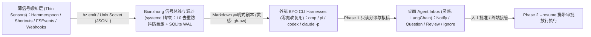

# 02｜生态与竞品先驱调研：本地主动式 Agent 与 Ambient 事件编排范式

> **调研目标**：系统梳理 macOS 本地主动式/感知式 Agent、通用 Ambient Agents 交互范式及事件驱动工作流引擎，通过五维对比提炼反模式教训，确立 **Bianzhong（编钟）** 作为 **"macOS 上的轻量级 Agent 信号总线与环境收件箱（systemd + Hammerspoon + Agent Inbox for BYO CLI Harnesses）"** 的差异化生态位。

---

## 一、macOS 与本地主动式 / 感知式 Agent 项目调研

本节调研直接运行于个人桌面端（尤其是 macOS）的 9 类代表性项目与原生系统能力，重点考察其**信号捕获方式、主动唤醒机制、Agent 执行形态、权限/隐私代价与资源开销**。

### 1.1 Screenpipe（`screenpipe/screenpipe`，原 `mediar-ai/screenpipe`）

- **项目地址**：[github.com/screenpipe/screenpipe](https://github.com/screenpipe/screenpipe)（原 `mediar-ai/screenpipe` 仓库已自动重定向至该独立组织）
- **核心架构**：Tauri 桌面壳 + Rust 后台守护进程（`sck-rs` 调用 macOS ScreenCaptureKit 抓帧、`uniOCR`/Apple Vision 执行 OCR、`audiopipe`/Whisper 进行音频转写，辅以 Accessibility Tree 提取），将时序文本与媒体元数据写入本地 **SQLite（FTS5 全文索引）**，同时向外部暴露本地 REST API 与 MCP Server。
- **事件与调度机制（Pipes）**：
  - 用户在 `~/.screenpipe/pipes/<pipe-name>/pipe.md` 中使用 YAML Frontmatter（`schedule: every 2h`、`lookback`、`enabled` 等）加 Markdown 自然语言指令定义任务。
  - 到点触发时，Screenpipe 会以该 Pipe 目录为工作目录拉起本地编码 Agent（如 `pi` 或 `claude-code`），并注入 `screenpipe-search` 等检索 Skill 查询历史屏幕/音频记录。
- **优点**：
  - **100% 本地优先**：原始帧、OCR 文本与音频默认驻留本机，具备完整的离线回溯能力。
  - **双源捕获 + 开放接口**：结合 Accessibility Tree 与视觉 OCR（可覆盖 Canvas/视频等无障碍树盲区），且通过 REST/MCP 方便外部工具读取。
- **缺点与局限**：
  - **持续高资源消耗**：全天候录屏 + OCR + 音频转录通常持续占用 **5%–20% CPU** 与数 GB 内存，显著影响 MacBook 续航；原始媒体与索引文本长期积累易膨胀至数十 GB 磁盘空间。
  - **高噪声与提示注入风险**：UI 杂讯和变体字体产生大量低质 OCR token；当 Pipes 自动读取屏幕历史喂给 LLM 时，网页或聊天窗口中的恶意文本可能构成间接提示注入（Indirect Prompt Injection）。
  - **以“时间轮询回溯”为主，非精细系统事件总线**：Pipes 核心仍以周期性 `schedule` + `lookback` 拉取历史为主，缺乏面向单一系统通知/Webhook/文件变更的毫秒级确定性过滤漏斗与精细审批流。

### 1.2 OpenClaw 及同类主动式个人 Agent 生态

- **代表项目**：[github.com/openclaw/openclaw](https://github.com/openclaw/openclaw)（官网 [openclaw.ai](https://openclaw.ai)，原名 ClawdBot / MoltBot）
- **核心架构**：以常驻 **Gateway**（默认 WebSocket/HTTP 端口 `18789`）为中枢，桥接 20+ 主流 IM 通道（Telegram、WhatsApp、Discord、Slack、Microsoft Teams、iMessage 等）与本地或容器化 Agent 执行环境。
- **主动唤醒与记忆设计**：
  - **Heartbeat 与 Cron / Automation Jobs 演进**：OpenClaw 早期在子系统层面区分 **Heartbeat（工作区文件 `HEARTBEAT.md`）** 与 **Cron**——前者负责主会话周期性自检、上下文维护与通知节流抑制，后者负责精确定时、持久化、抗重启的隔离任务并通过 wake/event 桥梁唤醒 Heartbeat。需注意：**自 OpenClaw v2026.8.1（OpenClaw 2.0）起，官方已正式废弃 `HEARTBEAT.md` 及全局 heartbeat 配置**，将其统一迁移为状态库内的原生 **Automation Jobs**（通过 `openclaw automations` CLI 或 Control UI 管理单任务调度与提示词，旧文件由 `openclaw doctor --fix` 备份至 `backups/heartbeat-migration/` 并迁移）。
  - **Inbound/Outbound Webhooks**：外部事件（如 GitHub PR/Issue Webhook）可直连 Gateway 唤醒指定会话，后台任务完成后也可通过 Webhook 回推结果。
  - **基于 Workspace Markdown 的记忆体系**：初始化生成 `SOUL.md`（人格、行为规范与约束边界，如夜间免打扰）、`AGENTS.md`、`TOOLS.md`、`IDENTITY.md`、`USER.md` 及 `MEMORY.md`，并通过 `memory-core` 周期性将短期召回日志整固（"Dreaming"）为长期记忆。
- **工程隐患与真实安全教训**：
  - **进程臃肿与高攻击面**：TypeScript 全家桶 Gateway 常驻内存可达数百 MB；早期默认配置暴露公网引发大量实例暴露风险。
  - **真实漏洞链风险**：公开披露的高危漏洞包括 **CVE-2026-25253（"ClawBleed"）**（跨站 WebSocket 劫持窃取 Gateway Token 实现一键 RCE）、**CVE-2026-24763**（Docker 沙箱 PATH 操纵提权）以及第三方技能市场 **ClawHub** 的恶意插件投毒事件。
  - **用户级权限爆炸半径**：后台守护进程以宿主用户权限运行，可直接访问 SSH 密钥、浏览器 Cookie 与本地环境变量；一旦在邮件/网页中遭遇间接提示注入，破坏范围极难收口。
- **轻量与安全派生生态（"Claw Ecosystem"）**：针对 OpenClaw 的臃肿与安全隐患，社区涌现出一批轻量化替代方案及长记忆特化框架：
  - [HKUDS/nanobot](https://github.com/HKUDS/nanobot)：Python 实现，约 4,000 行核心代码，采用极简消息总线架构并支持 MCP。
  - [sipeed/picoclaw](https://github.com/sipeed/picoclaw)：Go 语言零依赖静态二进制，内存占用 **<10MB**、亚秒级启动，面向低功耗设备与轻量自托管。
  - [qwibitai/nanoclaw](https://github.com/qwibitai/nanoclaw)：基于 Node.js/TypeScript 与 Anthropic Agents SDK，将每个 Agent 隔离在独立 Linux 容器中实现 OS 级边界隔离。
  - [nearai/ironclaw](https://github.com/nearai/ironclaw)：Rust 编写的安全优先型个人 Agent OS，结合 WASM 沙箱与本地加密/TEE（Trusted Execution Environment）保护凭证。
  - [zeroclaw-labs/zeroclaw](https://github.com/zeroclaw-labs/zeroclaw)：Rust Trait 驱动的模块化轻量运行时，支持 WASM 工具插件与数 MB 级内存占用。
  - [letta-ai/letta](https://github.com/letta-ai/letta)（原 MemGPT，另含编码分支 [letta-ai/letta-code](https://github.com/letta-ai/letta-code)）：专注“LLM 分层操作系统级长期记忆”的有状态 Agent 框架，长于跨月级上下文持久化，但偏重自研服务端状态管理，并非 macOS 系统信号总线。

### 1.3 Goose（原 Block Goose）

- **项目地址**：[github.com/aaif-goose/goose](https://github.com/aaif-goose/goose)（原 `block/goose`，现由 Linux Foundation 旗下 Agentic AI Foundation 托管）
- **核心形态与自动化机制**：
  - 同时提供 **CLI** 与 **Desktop 桌面应用**，原生以 **MCP（Model Context Protocol）** 作为工具扩展底座。
  - **Recipes（`.yaml` / `.yml`）**：存放于 `~/.config/goose/recipes/` 或 GitHub 仓库中的可移植工作流描述文件，包含 `prompt`、`extensions`、动态 `parameters` 与 `sub-recipes`，支持通过 `goose run --recipe <path>` 无头执行。
  - **内置定时调度（`goose schedule`）**：通过 `goose schedule add / list / run-now / remove` 管理周期任务，持久化于 `schedules.json`，到期后拉起独立 Agent 实例执行目标 Recipe。
- **局限**：自动化完全以**静态 Cron 时间表**为驱动（而非实时系统事件/通知流），属于自研 Agent Harness + MCP 调度模式，无法直接编排或无缝续接第三方异构 CLI Harness（如 `omp`、`codex`、`pi`），亦缺少面向环境变量流的分级降噪与统一桌面审批收件箱。

### 1.4 Raycast AI

- **官方站点**：[raycast.com](https://www.raycast.com)（自动化功能参考 Raycast Manual）
- **核心机制**：
  - **AI Commands & Quick Fix**：通过全局热键或快捷方式调用 macOS Accessibility 读取当前选中文本并原地替换。
  - **AI Extensions**：允许扩展暴露命令作为 AI 工具（如 `@calendar`、`@browser`），实现轻量本地数据检索与操作。
  - **Scheduled Background Automations**：支持按小时、每天或自定义周期在后台自动触发 AI 任务。
- **局限**：
  - 后台自动化本质上是**每分钟轮询检测**，要求 Mac 处于唤醒状态且 Raycast 正在运行，输出仅投递至 Raycast 内置 AI Chat（新建或追加会话），遇到敏感工具调用时仅挂起等待 UI 点击。
  - 闭源生态且高度绑定 Raycast 自身 UI 与模型账单，无法监听任意 macOS 原生事件（如分布式通知、特定 FSEvents 路径流、Webhook 总线），也不能驱动用户本地已配置的第三方 CLI Agent。

### 1.5 Highlight AI

- **官方资源**：[highlightai.com](https://highlightai.com)｜GitHub 组织 [github.com/highlight-ing](https://github.com/highlight-ing)（含 `remote-mcp-servers` 等连接器，macOS 可通过 `brew install --cask highlight-ai` 安装）
- **核心机制**：定位为常驻桌面的上下文感知助手，后台持续感知当前屏幕应用、转录会议语音（Zoom/Google Meet/Teams/Slack，支持本地音频转录选项），并通过内置或远程 MCP 连接 Slack、GitHub、Linear、Notion、Google Calendar 等工作区工具，支持按日程或背景条件触发自定义 Skills。
- **局限**：闭源商业订阅模式（Free / Pro 约 $35/月 / Max 约 $200/月），同时打包了屏幕抓取、会议录音与自研 Agent/Skills 执行层，耦合度极高，面向通用办公人群而非本地 CLI 开发者工具链。

### 1.6 Pieces OS

- **官方资源**：[pieces.app](https://pieces.app)｜GitHub 开源入口 [github.com/pieces-app/opensource](https://github.com/pieces-app/opensource)、[TypeScript SDK](https://github.com/pieces-app/pieces-os-client-sdk-for-typescript)、[Python SDK](https://github.com/pieces-app/pieces-os-client-sdk-for-python)
- **核心机制**：
  - 本地后台守护进程（默认监听 `http://127.0.0.1:39300`）+ Flutter 桌面端，配合 **Long-Term Memory Engine（LTM-2 / LTM-2.7）** 与 **Workstream Pattern Engine**。
  - 相比全量录屏存储数十 GB 原始视频帧，Pieces OS 在端侧利用轻量纳米模型对 IDE、浏览器、终端窗口的上下文切换进行语义过滤与压缩（月均存储体积控制在 GB 级以内），并暴露 MCP Server 供 Claude Desktop、Cursor 等客户端查询历史工作流记忆。
- **启发与差异**：Pieces OS 证明了“轻语义过滤优于暴力像素留存”，但它的定位是**被动记忆检索底座（Context Recall）**，而非根据实时事件主动派发任务并管理高风险写入审批的 **Event-Driven Action Runtime**。

### 1.7 Limitless / Rewind（重要前车之鉴）

- **项目背景**：[rewind.ai](https://rewind.ai)（后更名 Limitless）曾是 macOS 全天候本地录屏 OCR 与会议音频索引先驱，并推出了配套可穿戴硬件 Limitless Pendant。
- **现状与警示**：**2025 年 12 月 Meta 正式收购 Limitless** 后，独立版 **Rewind Mac 桌面应用立即关停**（2025 年 12 月 19 日起永久禁用屏幕与音频捕获功能），Limitless Pendant 停止新硬件销售，并因数据合规监管原因立即切断欧盟与英国地区的服务访问。
- **教训**：重度依赖闭源客户端、将个人全部屏幕与语音记忆沉淀在单一商业公司技术栈内的模式，存在极高的**供应商锁定（Vendor Lock-in）、停服断供与监管合规脆弱性**。

### 1.8 macOS Shortcuts + App Intents（及第三方增强器 Shortery）

- **技术演进**：
  - **App Intents 框架**（[developer.apple.com/documentation/appintents](https://developer.apple.com/documentation/appintents)）：Apple 提供的 Swift 原生框架，允许应用以系统/守护进程级形式向 Siri、Spotlight、Apple Intelligence 与 Shortcuts 暴露无头动作（无需拉起完整 GUI）。
  - **macOS Tahoe（macOS 26）重大补齐**：在 macOS Sequoia 之前，Mac 版快捷指令长期缺失类似 iOS 的自动触发器，进阶用户不得不依赖第三方菜单栏工具 **Shortery**（[numberfive.co](https://www.numberfive.co/)）来监听合盖（Clamshell）、摄像头启闭、音频输出设备切换及复杂布尔组合条件。直到 **macOS Tahoe (macOS 26)**，Apple 才正式在 Mac 版 Shortcuts 中原生引入 **Personal Automations**（支持 Folder 文件夹变化、Focus 专注模式、Wi-Fi 网络、App 打开/关闭、外接电源/显示器/磁盘挂载等触发器），支持 **Run Immediately（立即无感后台运行）** 与 **Run After Confirmation**，并集成 Apple Intelligence（`Use Model`）动作。
- **作为 Agent 运行时的局限**：
  - **权限中断风险**：后台自动化一旦触及受保护目录、通信录或需要交互授权的资源，仍可能静默挂起（Stall）或弹窗打断。
  - **缺乏工程级事件调度原语**：Shortcuts 是线性指令流，缺乏内容哈希去重、高频事件防抖/聚合（如 5 秒内 30 次文件保存合并）、跨事件 `correlation_key` 会话路由、外部 CLI Agent 进程生命周期管理以及结构化人机审批队列。
- **定位结论**：macOS Shortcuts + App Intents 是极佳的 **系统级免费信号发射器（Thin Signal Emitter）**（只需末端调用 `Run Shell Script` 执行 `bz emit`），但不应承担 Agent 编排底座职责。

### 1.9 Hammerspoon + LLM 社区开源探索

- **核心底座**：经典版 [Hammerspoon/hammerspoon](https://github.com/Hammerspoon/hammerspoon)（Lua + Objective-C，成熟稳定）与演进中的下一代重写版 [cmsj/Hammerspoon2](https://github.com/cmsj/Hammerspoon2)（Swift + JavaScriptCore）。
- **社区典型实践**：
  - [sailwadhwani/rewrite-with-ollama](https://github.com/sailwadhwani/rewrite-with-ollama)：绑定全局热键，通过 `hs.eventtap` 模拟复制选中文本，使用 `hs.http.asyncPost` 请求本地 Ollama 并展示遮罩提示，完成后回写剪贴板并粘贴替换。
  - [Jane-xiaoer/hammerspoon-ai-translator](https://github.com/Jane-xiaoer/hammerspoon-ai-translator)：在微信、浏览器等任意应用中划词触发热键，调用 OpenAI / Gemini API 执行系统级实时翻译。
  - 社区也出现了专为 Claude Code 等终端 Agent 编写的 Hammerspoon Skill，用于自动生成 Lua 窗口/热键自动化规则。
- **模式与短板**：社区探索验证了 Hammerspoon 作为**低侵入、零录屏的 macOS OS 信号感知与动作触手**的巨大威力；但把 HTTP 请求、LLM Prompt、状态管理全塞进 `init.lua` 的胶水脚本缺乏持久化队列、多轮会话续接、死循环防护与统一审批收件箱，一旦逻辑复杂便难以维护且存在阻塞桌面热键线程的风险。这直接印证了 Bianzhong 将 **Hammerspoon 降格为可插拔薄 Sensor、将调度与收件箱外置为独立守护进程** 的架构必要性。

---

## 二、Ambient Agents（环境驻留式 Agent）与事件驱动编排范式

### 2.1 LangChain Ambient Agents & Agent Inbox

- **核心资源**：
  - 概念体系：LangChain 官方博客 *Introducing Ambient Agents*
  - 前端收件箱参考实现：[github.com/langchain-ai/agent-inbox](https://github.com/langchain-ai/agent-inbox)
  - 端到端原型：[github.com/langchain-ai/executive-ai-assistant](https://github.com/langchain-ai/executive-ai-assistant)（EAIA）
- **范式跃迁（Chat UX → Ambient UX）**：
  - 传统 Chat Agent 强依赖人类主动打开对话框并同步等待响应，人的注意力一次只能管理一个对话；**Ambient Agents** 则驻留后台异步消费持续的事件流（邮件、Slack、日程、系统告警），可并发执行大量任务，并仅在需要人类判断时发起轻量交互（**"Human-on-the-Loop"**）。
- **四类人机交互原语与审批动作映射**：
  - 在 Ambient Agents 架构与 EAIA 邮件分诊实践中，Agent 面对外部事件可归纳出四类核心处理语义：
    1. **Ignore（忽略）**：识别为噪音（推广邮件、常规心跳日志等），静默丢弃而不打扰用户。
    2. **Notify（通知）**：重要信息同步提醒（如收到重要合同签章通知），不阻塞也不请求 Agent 代为执行动作。
    3. **Question（提问）**：遇到信息缺失或个人偏好歧义（如是否参加某会议），主动暂停并向人类发问，避免盲目猜测或产生幻觉。
    4. **Review（审阅）**：Agent 拟定具备外部副作用的草案（如待发邮件回复、日历修改），在执行写入前挂起等待人类审阅。
  - 在 `langchain-ai/agent-inbox` 工程契约中，基于 LangGraph 动态 `interrupt()` 与 Checkpointer 持久化暂停机制，人类审核者在收件箱中通过 `HumanInterruptConfig` 对应的四种 `HumanResponse` 动作恢复工作流：**`accept`**（按原参数批准执行）、**`edit`**（修改参数后放行）、**`respond`**（文字反馈/回答问题让 Agent 调整）、**`ignore`**（拒绝/忽略并结束该中断分支）。
- **对 Bianzhong 的直接启发**：Bianzhong 应原汁原味吸收 **Ambient Inbox + 四原语分类 + Interrupt/Resume** 交互哲学，将其原生落袋为 macOS 菜单栏环境收件箱与终端接管能力；但**不绑定 LangGraph/Python 运行时**，而是通过外部 CLI 的只读预演与 `--resume` 会话恢复，为任何现成 CLI Agent 赋能同样的人机协作闭环。

### 2.2 Claude Code Hooks / Headless / Channels

- **官方文档与仓库**：[github.com/anthropics/claude-code](https://github.com/anthropics/claude-code)｜官方文档站点 `code.claude.com/docs`（Hooks、Headless mode、Channels）
- **三大关键机制**：
  1. **Hooks（确定性生命周期钩子）**：在 `~/.claude/settings.json` 或项目 `.claude/settings.json` 中通过 `matcher` 正则匹配工具，在 `PreToolUse`、`PostToolUse`、`Stop` 等确定性生命周期节点触发 Shell 命令、HTTP 请求或 MCP 调用。例如 `PreToolUse` 可通过返回退出码 `exit 2` 或结构化 JSON `permissionDecision: "deny"` 强硬拦截高危写操作（无需依赖 LLM 自觉性）。
  2. **Headless 模式（`-p` / `--bare`）**：通过 `claude -p` 支持非交互式脚本调用；`--bare` 标志可跳过本地个人 hooks/MCP/`CLAUDE.md` 自动加载，实现 CI 或外部调度器下的可复现纯净执行。
  3. **Channels（Research Preview）**：与传统 MCP Server（由 Agent 主动“拉取”外部工具）相反，Channels 将外部聊天平台包装为推送型 MCP 插件（官方提供 Telegram `telegram@claude-plugins-official`、Discord、iMessage，需 Bun 运行时与配对白名单安全校验），通过 `claude --channels ...` 将外部消息与 CI 告警**直接推入正在运行中的 Claude Code 会话**。
- **借鉴与边界**：Hooks 证实了“外部确定性护栏 > Prompt 软约束”的重要性；Channels 展现了事件向 CLI Agent 逆向注入的价值，但其前提是**维持长生命周期的常驻交互式 Claude Code 会话**（且认证受限于特定账户通道，绑定单一厂商 Harness）。相比之下，Bianzhong 采用“平时轻量守护进程收拢事件漏斗，命中后按需拉起或 `--resume` 任意 CLI Agent（OMP / Pi / Codex / Claude）”，空闲期资源近乎为零且彻底打破单厂商锁定。

### 2.3 GitHub Agentic Workflows（`github/gh-aw`，原 `githubnext/gh-aw`）

- **官方资源**：[github.com/github/gh-aw](https://github.com/github/gh-aw)（由 GitHub Next 发起，配套文档 [github.github.com/gh-aw/](https://github.github.com/gh-aw/) 与模板库 [github.com/githubnext/agentics](https://github.com/githubnext/agentics)）
- **核心设计哲学**：
  - **Markdown + YAML Frontmatter 即剧本**：开发者在 `.github/workflows/*.md` 中用 Frontmatter 声明触发条件（`on: weekly on monday`）、只读权限（`permissions: issues: read`）、可用工具集（`tools:`）与关键的 **`safe-outputs:`**（严格限定允许产生的写操作，如 `create-issue`），正文用自然语言描述目标。
  - **编译与多引擎调度**：通过 `gh aw compile` 将 `.md` 编译为标准的 GitHub Actions YAML 与 lockfile，底层可切换 **GitHub Copilot、Anthropic Claude、OpenAI Codex、Google Gemini** 等引擎执行。
- **对 Bianzhong 的核心启发**：GitHub Agentic Workflows 是“在云端 CI 中运行 Markdown 声明式 + Safe Outputs 约束的多引擎 Agent”；而 Bianzhong 正是把这一优雅范式**从云端仓库搬到个人 macOS 桌面**——用 `~/.config/bianzhong/chimes/*.md` 实现 YAML 确定性过滤与 Markdown 行动剧本的统一，并以外部只读沙箱 + `--resume` 审批复刻本地版 `safe-outputs`。

### 2.4 事件驱动工作流引擎（Trigger.dev / Inngest AgentKit / n8n / Windmill / Temporal）

| 平台 | 核心定位与仓库 | 持久化与 HITL 挂起机制 | 个人 macOS 本地场景适配评估 |
| :--- | :--- | :--- | :--- |
| **Inngest & AgentKit** | [inngest/agent-kit](https://github.com/inngest/agent-kit) TypeScript 多 Agent 网络编排与事件驱动持久化执行 | 基于步骤记忆化重放（Step Memoization）；通过 `step.waitForEvent()` 按关联键（如 `match: "data.ticketId"`）与超时配置挂起等待人类回复 | 强绑定 TypeScript/Node 生态与 Inngest Server（或云服务）；Agent 逻辑需用其 SDK 重写，无法直接作为 macOS 桌面信号总线调度外部异构 CLI |
| **Trigger.dev** | [triggerdotdev/trigger.dev](https://github.com/triggerdotdev/trigger.dev) TypeScript 后台任务与 Agent 编排引擎 | 基于进程快照（Checkpoint-Resume）；提供 **Waitpoints** / Token 审批机制，支持无超时长期挂起与 Webhook/UI 唤醒 | 偏向 SaaS/后端长任务部署（Docker/Serverless 容器架构），对个人单机桌面轻量常驻与原生 TCC/窗口上下文过度沉重 |
| **n8n** | [n8n-io/n8n](https://github.com/n8n-io/n8n) Fair-code 可视化低代码节点工作流与 AI Agent 平台 | 自带 AI Agent 节点、MCP 与 **Human Review / Wait** 节点（可经 Slack/Telegram/Webhook 等待批准）；依赖 PostgreSQL 持久化 | 自托管需 Docker + PostgreSQL 常驻；复杂分支 Agent 极易退化为“可视化意大利面条（Visual Spaghetti）”，脱离终端 CLI 开发工作流 |
| **Windmill** | [windmill-labs/windmill](https://github.com/windmill-labs/windmill) Rust + TS 代码优先脚本/Flow 编排与内部应用平台 | 原生支持 **Approval / Suspend** 流程节点与自动生成审批 UI；依赖 PostgreSQL 与独立 Worker 进程 | 面向团队内部工具与服务器运维编排，在个人 Mac 上维护数据库+Worker+Web 后台属于重型基础设施杀鸡用牛刀 |
| **Temporal** | [temporalio/temporal](https://github.com/temporalio/temporal) Go 语言分布式事件溯源（Event-Sourced）持久化执行引擎 | 通过 **Temporal Signals & Queries** 支持无限期耐久性等待与崩溃恢复，零算力空闲等待 | 运维复杂度最高（需 Temporal Server + Postgres/Cassandra + Workers），无开箱即用人工收件箱 UI，需编写大量确定性约束代码 |

---

## 三、五维结构化对比矩阵

下表从**信号源类型、Agent 耦合度、触发过滤机制、人机审批体验、资源占用与系统侵入性**五个核心维度，对主流先驱方案与 **Bianzhong** 定位进行横向对比：

| 项目 / 类别 | ① 信号源类型 | ② Agent 耦合度（自研 vs BYO） | ③ 触发过滤机制 | ④ 人机审批体验（HITL） | ⑤ 资源占用与系统侵入性 |
| :--- | :--- | :--- | :--- | :--- | :--- |
| **Screenpipe** | 全天候屏幕 OCR + 麦克风/系统音频 STT + AX 树 | **混合**：自带检索/Pipe 调度器，调用本地编码 CLI（`pi`/`claude`） | 以固定 `schedule` + `lookback` 回溯为主，缺精细去重漏斗 | 弱；多为后台静默写入文件或通知，缺统一中断审批台 | **极高**：5–20% 持续 CPU、数 GB 内存、数十 GB 磁盘，需录屏+麦克风权限 |
| **OpenClaw** | 20+ IM 通道、Automation Jobs（原 Heartbeat）/ Cron、Inbound Webhooks | **紧耦合自研 Harness**（内置执行器、Gateway、记忆系统） | 原 Heartbeat 自检抑制（v2026.8.1 起迁为独立 Automation Jobs）+ Cron 隔离，缺 OS 原生精细传感器 | 依赖外部 IM 对话确认；无专属桌面级差异预览收件箱 | **较高**：Node/TS 网关常驻数百 MB 内存；宿主用户全权限暴露多起 CVE 风险 |
| **PicoClaw / IronClaw** | IM 通道、定时任务、基础 Webhook | **紧耦合自研轻量 Harness**（Go/Rust 重写） | 基础定时/消息路由，未针对 macOS 桌面上下文优化 | 依赖 IM 文本交互；IronClaw 侧重 WASM/TEE 沙箱阻断 | **极低–低**：<10MB 内存（PicoClaw），但需配合外部渠道且非 macOS 原生 |
| **Block Goose** | 静态 Cron 调度（`goose schedule`）、手动 CLI/Desktop | **紧耦合自研 Harness**（基于 MCP 扩展体系） | 仅时间调度，无本地通知/剪贴板/窗口事件流过滤 | Desktop 内置工具权限确认；headless 计划任务偏全自动 | **中等**：闲置较低，但每次调度拉起完整自研运行时实例 |
| **Raycast AI** | 全局热键、选中文本、内置分钟级定时轮询 | **完全封闭自研**（绑定 Raycast AI 模型与扩展） | 固定轮询周期 + 手动命令触发，无 OS 事件总线 | 投递至 AI Chat，敏感工具运行前阻塞弹窗提示 | **低–中**：依托 Raycast 常驻，需 macOS Accessibility 权限，生态封闭 |
| **Highlight AI** | 全天候屏幕上下文、会议语音采集、工作区集成 | **完全封闭自研**（多模型路由 + 内置 Skills） | 定时/背景条件触发自定义 Skills | 桌面浮窗与会议摘要卡片，非开源/不可接管外部 CLI | **中高**：持续屏幕/音频采集 + 商业闭源黑盒，隐私信任成本高 |
| **Pieces OS** | IDE/浏览器/终端上下文纳米模型语义索引 | **上下文引擎**（通过 MCP/SDK 供给外部 Copilot） | 纳米模型实时过滤工作流噪点（LTM-2） | 无主动行动执行审批流（主打被动知识召回） | **中等**：本地守护进程常驻，需辅助功能/跨应用上下文监控 |
| **macOS Shortcuts + App Intents** | 文件夹、Focus、Wi-Fi、App 启闭、电源/外设（Tahoe+） | **无 Agent Harness**（线性系统动作流 + Apple Intelligence） | 基础条件分支，无哈希去重、防抖聚合与回环防护 | 仅二元粗粒度“运行前询问/立即运行”通知横幅 | **极低**：系统原生守护级集成，但跨权限域无人值守极易卡死 |
| **Hammerspoon + LLM 脚本** | 窗口、App、剪贴板、FSEvents、分布式通知、热键 | **无标准 Harness**（Lua/JS 胶水硬编码调 LLM API） | 开发者手写 Lua 条件与防抖逻辑，易碎片化 | 多为 `hs.alert` 或简陋弹窗，无状态化审批收件箱 | **极低**：几十 MB 内存，依赖 Accessibility；重任务易卡顿 UI 线程 |
| **LangChain Agent Inbox + EAIA** | 邮件/日程/Webhook 事件流（云端或本地 LangGraph Server） | **紧耦合 LangGraph**（必须以 LangGraph 构建状态图） | 依赖图内 LLM Triage（Ignore/Notify/Respond） | **行业标杆**：`interrupt()` + Inbox 统一承载 `accept/edit/respond/ignore` | **中等**：需运行 LangGraph Server + Web 前端 + 持久化存储 |
| **Claude Code Hooks / Channels** | 工具生命周期钩子 + Telegram/Discord/iMessage MCP 推送 | **绑定 Claude Code**（单一官方 CLI） | Hook `matcher` 正则过滤 + 频道白名单配对 | 终端交互确认 / `PreToolUse` 硬拦截 / 远程 IM 回复 | **中–高**：Channels 需维持长生命周期活跃终端会话与 Bun 运行时 |
| **GitHub Agentic Workflows (`gh-aw`)** | GitHub 仓库事件（`issues`/`pull_request`）与 `schedule` | **松耦合多引擎**（支持 Copilot/Claude/Codex/Gemini） | YAML Frontmatter 权限与触发声明 + `safe-outputs` | 依赖 PR Review / Issue 审批，非实时桌面本地交互 | **云端 CI**：不消耗本机资源，但不支持本机桌面环境感知 |
| **Inngest / Trigger.dev / n8n / Windmill / Temporal** | Webhook、Cron、应用集成事件 | **紧耦合引擎 SDK 或可视化节点**（难直接接入现有交互式 CLI） | 代码或节点条件分支，面向服务端高并发而非桌面抖动 | Web 后台 Approval 节点 / Waitpoint / Temporal Signal | **极重（对个人 Mac）**：需 Docker、PostgreSQL、Worker 或 Temporal 集群 |
| **Bianzhong（编钟定位）** | **可插拔薄信号源**：Hammerspoon/Shortcuts 触发、FSEvents、分布式通知、IM/GitHub Webhook、Cron | **BYO CLI Harness（零魔改复用）**：统一薄 Driver 调度本机 `omp` / `pi` / `codex` / `claude -p` | **三级漏斗**：L0 零 Token 确定性过滤（去重/防抖/冷却/防自激）→ 可选 L1 极低成本分诊 → L2 完整 Agent | **原生桌面 Agent Inbox**：MenuBar 收件箱承载 Notify/Question/Review/Ignore，**Phase 1 只读拟稿 → 批准后 `--resume` 写入**，支持一键终端接管 | **极薄极轻**：单一轻量守护进程 + SQLite WAL，空闲近零开销，不录屏不建重型 DB/Docker |

---

## 四、核心反模式教训提炼（Anti-Patterns）

通过对比先驱项目的真实工程得失，Bianzhong 在架构设计上必须坚决规避以下四类反模式：

### 反模式一：24/7 全天候录屏与 OCR（Screenpipe / Rewind 类）
1. **算力与存储的“无底洞”**：连续屏帧抓取 + 视觉 OCR + 音频 Whisper 转写会让笔记本在后台持续损耗 5%–20% CPU、数 GB 内存与高速电池电量，并堆积出数十 GB 充满 UI 杂讯的冗余文本。
2. **极高的隐私与安全爆炸半径**：全屏无差别录制意味着密码框、私密聊天、财务信息与临时令牌都会被 OCR 落盘；一旦后台 Agent 读取历史发生间接提示注入，隐私泄露风险不可控。
3. **商业锁定与合规脆弱性**：Limitless（原 Rewind）在被 Meta 收购后迅速停服关停 Mac 端并退出欧盟/英国的事实证明，个人主动感知基础设施绝不能建立在闭源云绑定的黑盒录制之上。
4. **Bianzhong 的解法**：用**语义级离散事件信号**（窗口切换、文件变更、应用通知/Webhook、热键/快捷指令发射）取代“全像素连续录像”；仅在用户主动触发或规则明确需要时按需抓取最小上下文。

### 反模式二：将企业级分布式 DAG / 持久引擎搬上个人 macOS（n8n / Temporal / Windmill）
1. **严重超重的基础设施税**：在个人 Mac 上维护 Docker 容器组、PostgreSQL、Cassandra 或独立 Worker 进程，违背“开箱即用、低功耗休眠、单机轻量”的桌面工具原则。
2. **编程范式与编码 Agent 格格不入**：Temporal 的确定性工作流约束与 n8n 的画布连线，很难优雅驾驭本机已经具备完善工具链、Skills 与 MCP 的交互式 CLI Coding Agent（强制将其塞入 DAG 节点要么失去长上下文流式推理能力，要么陷入可视化意大利面条）。
3. **对 macOS 原生上下文与 TCC 割裂**：服务端引擎无法自然感知“当前是否处于勿扰专注模式”、“前台是否为密码管理器”、“工作树 git 仓库状态”，也缺少优雅的原生 MenuBar 审批体验。
4. **Bianzhong 的解法**：借鉴 `systemd` 的轻量化思路（配合 macOS `launchd`），使用单机内嵌 **SQLite WAL** 替代重型外置数据库，用声明式 **YAML + Markdown (`chimes/*.md`)** 替代重型 DAG 画布。

### 反模式三：大而全自研单体个人 Agent 网关（OpenClaw 默认形态）
1. **重复造轮子与生态割裂**：一旦在运行时内部自研一套完整 Agent Harness（Tool Loop、Prompt 拼接、Skill 规范、MCP 客户/服务端），用户就无法直接复用在 `omp`、`pi`、`codex` 或 `claude` 上已经打磨成熟的模型配置、权限模型、Skills 与终端交互习惯。
2. **单进程权限过大引发链式安全风险**：OpenClaw 将 20+ IM 网络入口、网关服务与本地宿主全权限执行耦合在一起，导致了 CVE-2026-25253、CVE-2026-24763 等严重安全事件。
3. **Bianzhong 的解法**：坚持 **Harness-Agnostic（零魔改复用外部 CLI）** 与 **权限外置隔离**——信号总线与规则漏斗不直接裸露公网端口，写操作必须通过外部 CLI 原生沙箱/只读工具参数（如 `codex --sandbox read-only` 或 `--tools read,grep,find`）与人工审批闸门进行两阶段隔离。

### 反模式四：零散热键脚本与线性快捷指令（Ad-hoc Hammerspoon 脚本 / Shortcuts）
1. **缺乏系统工程护栏**：直接用 Hammerspoon Lua 调 LLM 或靠 Shortcuts 串联操作，极易在遇到连续文件保存（高频触发风暴）、Agent 自身修改文件引发的自激死循环（Self-Triggering Loop）时失控狂刷 Token。
2. **缺少并发限流、关联路由与审计闭环**：无法把同一条通知线程或同一个仓库的事件归并至同一个 `--resume` 会话，也无法在用户离开工位时暂存任务等待集中审批。
3. **Bianzhong 的解法**：让 Hammerspoon（v1 或逐步演进的 v2）与 Shortcuts 退守到最擅长的角色——只做 **100 行以内的薄 Sensor 插件**，通过统一协议将事件推入 Bianzhong 的防抖/去重/并发治理漏斗。

---

## 五、Bianzhong 的差异化生态位总结

综合全行业先驱得失，**Bianzhong（编钟）** 在竞争格局中占据一个清晰而尚未被满足的独特生态位：

> **macOS 上的轻量级 Agent 信号总线与环境收件箱（`systemd` + `Hammerspoon` + `Agent Inbox` for BYO CLI Harnesses）**

这一生态位由四大支柱精准咬合而成：

1. **像 `systemd` 一样管理本地主动后台能力**：依托 macOS 原生守护进程与单机 SQLite WAL，提供声明式触发单元（`chimes/*.md`）、并发信号量、超时熔断、自激回环抑制与 L0 零 Token 漏斗，摒弃 Docker/Postgres 运维负担与全天候录屏功耗。
2. **像 `Hammerspoon` 与 `Shortcuts` 一样薄而贴近系统**：不强绑定单一窗口管理器进程，将 Hammerspoon v1/v2、macOS Tahoe Shortcuts 自动化、原生 `FSEvents` 监听器与外部 Webhook 统一抽象为标准事件输入源，低侵入获取桌面状态与上下文（如专注模式、前台应用、安全剪贴板过滤）。
3. **像 `LangChain Agent Inbox` 一样优雅地“人在环上（Human-on-the-Loop）”**：完整吸收 Notify / Question / Review / Ignore 交互原语，以原生 macOS MenuBar 收件箱承接中断与摘要，告别 IM 群聊刷屏与无人值守失控写操作，并结合 `github/gh-aw` 的“Markdown + Safe Outputs”理念落地两阶段 `--resume` 审批流。
4. **专为 `BYO CLI Harnesses`（自带外部编码/通用 Agent）打造**：绝不重复发明 Agent Loop，也不魔改任何开源/闭源 CLI 源码。通过最薄的外部驱动接口调用用户本机已有的 `omp`、`pi`、`codex` 或 `claude`，直接继承其全部工具、Skills、MCP 配置与多模型路由，让现有终端 Agent 真正拥有“听觉（Sensors）”与“桌面收件箱（Inbox）”。

---

## 六、参考链接汇总（均已核验）

- **Screenpipe**：[github.com/screenpipe/screenpipe](https://github.com/screenpipe/screenpipe)
- **OpenClaw**：[github.com/openclaw/openclaw](https://github.com/openclaw/openclaw)｜[openclaw.ai](https://openclaw.ai)
- **Claw 轻量化与安全派生生态**：[HKUDS/nanobot](https://github.com/HKUDS/nanobot)｜[sipeed/picoclaw](https://github.com/sipeed/picoclaw)｜[qwibitai/nanoclaw](https://github.com/qwibitai/nanoclaw)｜[nearai/ironclaw](https://github.com/nearai/ironclaw)｜[zeroclaw-labs/zeroclaw](https://github.com/zeroclaw-labs/zeroclaw)｜[letta-ai/letta](https://github.com/letta-ai/letta)
- **Block Goose**：[github.com/aaif-goose/goose](https://github.com/aaif-goose/goose)
- **Raycast AI**：[raycast.com](https://www.raycast.com)
- **Highlight AI**：[highlightai.com](https://highlightai.com)｜[github.com/highlight-ing](https://github.com/highlight-ing)
- **Pieces OS**：[pieces.app](https://pieces.app)｜[pieces-app/opensource](https://github.com/pieces-app/opensource)｜[TypeScript SDK](https://github.com/pieces-app/pieces-os-client-sdk-for-typescript)｜[Python SDK](https://github.com/pieces-app/pieces-os-client-sdk-for-python)
- **Limitless / Rewind**：[rewind.ai](https://rewind.ai)｜[limitless.ai](https://limitless.ai)
- **Apple App Intents & Shortery**：[developer.apple.com/documentation/appintents](https://developer.apple.com/documentation/appintents)｜[numberfive.co (Shortery)](https://www.numberfive.co/)
- **Hammerspoon & 社区 LLM 探索**：[Hammerspoon/hammerspoon](https://github.com/Hammerspoon/hammerspoon)｜[cmsj/Hammerspoon2](https://github.com/cmsj/Hammerspoon2)｜[sailwadhwani/rewrite-with-ollama](https://github.com/sailwadhwani/rewrite-with-ollama)｜[Jane-xiaoer/hammerspoon-ai-translator](https://github.com/Jane-xiaoer/hammerspoon-ai-translator)
- **LangChain Ambient Agents & Agent Inbox**：[langchain-ai/agent-inbox](https://github.com/langchain-ai/agent-inbox)｜[langchain-ai/executive-ai-assistant](https://github.com/langchain-ai/executive-ai-assistant)
- **Claude Code**：[anthropics/claude-code](https://github.com/anthropics/claude-code)｜[code.claude.com/docs](https://code.claude.com/docs)
- **GitHub Agentic Workflows**：[github/gh-aw](https://github.com/github/gh-aw)｜[github.github.com/gh-aw/](https://github.github.com/gh-aw/)｜[githubnext/agentics](https://github.com/githubnext/agentics)
- **事件工作流引擎**：[inngest/agent-kit](https://github.com/inngest/agent-kit)｜[triggerdotdev/trigger.dev](https://github.com/triggerdotdev/trigger.dev)｜[n8n-io/n8n](https://github.com/n8n-io/n8n)｜[windmill-labs/windmill](https://github.com/windmill-labs/windmill)｜[temporalio/temporal](https://github.com/temporalio/temporal)
