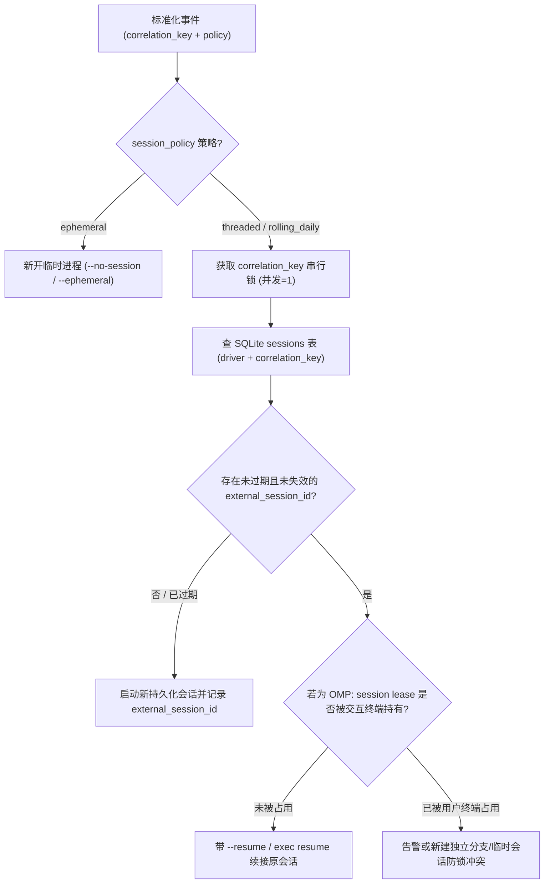
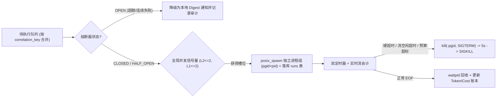

# Bianzhong（编钟）Agent 统一调度与生命周期管理深度调研

> **调研范围**：在不自研 Agent Harness、不修改外部 Agent 源码的前提下，通过极薄外部适配层统一调度本机及生态主流 CLI Agent（`omp`、`pi`、`codex`、`claude` 与 ACP 协议适配器），并给出 `AgentDriver` 抽象、会话路由、上下文注入及全生命周期治理方案。  
> **实证基准**：本报告所有命令行参数、版本与二进制冷启动耗时均基于本机实测（`omp v19.1.1`、`codex-cli 0.172.0`、`claude 2.1.205`），未触发任何实际模型推理调用；`codex app-server` 协议字段核对自本机生成的官方 JSON Schema；`pi-coding-agent` 与 ACP 协议对照官方仓库文档核实。

---

## 1. 核心原则与设计边界

Bianzhong（编钟）定位为 **macOS 上的轻量级事件驱动主动式 Agent 运行时**，而非又一个编码 Agent。为保持核心极端精薄与长期可维护性，调度层必须坚守三条硬约束：

1. **绝不重造 Agent Harness**：Prompt 拼装、工具循环（Tool Loop）、上下文压缩（Compaction）、MCP 客户端、LSP/AST/Bash 工具及子 Agent 编排均由用户自备的现有 CLI Agent（BYO CLI Harness）承担。
2. **绝不侵入/魔改上游源码**：不向 `omp`、`pi`、`codex`、`claude` 提 Fork 补丁；所有调度、权限降级、预算控制、会话续接均通过 **CLI 参数 + 环境变量 + `stdin`/`stdout` JSONL 流 + OS 进程组信号** 在外部完成。
3. **能力降级与优雅兼容**：不同 Agent 的原生控制粒度不同（例如 `omp` 原生支持 `--max-cost`/`--max-time`/`--tools`，`codex exec` 原生支持 `--sandbox`/`--output-schema`，`claude` 支持 `--bare`/`--max-budget-usd`），`AgentDriver` 仅抽象最小公共集，将原生能力透传并在运行时补齐缺失的外部护栏。

---

## 2. 主流 Agent CLI 实测能力与协议深度盘点

### 2.1 实测二进制特征与冷启动基线

本机 `/Users/blizhan/.local/bin/` 与 `/opt/homebrew/bin/` 下已安装 CLI 的实测基线（仅调用 `--version` 测量进程拉起与运行时初始化开销，不产生 API 请求）：

| CLI 工具 | 本地路径与版本 | 二进制形态与体积 | `--version` 冷启动耗时 | 官方仓库 / 规范 |
| :--- | :--- | :--- | :--- | :--- |
| **`omp`** (Oh-My-Pi) | `/Users/blizhan/.local/bin/omp` (`omp/19.1.1`) | Mach-O arm64 原生/打包可执行文件 (222 MB，含 Rust core + Bun/TS) | **14.9 ms** | [can1357/oh-my-pi](https://github.com/can1357/oh-my-pi) |
| **`codex`** | `/Users/blizhan/.local/bin/codex` (`codex-cli 0.172.0`) | Mach-O arm64 原生 Rust 可执行文件 (291 MB) | **10.0 ms** | [openai/codex](https://github.com/openai/codex) |
| **`claude`** | `/opt/homebrew/bin/claude` (`2.1.205 (Claude Code)`) | Mach-O arm64 可执行文件 (226 MB) | **310.8 ms** | [anthropics/claude-code](https://github.com/anthropics/claude-code) |
| **`pi`** | 未在本机安装（npm 包 `@mariozechner/pi-coding-agent`） | Node.js / Bun CLI | 约数百 ms 量级（取决于 JS 运行时，未实测） | [badlogic/pi-mono](https://github.com/badlogic/pi-mono) |

> **工程启示**：原生/编译型单二进制的进程拉起延迟仅 **10–311 ms**（即使加上读取配置文件与认证信息，通常也在数百毫秒内），远低于大模型首字延迟（TTFT 通常为 500–3000+ ms）。这为「按需拉起子进程」的薄架构奠定了性能基础。

---

### 2.2 Oh-My-Pi (`omp v19.1.1`) 深度解析

基于 `omp --help`、`omp acp --help`、`omp session --help`、`omp ps --help`、`omp worktree --help` 实测结果与官方仓库文档：

#### (1) 非交互执行与输出模式
- **`-p, --print`**：非交互模式，处理单次 Prompt 后退出。
- **`--mode=<value>`**：输出与控制协议，支持 `text`（默认）、`json`、`rpc`、`rpc-ui`：
  - **`-p --mode json`**：单次非交互运行，向 `stdout` 输出换行分隔 JSON（JSONL）全量事件流，完成后进程退出。适合按需调度。
  - **`--mode rpc`**：长驻无头子进程，通过 `stdin`/`stdout` 的 **自定义 JSONL 帧协议**（注：**不是**标准 JSON-RPC 2.0）进行多轮交互。启动时 `stdout` 先发送 `ready` 帧；`stdin` 可发 `prompt`、`steer`、`follow_up`、`abort`、`get_state`、`get_messages`、`set_model`、`compact`、`switch_session`、`fork`、`bash`、`abort_bash` 等命令（可携带可选字符串 `id`）；`stdout` 返回镜像 `id` 的 `RpcResponse` 及异步会话事件、Extension UI / `host_tool` 请求。RPC 模式下禁止 CLI `@file` 参数（须通过 `prompt` 命令提交），且默认设置 `PI_NO_TITLE=1` 以关闭自动生成标题的额外模型开销。
  - **`--mode rpc-ui`** 与 **`--no-ui`**：`rpc-ui` 允许通过 RPC 通道渲染扩展与工具 UI（同时禁用 PTY，相当于 `PI_NO_PTY=1`）；附加 `--no-ui` 则以纯无头方式运行扩展（仍保留 `rpc-ui` 工具 UI）。
- **`omp acp`**：内置子命令，直接作为 **Agent Client Protocol (ACP)** stdio 服务端运行。

#### (2) 会话管理与存储结构（本机实测 `~/.omp/agent/sessions/`）
- **核心 CLI 标志**：
  - `-r, --resume=<value>`：按会话 ID 前缀或 `.jsonl` 文件路径直接恢复会话（省略值时打开交互选择器）。
  - `--restore=<value>`：类似 `--resume`，但会接续上次进程崩溃或中断时未完成的 Turn 与运行中的子 Agent。
  - `-c, --continue`：续接当前目录上一会话。
  - `--session-dir=<value>`：指定会话目录（默认受 `PI_CODING_AGENT_DIR` 控制，缺省 `~/.omp/agent`）。
  - `--no-session`：临时会话（Ephemeral），不落盘。
  - `--from-claude` / `--from-codex`：支持将 Claude Code 或 Codex 会话导入 OMP。
  - `--no-title`：禁用标题自动生成模型调用，适合后台自动化省流。
  - `omp session lease --json -- <id>...`：查询哪些会话 ID 正被运行中的 `omp` 进程持有租约，可用于避免与用户交互终端抢占同一会话。
- **本地存储格式（实测 57 个本地 `.jsonl` 文件结构）**：
  - 目录路径：`~/.omp/agent/sessions/<encoded-cwd>/<ISO-timestamp>_<uuid>.jsonl`，伴随 `.lock.os` 锁文件及同名附件目录。
  - **JSONL 树形结构**：首行/头节点为 `{"type":"session","version":3,"id":"<uuid>","timestamp":"...","cwd":"..."}`，后续节点均携带 `id` 与 `parentId` 构成有向树，实测条目 `type` 包含 `session`、`title`、`title_change`、`model_change`、`thinking_level_change`、`service_tier_change`、`message`、`model_usage`、`compaction`、`custom`、`custom_message`。
  - 助手消息（`message.role == "assistant"`）内嵌结构化用量字段：`usage: {input, output, cacheRead, cacheWrite, totalTokens, cost}` 以及 `duration`、`ttft`、`stopReason`，便于外部运行时精确计费。

#### (3) 上下文注入、工具隔离、异步与预算熔断标志
- **环境与配置隔离**：`--profile=<value>`（或 `OMP_PROFILE` 环境变量，隔离认证/会话/设置/缓存）、`--config=<value>`（叠加临时 `config.yml`，可重复）、`--cwd=<value>`、`--add-dir=<value>`（可重复）、`--allow-home`（防止在 `~` 启动时被自动切换至临时目录）。
- **低侵入提示词与上下文开关**：`--append-system-prompt=<value>`（追加文本或文件内容到系统提示词）、`--system-prompt=<value>`、`--system-prompt-template=<value>`、`--no-context-files`（禁用自动读取 `AGENTS.md`/`CLAUDE.md`）、`--no-rules`。
- **外部权限收敛与扩展加载**：
  - `--tools=<value>`：精确指定内置或扩展工具白名单（默认启用内置：`read,edit,write,bash,grep,glob,find,eval,task,wait,todo,ask,web_search,lsp,ast_edit,debug`；可选：`ast_grep,github,checkpoint,rewind,context_notes,new_context,retain,recall,reflect,memory_edit,learn,manage_skill,security_scan`）。例如只读分诊可直接传 `--tools=read,grep,glob,find`。
  - `--no-tools`：禁用全部内置工具（适合纯文本 L1 分诊）。
  - `--no-lsp` / `--no-pty` / `--offline` / `--no-judge` / `--no-spotlight`。
  - `--skills=<value>`（glob 过滤） / `--no-skills`。
  - `--hook=<value>` / `-e, --extension=<value>`（可重复）/ `--no-extensions`（禁用自动发现，但显式 `-e` 仍生效）/ `--plugin-dir <path>`。
  - `--auto-approve` / `--approval-mode=<always-ask|always-ask-cached|write|yolo>`。
- **异步等待、轻量模型与原生熔断护栏**：
  - `--smol=<value>`（或 `PI_SMOL_MODEL`）：指定轻量快速模型（配合 `--no-tools` 是极佳的 L1 分诊组合）。
  - `--wait-async`：在 `-p` 打印模式下等待后台子任务结束并唤醒会话（无时间上限除非配合 `--max-time`）。
  - `--max-time=<value>`：硬性运行时间上限（如 `600`、`10m`、`1h`）。
  - `--warn-cost=<value>` / `--max-cost=<value>`：单会话含子 Agent 总花费（USD）预警与熔断；达到 `--max-cost` 后停止发起新请求，`-p` 模式以 **退出码 `3`** 退出。

---

### 2.3 Pi (`@mariozechner/pi-coding-agent`) 与 OMP 演进/兼容关系

依据 [`badlogic/pi-mono`](https://github.com/badlogic/pi-mono)（现亦维护于 [`earendil-works/pi`](https://github.com/earendil-works/pi)，官网 [pi.dev](https://pi.dev)）的 `packages/coding-agent` 源码与文档（`src/cli/args.ts`、[`docs/json.md`](https://github.com/badlogic/pi-mono/blob/main/packages/coding-agent/docs/json.md)、[`docs/rpc.md`](https://github.com/badlogic/pi-mono/blob/main/packages/coding-agent/docs/rpc.md)、[`docs/session.md`](https://github.com/badlogic/pi-mono/blob/main/packages/coding-agent/docs/session.md)、[`docs/extensions.md`](https://github.com/badlogic/pi-mono/blob/main/packages/coding-agent/docs/extensions.md)）：

#### (1) 核心协议与存储机制
- **CLI 与模式**：支持 `-p` / `--print` 与 `--mode <text|json|rpc>`；工具与扩展通过 `--tools`、`--no-tools`、`--no-builtin-tools`、`-e` / `--extension <path>` 控制（早期 `--hook` 与 `--tool` 已统一为 `--extension`）。
- **`--mode json` 与 `--mode rpc` 事件流**：
  - 两者共享底层 `AgentSession` 事件流，通过严格 `\n` 分隔的 JSONL 输出：`session` 头、生命周期事件 `agent_start`、`turn_start`、`message_start`、`message_update`（含 `assistantMessageEvent` delta）、`message_end`、`tool_execution_start`、`tool_execution_update`、`tool_execution_end`、`turn_end`、`agent_end`（汇总最终 `messages`），以及 `auto_compaction_start` / `auto_retry_start`。
  - `--mode rpc` 额外接收 `stdin` 上的 `RpcCommand`（`prompt`、`steer`、`follow_up`、`abort`、`get_state`、`get_messages`、`set_model`、`cycle_model`、`get_available_models`、`set_thinking_level`、`compact`、`set_auto_compaction`、`bash`、`abort_bash`、`get_session_stats`、`export_html`、`switch_session`、`branch` 等），并返回 `{"type":"response","id":...,"command":...,"success":...,"data":...}`。
- **JSONL 树形会话（`~/.pi/agent/sessions/<encoded-cwd>/`）**：
  - 使用 `id` / `parentId` 构造单文件多分支对话树，支持 `session`、`message`、`compaction`、`branch_summary` 等记录类型，允许无损分叉（`/branch`、`/fork`、`/tree`）。
- **ExtensionAPI 机制**：
  - 以 TypeScript 模块（由 `jiti` 运行时加载，无需手动编译）导出 `default function (pi: ExtensionAPI)`，通过 `pi.on(...)` 监听 `session_start`、`before_agent_start`、`tool_call` 等事件（其中 `tool_call` 可原地改写 `event.input` 或返回 `{ block: true, reason }` 直接拦截工具执行），并可用 `pi.registerTool()` 注册扩展工具。

#### (2) OMP 与 Pi 的演进及兼容对比

| 维度 | Pi (`badlogic/pi-mono`) | OMP (`can1357/oh-my-pi` v19.1.1) | Bianzhong 适配策略 |
| :--- | :--- | :--- | :--- |
| **渊源关系** | 上游极简内核（Mario Zechner 主导） | 基于 Pi 的功能增强型分支（含 Rust core 与集成 IDE 工具链） | **共享 JSONL 流解析器，CLI 参数各自映射** |
| **按 ID/路径恢复会话（关键差异）** | `--session <path\|id>` 直连指定会话；`-r/--resume` 为交互选择器 | `-r, --resume=<value>` 直接接受 ID 前缀、路径或打开选择器（另有 `--restore=<value>`） | **`PiDriver` 用 `--session <id>`；`OmpDriver` 用 `--resume=<id>`** |
| **会话存储目录与格式** | `~/.pi/agent/sessions/`，JSONL `id`/`parentId` 树 | `~/.omp/agent/sessions/`，兼容树形结构并扩展 `title`/`model_usage` 等 | 均记录外部 `session_id` 或文件路径供恢复 |
| **协议模式** | `--mode text\|json\|rpc` | `--mode=text\|json\|rpc\|rpc-ui` + `omp acp` 子命令 | M0 统一走 `-p --mode json` |
| **原生预算/超时护栏** | 需外部运行器计时与解析 `get_session_stats` / `message_end` 用量 | 原生支持 `--max-time`、`--warn-cost`、`--max-cost`（退出码 3） | `OmpDriver` 透传原生标志，外部仍兜底 |

---

### 2.4 OpenAI Codex CLI (`codex-cli 0.172.0`) 深度解析

基于本机 `/Users/blizhan/.local/bin/codex` 实测各子命令 `--help` 及 `codex app-server generate-json-schema` 生成的 v2 Protocol Schema：

#### (1) 非交互流：`codex exec --json` 与 `codex exec resume`
- **`codex exec [OPTIONS] [PROMPT]`**（别名 `codex e`）：
  - 若省略 `[PROMPT]` 或传入 `-`，从 `stdin` 读取指令；若同时管道传入 `stdin` 与参数，则将 `stdin` 作为 `<stdin>` 块追加。
  - **关键参数**：
    - `--json`：向 `stdout` 输出 JSONL 事件流（进度日志输出至 `stderr`）。
    - `-s, --sandbox <read-only|workspace-write|danger-full-access>`：启用原生 macOS Seatbelt 沙箱隔离！
    - `-C, --cd <DIR>`、`--worktree`（在新建托管 Git worktree 中运行）、`--add-dir <DIR>`、`--skip-git-repo-check`。
    - `--ephemeral`：不将 rollout 会话文件落盘（适合一次性任务）。
    - `--ignore-user-config` / `--ignore-rules` / `-p, --profile <NAME>` / `-c, --config <key=value>`：实现配置隔离与 TOML 键值覆盖。
    - `--output-schema <FILE>`：用 JSON Schema 强制约束 Agent 最终输出格式（L1 结构化分诊或结构化拟稿利器）。
    - `-o, --output-last-message <FILE>`：将最后一条回复直接写入文件。
    - `--approve-for-me` / `--dangerously-bypass-approvals-and-sandbox`。
  - **重要实测边界**：`codex exec --help` **并未直接暴露** `-a/--ask-for-approval`（该参数位于交互式 `codex`、`codex resume` 与 `app-server` 参数中）；非交互模式若需覆写审批策略可通过 `-c approval_policy="never"` 配置。
- **`codex exec --json` 事件流结构**（`codex-rs/exec/src/exec_events.rs`）：
  - `thread.started`（含 `thread_id`，即为后续 `resume` 的 `SESSION_ID`）
  - `turn.started`
  - `item.started` / `item.updated` / `item.completed`（`item.type` 为 `snake_case`：`agent_message`、`reasoning`、`command_execution`、`file_change`、`mcp_tool_call`、`web_search`、`todo_list`、`error`）
  - `turn.completed`（含 `usage: {input_tokens, cached_input_tokens, output_tokens}`）、`turn.failed`、`error`。
- **`codex exec resume [OPTIONS] [SESSION_ID] [PROMPT]`** 与 **`codex exec fork`**：
  - 通过上轮捕获的 `thread_id`（UUID）或 `--last` 续接会话，支持 `--json`、`-o`、`--output-schema`、`--ephemeral`、`--worktree`、`--ignore-user-config`、`-c <key=value>`。
  - **关键实测坑点**：`codex exec resume --help` 显示其**不接受 `-s/--sandbox` 与 `-C/--cd` 参数**！因此若 Phase 1 用 `codex exec -s read-only` 拟稿，Phase 2 续接执行写入操作时，需通过 **`-c sandbox_mode="workspace-write"`** 覆写沙箱模式（或改走 `app-server` 的 `thread/resume` + `turn/start` `sandboxPolicy`）。
- **辅助子命令**：
  - `codex queue --thread <THREAD> --message <TEXT> [--resume]`：向现有后台 daemon/remote 会话排队注入消息。
  - `codex sandbox [-P <PROFILE>] [--sandbox-state-readable-root <DIR>] [--sandbox-state-disable-network] [--allow-unix-socket <PATH>] [--log-denials] [COMMAND]...`：将 Codex 的 macOS Seatbelt 沙箱单独作为通用隔离壳来运行任意脚本或非内置沙箱的 Agent 工具。
- **本地会话存储（本机实测 `~/.codex/`）**：Rollout 记录以 Zstd 压缩 JSONL 存放在 `~/.codex/sessions/YYYY/MM/DD/rollout-<ts>-<uuid>.jsonl.zst`（包含 `session_meta`、`turn_context`、`response_item`、`event_msg`、`world_state`），并由 `~/.codex/state_5.sqlite` 等索引维护。

#### (2) 常驻双工协议：`codex app-server`（JSON-RPC 2.0）
- **定位与传输**：`codex app-server`（目前标注 `[experimental]`）提供双向 JSON-RPC 2.0 over JSONL 服务，支持 `--listen stdio://`（默认）、`unix://`、`unix://PATH`、`ws://IP:PORT`（支持 `--ws-auth` 令牌鉴权），并自带 `daemon`（`start|stop|restart|bootstrap`）与 `proxy` 子命令。可通过 `codex app-server generate-json-schema` 与 `generate-ts` 导出与当前二进制版本严格同步的 Schema。
- **核心生命周期原语（`Thread` -> `Turn` -> `Item`）**：
  - **Client -> Server (`ClientRequest.json`)**：`initialize`、`thread/start`（支持 `cwd`、`model`、`sandbox`: `read-only|workspace-write|danger-full-access`、`approvalPolicy`: `untrusted|on-request|never|{granular}`、`ephemeral`、`baseInstructions`、`developerInstructions`）、`thread/resume`、`thread/fork`、`thread/compact/start`、`turn/start`（支持 `threadId`、`input`、`sandboxPolicy`（对象 `type` 为 camelCase：`readOnly|workspaceWrite|dangerFullAccess|externalSandbox`）、`approvalPolicy`、`outputSchema`）、`turn/steer`、`turn/interrupt`、`command/exec`。
  - **Server -> Client 通知 (`ServerNotification.json`)**：`thread/started`、`thread/status/changed`、`thread/tokenUsage/updated`（实时返回 `last` 与 `total` 的 `inputTokens`/`cachedInputTokens`/`outputTokens`/`reasoningOutputTokens`/`totalTokens`）、`turn/started`、`turn/completed`（`status`: `completed|interrupted|failed|inProgress`）、`item/started`、`item/completed`、`item/agentMessage/delta`、`item/commandExecution/outputDelta`、`item/fileChange/patchUpdated`、`error`（注：Item 类型在 v2 Schema 中为 `camelCase`，如 `agentMessage`、`commandExecution`、`fileChange`、`mcpToolCall`、`dynamicToolCall`、`collabAgentToolCall`）。
  - **Server -> Client 审批回调 (`ServerRequest.json`)**：`item/commandExecution/requestApproval`、`item/fileChange/requestApproval`、`item/permissions/requestApproval`、`item/tool/requestUserInput`、`mcpServer/elicitation/request`，客户端回传 `{"decision": "accept" | "decline" | ...}` 即可在 Turn 中途动态放行或阻断操作。

---

### 2.5 Claude Code (`claude 2.1.205`) 与 ACP (Agent Client Protocol)

#### (1) Claude Code Headless CLI（实测 `claude --help`）
- **标准调用形态**：
  ```bash
  claude -p --output-format stream-json --verbose \
    --permission-mode plan --tools "Read,Glob,Grep" \
    --append-system-prompt "..."
  ```
  > **实测坑点**：`--output-format stream-json` 在非交互 `-p` 模式下**必须同时传入 `--verbose`**，否则 CLI 会报错退出；如需 token 级增量再叠加 `--include-partial-messages`。
- **核心治理与隔离参数**：
  - **会话控制**：`--resume <session_id>`（或 `-r`）、`--session-id <uuid>`、`--fork-session`、`--no-session-persistence`（Ephemeral 不落盘）。
  - **纯净隔离（`--bare`）**：跳过 hooks、LSP、插件同步、auto-memory、keychain 读取与 `CLAUDE.md` 自动发现（设置 `CLAUDE_CODE_SIMPLE=1`），避免外部触发被本地重度插件污染；**注意认证限制**：`--bare` 仅使用 `ANTHROPIC_API_KEY` 或 `--settings` 中的 `apiKeyHelper`，不读取 OAuth/Keychain，若用户依赖订阅态 OAuth 则需改用 `--setting-sources user --strict-mcp-config --disable-slash-commands`。
  - **权限与预算**：`--permission-mode <acceptEdits|auto|bypassPermissions|manual|dontAsk|plan>`、`--allowedTools` / `--disallowedTools` / `--tools`、`--json-schema`、`--max-budget-usd <amount>`（仅 `-p` 模式生效）、`--exclude-dynamic-system-prompt-sections`（提升 prompt cache 复用率）、`-w, --worktree [name]`。
- **`stream-json` NDJSON 事件与已知陷阱**：
  - 典型流序列：`{"type":"system","subtype":"init","session_id":"..."}` -> `{"type":"assistant","message":{...}}` -> `{"type":"result","result":"...","session_id":"...","total_cost_usd":...,"usage":{...}}`。
  - **双工模式**：加上 `--input-format stream-json` 可实现常驻 stdin/stdout 多轮对话，但社区 Issue 记录显示 `stream-json` 长流偶发网络/内部挂起而不自退（进程处于低 CPU 睡眠），因此 **外部流空闲看门狗（Idle Timeout）是刚需**。

#### (2) ACP (Agent Client Protocol) 作为通用扩展层的可行性评估
- **协议规范**（[agentclientprotocol.com](https://agentclientprotocol.com/)，[agentclientprotocol/agent-client-protocol](https://github.com/agentclientprotocol/agent-client-protocol)）：由 Zed 与 JetBrains 等推进的开放标准，基于 **JSON-RPC 2.0 over stdio**（本地）或 HTTP/WebSocket。核心方法包括：
  - `initialize`：协商协议版本与双方能力（`agentCapabilities`、`authMethods`）；
  - `session/new` / `session/load`：传入 `cwd` 与 `mcpServers` 创建或加载 `sessionId`（注：`loadSession` 为可选能力）；
  - `session/prompt` / `session/cancel`：提交与取消对话轮次；
  - `session/update`（Agent -> Client 通知）：流式推送 `agent_message_chunk`、`user_message_chunk`、`tool_call`、`plan` 等；
  - `session/request_permission`（Agent -> Client 请求）：客户端作为安全门卫批准/拒绝文件修改或终端执行。
- **生态与 SDK 现状**：
  - **适配器**：`omp acp` 已原生内置；Claude Code 对应 `@agentclientprotocol/claude-agent-acp`（原 `zed-industries/claude-code-acp`）；Codex 对应社区/Zed `codex-acp`。
  - **SDK**：官方维护 Rust SDK、TypeScript SDK（`@agentclientprotocol/sdk`）与 Python SDK（`agent-client-protocol`）；Swift 侧已有社区实现（如 `wiedymi/swift-acp`、`aptove/swift-sdk`）。
- **对 Bianzhong 的可行性结论**：
  - **非常适合作为 M1/M2 的通用扩展驱动（`AcpDriver`）**：只需约 150 行 JSON-RPC 2.0 客户端代码，即可零适配成本接入任何未来支持 ACP 的本地 Agent（Goose、Gemini CLI、OpenCode 等）及原生 `omp acp`。
  - **不建议在 M0 作为唯一主驱动**：
    1. **控制原语粒度不足**：ACP 面向 IDE 交互式聊天抽象，缺乏统一的标准参数来透传各家的硬性护栏（如 `omp --max-cost`、`codex --sandbox read-only` / `--output-schema`、`claude --bare` / `--max-budget-usd`）。
    2. **额外进程与 Shim 开销**：`codex` 和 `claude` 走 ACP 均需额外拉起 Node/桥接适配进程（`codex-acp` / `claude-agent-acp`），增加一层失败点与冷启动延迟。
    3. **会话恢复并非强制能力**：`session/load` 依赖各适配器是否实现 `loadSession` 能力，而原生 `--resume` / `codex exec resume` 已在所有主力 CLI 上稳定可用。

---

## 3. 极薄 `AgentDriver` 统一接口设计

### 3.1 调度模式对比：按需子进程 vs 常驻进程池

| 对比维度 | 模式 A：按需 CLI 子进程 + JSON 流 + `--resume` | 模式 B：常驻 JSON-RPC / `app-server` 进程池 |
| :--- | :--- | :--- |
| **空闲内存占用** | **0 MB**（任务结束立即释放 RSS、FDs 与 MCP 子进程） | **80–300+ MB / 进程**（每个常驻 `omp`/`codex` 及其附带的 MCP Server 长期驻留内存） |
| **冷启动延迟** | 二进制启动 10–311 ms + 配置/MCP 初始化约 100–500 ms；相对 LLM 1–3 s 首字延迟 **几乎可忽略** | **< 5 ms**（仅需向已热身进程写一行 stdin JSON） |
| **多任务隔离与并发** | **天然隔离**：每次运行独立 `cwd`/worktree、独立环境变量、独立只读/可写权限标志与独立进程组 `pgid` | 多任务复用同一常驻进程易出现 `cwd`/沙箱策略切换冲突、状态串扰与并发锁竞争 |
| **故障恢复与状态管理** | **极简单**：进程退出即终态，靠退出码与 JSONL 最后一帧判定；通过外部 SQLite 保存 `session_id` 续接 | **复杂**：需维护长连接心跳、管道断连重建、请求 ID 关联、并发 `stdin` 互斥与内存泄漏定期重启 |
| **Mid-turn 实时交互** | 仅支持整轮结束后结果展示，或通过 Phase 1 -> 挂起 -> Phase 2 `--resume` 实现两阶段审批 | 原生支持 Turn 中途打断注入（`steer`）及工具调用级拦截审批（`requestApproval` / `request_permission`） |
| **适用阶段** | **M0 核心主干（强烈推荐）** | **M1/M2 按需叠加**（仅用于需要实时流式 UI 接管或单步工具弹窗审批的高交互场景） |

> **MVP 明确推荐**：**以模式 A（按需 CLI 子进程 + JSONL 流 + `--resume`）作为 Bianzhong M0 的唯一默认调度机制**。它完美契合 macOS 个人后台运行时“日常几乎零内存占用、事件来时毫秒级拉起、执行完即销毁回收、借助 `--resume` 保留长上下文”的诉求；同时在接口层预留 `turn/interrupt` 与双向流扩展点，以便 M1 对接 `codex app-server`、`omp --mode rpc` 或 `AcpDriver`。

### 3.2 `AgentDriver` 核心契约设计

接口刻意保持在 4 个核心方法以内，任何新 CLI 的接入代码控制在 **60–120 行**：

```swift
// 极薄 AgentDriver 协议契约（Swift 伪代码，可直接对应 TypeScript / Rust 实现）
public enum AgentPermissionProfile: String, Codable {
    case noTools      // 纯文本推理/L1分诊（禁止任何工具）
    case readOnly     // 仅读检索与分析（Phase 1 拟稿安全边界）
    case workspaceRW  // 允许当前仓库/worktree 读写（Phase 2 批准后执行）
}

public struct AgentInvocationRequest {
    public let runID: String
    public let correlationKey: String
    public let workingDirectory: String
    public let promptText: String              // 精简事件提示词（经 stdin 传入）
    public let eventFilePath: String           // 完整事件 JSON 临时文件路径
    public let permissionProfile: AgentPermissionProfile
    public let modelOverride: String?          // 如 smol / opus / gpt-5.4
    public let resumeSessionID: String?        // nil 表示新开；非 nil 表示续接
    public let ephemeral: Bool                 // true 时禁止持久化会话文件
    public let maxTimeSeconds: Int?
    public let maxCostUSD: Double?
    public let outputSchemaPath: String?       // 可选结构化输出约束
}

public struct SpawnSpec {
    public let executablePath: String
    public let arguments: [String]
    public let environment: [String: String]   // 注入 BIANZHONG_* 变量，不污染全局
    public let stdinData: Data?
    public let workingDirectory: String
}

public enum NormalizedAgentEvent {
    case sessionStarted(externalSessionID: String)
    case textDelta(chunk: String)
    case toolActivity(name: String, status: String, summary: String?)
    case usageReported(inputTokens: Int, outputTokens: Int, cachedTokens: Int, costUSD: Double?)
    case finalAnswer(text: String)
    case error(message: String, isBudgetOrTimeout: Bool)
}

public protocol AgentDriver {
    var id: String { get }                     // "omp" | "pi" | "codex" | "claude" | "acp"
    var supportsNativeCostCap: Bool { get }
    var supportsOutputSchema: Bool { get }
    func buildSpawnSpec(request: AgentInvocationRequest) -> SpawnSpec
    func parseStdoutLine(_ line: String) -> [NormalizedAgentEvent]
    func isSuccessExit(exitCode: Int32, lastEvents: [NormalizedAgentEvent]) -> Bool
}
```

### 3.3 各 Harness CLI 参数与协议字段精确映射表

| 能力 / 语义 | `OmpDriver` (`omp v19.1.1`) | `PiDriver` (`pi-coding-agent`) | `CodexDriver` (`codex-cli 0.172.0`) | `ClaudeDriver` (`claude 2.1.205`) |
| :--- | :--- | :--- | :--- | :--- |
| **基础非交互 JSON 流** | `-p --mode=json --no-title` | `-p --mode json` | `exec --json --skip-git-repo-check` | `-p --output-format stream-json --verbose` |
| **Prompt 投递方式** | `stdin` 管道（或尾随参数；避免 `@` 误触发） | `stdin` 管道（或参数） | 末尾传 `-` 从 `stdin` 读取 | `stdin` 管道（或末尾参数） |
| **纯推理无工具 (`noTools`)** | `--no-tools` | `--no-tools` | 需外层/指令约束，或结合 `--sandbox read-only` + `--output-schema` | `--tools ""` |
| **只读分析 (`readOnly`)** | `--tools=read,grep,glob,find` | `--tools read,grep,find,ls` | `-s read-only -c approval_policy="never"` | `--permission-mode plan --tools "Read,Glob,Grep"` |
| **工作区读写 (`workspaceRW`)** | `--tools=read,edit,write,bash,grep,glob,find` + `--auto-approve` | `--tools read,bash,edit,write,grep,find,ls` | `-s workspace-write -c approval_policy="never"`（或 `--worktree`） | `--permission-mode acceptEdits`（或限定 `--allowedTools`） |
| **指定模型 (`modelOverride`)** | `--model=<val>`（L1 可传 `--smol=<val>`） | `--model <val>` | `-m <val>` | `--model <val>` |
| **新建临时会话 (`ephemeral`)** | `--no-session` | `--no-session` | `--ephemeral` | `--no-session-persistence` |
| **续接历史会话 (`resume`)** | `--resume=<session_id>`（或 `--session-dir` + `--resume`） | `--session <session_id_or_path>` | `exec resume <session_id>`（**注意：读写权限变更需改用 `-c sandbox_mode="workspace-write"`**） | `--resume <session_id>` |
| **工作目录设定** | `--cwd=<dir> --allow-home` | 进程 `cwd` | `-C <dir>`（仅首次 `exec` 支持，`exec resume` 依赖进程 `cwd` 与原线程目录） | 进程 `cwd`（辅以 `--add-dir`） |
| **隔离全局配置/插件** | `--no-extensions --no-rules`（或 `--profile bianzhong`） | `--no-extensions` | `--ignore-user-config --ignore-rules`（需认证复用 `CODEX_HOME`） | `--bare`（API Key 场景）或 `--setting-sources user --strict-mcp-config --disable-slash-commands` |
| **原生超时 / 成本上限** | `--max-time=<duration>`（如 `600`、`10m`）、`--max-cost=<usd>`（退出码 3） | 无原生，由运行时看门狗强制执行 | 无 CLI 成本上限，由运行时流监控拦截 | `--max-budget-usd <usd>` |
| **捕获 `external_session_id`** | 首帧 `type == "session"` 的 `.id` | 首帧 `type == "session"` 的 `.id` | `type == "thread.started"` 的 `.thread_id` | `type == "system" && subtype == "init"` 的 `.session_id`（或 `result.session_id`） |
| **抽取 Token 与成本** | `message_end` / `agent_end` 中 `message.usage`（含 `cost`） | `message_end` / `agent_end` 中 `usage` | `turn.completed.usage` (`input_tokens`, `cached_input_tokens`, `output_tokens`) | `type == "result"` 的 `total_cost_usd` 与 `usage` |

---

## 4. 会话路由（Session Routing）与上下文注入

### 4.1 基于 `correlation_key` 的三种路由策略

每条来自感知层的事件均携带规范化 `correlation_key`（例如 `github:owner/repo#pr-42`、`fs:/Users/me/proj:test-fail`、`feishu:oc_123:om_456`、`digest:daily:2026-11-24`）。调度器结合规则声明的 `session_policy` 决定会话生命周期：



1. **`ephemeral`（无状态一次性）**：适用于剪贴板解析、单次系统告警、L1 轻量分诊。直接传入 `--no-session` / `--ephemeral` / `--no-session-persistence`，零磁盘残留。
2. **`threaded`（上下文线程粘性，带 TTL）**：适用于同一 PR 讨论、同一 IM 对话线程、同一仓库连续编译报错、以及 **Two-Phase HITL 审批闭环**（Phase 1 只读分诊拟稿记录 `external_session_id`，人工点击批准后 Phase 2 精准 `--resume` 同一 `external_session_id` 并提升权限执行）。在 SQLite `sessions` 表以 `(correlation_key, driver)` 为索引记录 `external_session_id`、`cwd`、`last_used_at`、`expires_at`（默认 TTL 如 24 小时或按规则配置）及 `turn_count`（超限如 > 20 轮自动轮转新会话防上下文腐化）。
3. **`rolling_daily`（每日聚合滚动会话）**：例如 `digest:daily:YYYY-MM-DD`，同一天内的多批次摘要事件续接同一个轻量会话，跨日自动开启新会话。

**并发串行锁与租约冲突保护**：
- 同一 `correlation_key` 严格保持 **并发度 = 1**（FIFO 排队或合并），防止两个同时到达的事件同时对同一 `.jsonl` 会话文件写锁冲突（如 OMP 的 `.lock.os`）或破坏树形 `parentId` 链。
- 针对 `omp` 会话，续接前可选调用一次轻量只读命令 `omp session lease --json -- <session_id>`，确认用户没有在交互式终端里同时打开同一个会话。

### 4.2 精简事件信封注入（不污染全局配置、不撑爆上下文）

主动式运行时最忌讳两件事：(a) 直接把数 MB 的日志/邮件/通知 JSON 塞进命令行参数（触发 `ARG_MAX` 上限且白白烧掉大量 Input Token）；(b) 往用户的 `~/.omp/agent/AGENTS.md` 或 `~/.codex/config.toml` 写入 Bianzhong 私有规则。

推荐采用 **“双通道极简信封（Env + 临时文件 + 短 Prompt 指针）”**：

1. **隔离沙箱目录与运行时文件（Run Workspace）**：
   - 每次触发创建临时目录 `~/.local/state/bianzhong/runs/<run_id>/`（权限 `0700`），写入完整载荷 `event.json`（权限 `0600`），任务结束后按保留策略清理。
2. **子进程环境变量注入（仅传子进程，零全局写入）**：
   - `BIANZHONG_RUN_ID=<run_id>`
   - `BIANZHONG_CORRELATION_KEY=<correlation_key>`
   - `BIANZHONG_PHASE=<triage|draft|execute>`
   - `BIANZHONG_EVENT_FILE=/Users/.../runs/<run_id>/event.json`
   - `BIANZHONG_EVENT_JSON=<压缩摘要 JSON，严格截断在 4 KB 以内，去掉大文本正文字段>`
   - `BIANZHONG_ORIGIN_MARKER=1`（供下游 `bz`/感知器识别自身产生的副作用，协同防自激循环）
3. **Stdin 短指令注入 + 系统角色追加**：
   - 通过 `--append-system-prompt`（`omp`/`claude`）或前置指令告知 Agent：“你正被 Bianzhong 后台事件驱动唤醒。完整原始信号位于 `$BIANZHONG_EVENT_FILE`，仅在元数据不足以判断时再按需读取。不要修改与任务无关的配置。”
   - 当续接已有会话（`--resume`）时，**不再重复发送冗长规则上下文**，仅通过 `stdin` 喂入本次增量事件信封与明确行动边界（例如 Phase 2 批准指令）。
4. **防止全局 Hook/Skill 污染的开关**：
   - L1 分诊与非信任信号默认附带 `--no-extensions --no-rules --no-context-files`（OMP）或 `--ignore-user-config --ignore-rules`（Codex）或 `--bare` / `--disable-slash-commands`（Claude）；仅当 Chime 规则显式需要用户项目环境与 Skill（`inherit_project_context: true`）时才放开。

---

## 5. 全生命周期治理（Lifecycle Governance）

事件驱动系统在真实 macOS 环境中极易遭遇“Git checkout 引发数百次 FSEvents”、“网络恢复涌入数十条通知”、“外部 API 卡死导致进程长期挂起”等问题，必须在调度器内建四重确定性防线：



### 5.1 分级并发信号量（防止事件风暴）
- **双车道并发上限（Apple Silicon 本地资源保护）**：
  - **L1 分诊车道（`max_concurrent_triage = 2`）**：仅运行 `--no-tools --smol` 快速分类，耗时短、无磁盘副作用。
  - **L2 行动车道（`max_concurrent_runs = 2`）**：完整 Agent 工具与子进程，限制为 2（可配置 `1–4`），防止事件风暴同时拉起十几个 Rust/Node/MCP 进程拖垮机器内存或触发 API 429 限流。
- **同 Key 合并与队列淘汰**：相同 `correlation_key` 在队列中已有等待项时，合并或保留最新载荷（Coalescing）；队列长度设上限（如 `max_pending = 32`），超出时优先丢弃过期的低优先级观察事件。

### 5.2 双重超时控制（Wall-Clock + Stream Idle Watchdog）
- **硬墙钟超时（Hard Deadline）**：按阶段严格限定上限，例如 L1 分诊默认 `30s`、Phase 1 只读拟稿 `180s`、Phase 2 编码执行 `600s`；支持 `omp --max-time` 的驱动同时传入原生标志形成双重保险。
- **流空闲看门狗（Stream Idle Watchdog）**：监控子进程 `stdout` + `stderr` 最后一次收到字节的时间。若连续 `90s`（可配置）无任何输出心跳（针对如 Claude `stream-json` 偶发无声挂死等场景），立即判定进程假死并触发优雅中断流程。

### 5.3 优雅中断（SIGTERM -> SIGKILL）与孤儿进程回收
CLI Agent 在执行过程中常衍生多层子进程（`bash` 脚本、测试框架、MCP stdio 服务器、`omp` 子 Agent）。若仅 `kill(pid)`，子孙进程将被 `launchd`（PID 1）收养成为孤儿进程并持续占用锁或 CPU。

1. **强制独立进程组（Process Group Isolation）**：
   - 使用 `posix_spawn`（配合 `POSIX_SPAWN_SETPGROUP` 属性）或子进程 `setpgid(0, 0)` 启动每个 Agent，确保 `pgid == pid`。
   - 为子进程环境设置 `CI=true`、`TERM=dumb`、关闭交互 TTY，避免某些底层工具弹密码框或卡在分页器（`less`/`git diff`）。
2. **两阶段信号终止阶梯**：
   - **T+0s**：向整个进程组发送 `kill(-pgid, SIGTERM)`，允许 Agent 刷出最后日志并清理临时锁（如 OMP `.lock.os`）。
   - **T+5s（Grace Window）**：若 `waitpid(pid, WNOHANG)` 仍未回收或进程组仍有存活成员，发送 `kill(-pgid, SIGKILL)` 强杀整组并同步 `waitpid` 避免僵尸进程。
3. **Daemon 崩溃重启后的孤儿扫除（Orphan Reaping）**：
   - 子进程刚创建即把 `(run_id, driver, pid, pgid, process_start_time_ns, status='running')` 写入 SQLite `runs` 表（WAL 模式保证崩溃不丢）。
   - Bianzhong 守护进程启动时及每 5 分钟巡检 `status='running'` 的历史记录：通过 macOS `libproc` (`proc_pidinfo` 获取 `pbi_start_tvsec`/`pbi_start_tvusec`) 核对 PID 未被系统重用后，若进程仍存活但已失去父守护进程归属，即刻清理整组 `-pgid` 并将状态标记为 `aborted_orphan`；若规则配置允许断点续跑且驱动为 `omp`，可选择记录该记录供用户手动 `omp --restore` 接管。

### 5.4 Token / 调用预算熔断（Budget & Circuit Breaker）
结合原生护栏与流式账本实现三级熔断：

1. **驱动原生硬限（首选透传）**：
   - `omp` 传入 `--warn-cost` 与 `--max-cost`（触发退出码 `3` 识别为预算中止）；
   - `claude` 传入 `--max-budget-usd`；
   - `codex` 目前 CLI 无原生 USD 参数，依赖第 2 层实时截断。
2. **流式实时成本核算（中途强杀）**：
   - 解析 `stdout` JSONL 中的 Token 与费用字段（`omp`/`pi` 的 `usage.cost.total`、`codex` 的 `turn.completed.usage`、`claude` 的 `result.total_cost_usd`），按模型单价表折算实时消耗；若单次运行超出 Chime 规则 `max_run_usd` 或 `max_turns`，不等进程自然结束即触发 `kill(-pgid, SIGTERM)`。
3. **全局滑动窗口熔断器（Circuit Breaker）**：
   - SQLite `runs` 表聚合统计 **每小时 / 每日全局调用次数与累计花费**，以及连续错误率（如连续 3 次返回 429 Rate Limit 或认证失败）。
   - 触发阈值时调度器进入 **`OPEN` 熔断态**：自动暂停全部 L2/L1 大模型自动唤醒（例如保留 `30m` 冷却期，之后进入 `HALF_OPEN` 单次探测），期间所有高优事件直接以本地 L0 摘要通知用户（MenuBar Inbox），彻底杜绝整夜失控账单。

---

## 6. 总结：对 MVP 落地的核心约束建议

1. **M0 只实现 Mode A（按需子进程 + JSONL stdout + `--resume`）**：优先打通 `OmpDriver`、`CodexDriver`、`ClaudeDriver`（以及兼容的 `PiDriver`），每驱动仅约 80–120 行代码；M1 再增加通用 `AcpDriver` 覆盖长尾 ACP Agent。
2. **绝不混用各家 CLI 的会话参数**：文档中已实证 `omp` 使用 `--resume=<id>`（或 `-r <id>`）、`pi` 使用 `--session <id>`、`codex` 使用 `exec resume <id>`（且 `exec resume` 不认 `-s` 需用 `-c sandbox_mode=...`）、`claude` 使用 `--output-format stream-json --verbose --resume <id>`。
3. **从第一天就落地独立进程组（`pgid`）与双定时器**：`setpgid` + `SIGTERM -> 5s -> SIGKILL` + Stream Idle Watchdog + SQLite 崩溃孤儿回收是后台常驻运行时稳定性的底线保障。

---

## 参考资料与实证来源

- 本机实测输出：`/Users/blizhan/.local/bin/omp --help` (`omp/19.1.1`)、`/Users/blizhan/.local/bin/codex --help` / `exec --help` / `exec resume --help` / `app-server --help` / `queue --help` / `sandbox --help` (`codex-cli 0.172.0`)、`/opt/homebrew/bin/claude --help` (`2.1.205`)、以及本机 `codex app-server generate-json-schema` 产物与 `~/.omp/agent/sessions/` 真实 JSONL 结构检查。
- Oh-My-Pi 官方仓库：[can1357/oh-my-pi](https://github.com/can1357/oh-my-pi)
- Pi Coding Agent 官方仓库与协议文档：[badlogic/pi-mono](https://github.com/badlogic/pi-mono) / [earendil-works/pi](https://github.com/earendil-works/pi) / [pi.dev](https://pi.dev)（[`docs/json.md`](https://github.com/badlogic/pi-mono/blob/main/packages/coding-agent/docs/json.md)、[`docs/rpc.md`](https://github.com/badlogic/pi-mono/blob/main/packages/coding-agent/docs/rpc.md)、[`docs/session.md`](https://github.com/badlogic/pi-mono/blob/main/packages/coding-agent/docs/session.md)、[`docs/extensions.md`](https://github.com/badlogic/pi-mono/blob/main/packages/coding-agent/docs/extensions.md)）
- OpenAI Codex 官方仓库：[openai/codex](https://github.com/openai/codex)
- Anthropic Claude Code 官方仓库：[anthropics/claude-code](https://github.com/anthropics/claude-code)
- Agent Client Protocol 官方规范与 SDK：[agentclientprotocol.com](https://agentclientprotocol.com/)、[agentclientprotocol/agent-client-protocol](https://github.com/agentclientprotocol/agent-client-protocol)、[agentclientprotocol/typescript-sdk](https://github.com/agentclientprotocol/typescript-sdk)、[agentclientprotocol/python-sdk](https://github.com/agentclientprotocol/python-sdk)、[@agentclientprotocol/claude-agent-acp](https://www.npmjs.com/package/@agentclientprotocol/claude-agent-acp)、[wiedymi/swift-acp](https://github.com/wiedymi/swift-acp)
