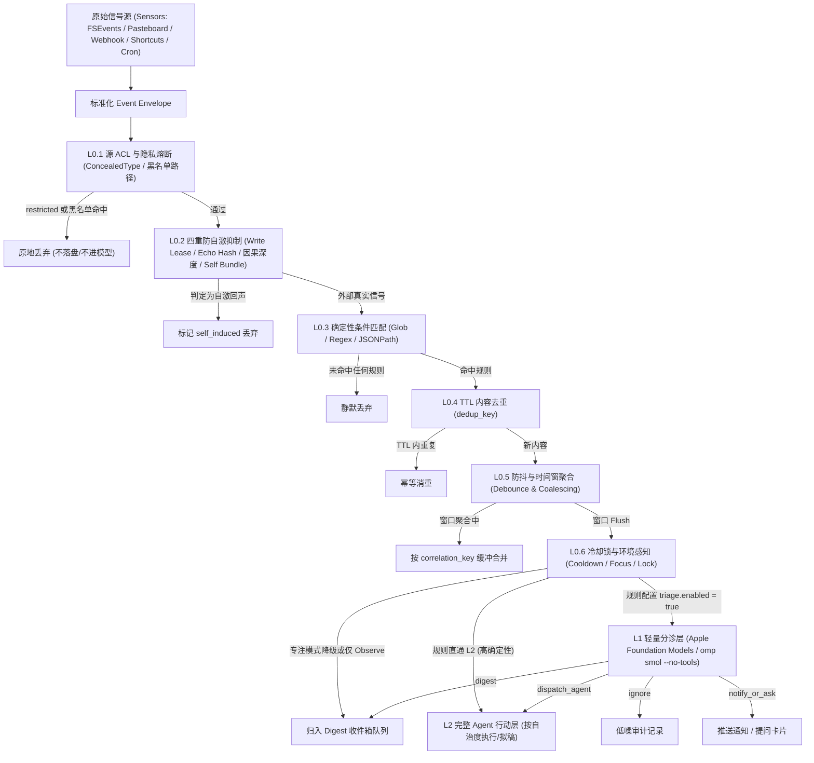
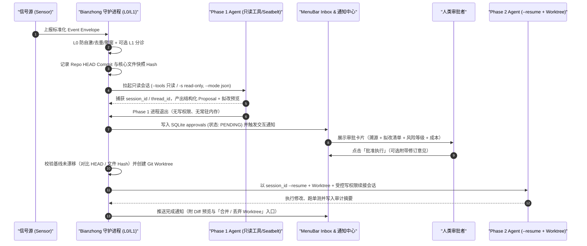

# 04 · 事件触发漏斗、权限边界与人机协作（HITL）专题调研

> **调研角色**：Bianzhong（编钟）事件触发漏斗、权限边界与 HITL 调研员  
> **核心命题**：在「对外部 Agent Harness（OMP / Pi / Codex）零源码魔改」与「对 macOS 系统低侵入、极薄运行时」前提下，系统性解决主动式后台 Agent 的三大死穴：**避免无意义唤醒（Anti-Noise）**、**防自激死循环（Anti-Loop）** 与 **防止未经授权行动（Zero-Trust HITL）**。

---

## 0. 执行摘要（TL;DR）

1. **标准化局部事件信封（Event Envelope）**：基于 [CloudEvents v1.0](https://github.com/cloudevents/spec) 核心四元组（`specversion`, `id`, `source`, `type`）裁剪构建本地事件信封，补充 `ts`、`correlation_key`、`dedup_key`、`privacy_level`、`causality` 及采集瞬间的 `ambient_context`（前台 App、专注模式、空闲时长、锁屏状态）。**大对象不内联、敏感剪贴板原地丢弃**。
2. **三级漏斗式唤醒（Tiered Wakeup Funnel）**：拒绝“信号一来就调用大模型”。
   - **L0 确定性规则层（0 Token，毫秒级）**：按固定流水线执行「源 ACL 与隐私熔断 -> 四重防自激抑制 -> 表达式条件匹配 -> TTL 内容哈希去重 -> 尾随防抖与时间窗聚合（Debounce & Coalescing）-> 冷却锁与勿扰降级」。预计拦截 **90%+** 噪音与风暴。
   - **L1 轻量分诊层（可选，低成本/端侧）**：仅对 L0 无法靠规则裁决的语义信号启用，输出严格受限的四分类 `ignore | digest | notify_or_ask | dispatch_agent`。优先使用 macOS 26 Tahoe+ 端侧 `SystemLanguageModel`（[Apple Foundation Models](https://developer.apple.com/documentation/foundationmodels)，0 API 费用、敏感文本不出端），降级采用剥离上下文与工具的 CLI 轻量调用（如 `omp --model smol --no-tools --no-extensions --no-skills --no-rules --no-context-files --no-session --no-title --thinking off -p`）。
   - **L2 完整 Agent 行动层**：仅处理高价值、已通过权限门控的任务。
3. **自激死循环防护（Loop Prevention）**：实证指出 macOS `FSEvents` 的 `kFSEventStreamCreateFlagIgnoreSelf` **仅忽略当前守护进程 PID，不忽略子进程树**（即 `bianzhongd` 拉起的 `omp`/`codex` 写文件仍会反触发自己）。在不引入需要系统授权的 Endpoint Security 框架前提下，设计**「活跃写路径租约 + 回声指纹（Echo Hash）抑制 + 进程环境变量因果深度标记（`BIANZHONG_DEPTH`）+ `CFBundleIdentifier` / `NSPasteboard` 规范标记排除」**四重零侵入防线。
4. **零魔改“两阶段会话续接审批（Two-Phase Resume HITL）”**：定义四级自治度（`Observe/Digest` -> `Notify` -> `Draft & Approve` -> `Bounded Auto`）。核心默认档 `Draft & Approve` 完全复用原生 CLI 约束：
   - **Phase 1（只读勘察与拟稿）**：使用只读工具白名单（`omp --tools read,grep,glob --no-extensions` / `pi --tools read,grep,find,ls`）或 OS 级只读沙箱（`codex exec -s read-only`），产出行动方案/Diff 草案并捕获 `session_id` / `thread_id`。
   - **HITL 挂起审批**：通过带合法 `CFBundleIdentifier` 的极薄 `.app`（MenuBar Inbox + [`UNUserNotificationCenter`](https://developer.apple.com/documentation/usernotifications) 交互通知）展示「触发溯源 + 拟执行动作 + 风险分级 + 一键批准/拒绝/终端接管」。
   - **Phase 2（批准后续接执行）**：仅在人工批准并校验基线未漂移后，创建独立 Git Worktree，通过原生会话续接/分叉（`omp -r <session_id> --cwd <worktree>` / `codex exec fork <thread_id> --worktree -c sandbox_mode="workspace-write"`）恢复完整推理上下文并开放受限写权限，**零重复探索 Token、零源码侵入**。

---

## 1. 统一事件格式（Event Envelope）与上下文关联

### 1.1 参考 CloudEvents v1.0 的本地裁剪原则

[CNCF CloudEvents v1.0 规范](https://github.com/cloudevents/spec) 明确区分了 **4 个必填上下文属性**（`specversion`、`id`、`source`、`type`）与 **可选属性**（如 `time`、`datacontenttype`、`subject`、`dataschema`）。Bianzhong 作为单机本地总线（Unix Domain Socket / SQLite WAL），完全沿用其“信封与载荷解耦”的思想，同时裁剪掉 HTTP/Kafka 传输绑定冗余，新增**去重键、关联键、隐私分级、因果溯源与环境快照**五个主动式运行时刚需字段。

### 1.2 核心字段规范与 JSON Schema 示例

```json
{
  "specversion": "1.0",
  "id": "01JDY9M2X4K7Q8Z3N5R6V8W0PY",
  "source": "bz://sensor/fsevents/workspace",
  "type": "dev.bianzhong.fs.modified",
  "ts": "2026-11-24T09:15:32.418Z",
  "correlation_key": "repo:/Users/blizhan/code/app-core",
  "dedup_key": "sha256:9f86d081884c7d659a2feaa0c55ad015",
  "privacy_level": "internal",
  "causality": {
    "emitter_pid": 41820,
    "parent_run_id": null,
    "depth": 0
  },
  "payload": {
    "root": "/Users/blizhan/code/app-core",
    "paths": ["src/auth/token.ts", "tests/auth.test.ts"],
    "change_kind": "modified",
    "coalesced_count": 12,
    "summary": "12 file-save events coalesced in 5s window"
  },
  "ambient_context": {
    "frontmost_app": {
      "bundle_id": "com.microsoft.VSCode",
      "name": "Visual Studio Code"
    },
    "focus_mode": {
      "active": false,
      "mode_id": null,
      "source": "shortcuts_hook"
    },
    "idle_seconds": 3.4,
    "screen_locked": false,
    "on_battery": false
  }
}
```

| 字段 | 类型 / 约束 | 来源 / 对齐标准 | 核心职责与设计边界 |
| :--- | :--- | :--- | :--- |
| `specversion` | `"1.0"` | CloudEvents v1.0 必填 | 固定信封协议版本，保证 Sensor 解耦演化。 |
| `id` | ULID / UUIDv7 字符串 | CloudEvents v1.0 必填 | 局部全局唯一且按时间单调递增，优化 SQLite B-Tree 写入性能。 |
| `source` | URI-reference | CloudEvents v1.0 必填 | 标识产生事件的 Sensor 实例（如 `bz://sensor/pasteboard`、`bz://sensor/webhook/github`）。 |
| `type` | 反向域名枚举 | CloudEvents v1.0 必填 | 事件语义类型（如 `dev.bianzhong.im.mention`、`dev.bianzhong.ci.failed`），供 L0 精确路由。 |
| `ts` | RFC 3339 时间戳 | CloudEvents `time` 映射 | 事件在源头发生的真实时间（非入队时间），用于时序审计与窗口聚合。 |
| `correlation_key` | 标准化字符串 | 运行时扩展 | **上下文聚合与会话锚点**。同键事件共享防抖队列、冷却锁及同一个 Agent `session_id`（如 `pr:owner/repo#108`、`mail:thread-abc`）。 |
| `dedup_key` | `sha256:<hex>` | 运行时扩展 | **幂等去重锚点**。通常由 `source + type + canonical_target + normalized_payload_hash` 计算，拦截高频重复上报。 |
| `privacy_level` | 四级枚举 | 运行时安全约束 | `public` \| `internal` \| `sensitive` \| `restricted`。决定该事件**能否落盘、能否进云端模型、是否必须原地销毁**（见 §1.3）。 |
| `causality` | `{ emitter_pid, parent_run_id, depth }` | 防自激扩展 | 追踪事件是否由 Bianzhong 托管的子进程间接产生，用于递归深度硬熔断（§2.2）。 |
| `payload` | JSON Object（`<= 8KB`） | CloudEvents `data` | 仅承载结构化元数据与轻量摘要。长文本、大 Diff、附件不内联，仅存受控临时文件指针或项目路径，由 Phase 1 Agent 按需 `read`。 |
| `ambient_context` | 结构化快照 | macOS 运行时感知 | 决定“此刻是否适合打扰用户或执行后台动作”。采集边界与零特权降级策略见 §1.4。 |

### 1.3 `privacy_level` 四级隐私强制语义

| 隐私等级 | 典型信号示例 | L0 落盘策略 | 允许进入的模型层级 |
| :--- | :--- | :--- | :--- |
| `public` | 开源仓库 CI/PR 状态、公开日程标题、非隐私系统唤醒 | 完整落盘审计 | L1 本地 / 云端均可，L2 按规则执行 |
| `internal` | 本地工作区文件路径、终端命令退出码、编译错误摘要 | 脱敏路径或完整落盘 | L1 本地优先（云端需规则显式允许），L2 正常执行 |
| `sensitive` | 个人邮件正文、IM 私聊、普通剪贴板文本、本地备忘录 | 仅存摘要哈希或加密临时区，TTL 后清理 | **禁止自动上传未脱敏云端模型**；仅允许端侧模型或人工点击确认后送 L2 |
| `restricted` | 密码管理器剪贴板（`ConcealedType`）、OTP 验证码、Keychain/SSH 私钥路径 | **禁止落盘、禁止记日志、L0 原地销毁** | **禁止进入任何 LLM（含本地小模型）** |

### 1.4 `ambient_context` 的低侵入采集现实（macOS 边界）

为贯彻“尽量少侵入 macOS、少申请高危 TCC 权限”的原则，环境上下文采取**公开 API 优先 + Shortcuts 零权限补充**的分层采集方案：

1. **前台应用（`frontmost_app`）**：通过公开 API `NSWorkspace.shared.frontmostApplication` 获取 `bundleIdentifier` 与 `localizedName`（**0 权限弹窗**；仅当需要窗口标题时才涉及 Accessibility 辅助功能权限，默认置空）。
2. **用户空闲时长（`idle_seconds`）**：通过公开 CoreGraphics API `CGEventSource.secondsSinceLastEventType(.combinedSessionState, eventType: CGEventType(rawValue: ~0)!)`（其中 `~0` 对应 C 常量 `kCGAnyInputEventType`）或 I/O Kit `IOHIDSystem` 注册表属性 `HIDIdleTime`（单位纳秒，除以 $10^9$ 得秒）读取（**无需特殊 TCC 权限**）。
3. **锁屏状态（`screen_locked`）**：调用 `CGSessionCopyCurrentDictionary()` 检查字典键 `CGSSessionScreenIsLocked`（布尔值）及 `kCGSSessionOnConsoleKey`，准确识别“人不在或已锁屏”（**无需特殊权限**）。
4. **专注模式 / 勿扰模式（`focus_mode`）**：
   - **技术现实**：现代 macOS（Monterey 12+ 至 Sequoia/Tahoe）**未提供公开 API** 读取当前 Focus/DND 状态。社区常见方案是解析 `~/Library/DoNotDisturb/DB/Assertions.json`（其中 `storeAssertionRecords[].assertionDetails.assertionDetailsModeIdentifier` 记录激活的模式 ID，如 `com.apple.donotdisturb.mode.default`）及 `ModeConfigurations.json`，但该路径受 TCC 保护，**强制依赖 Full Disk Access（FDA）权限**且属内部非公开 Schema。
   - **低侵入推荐方案**：Bianzhong 默认**不强求 FDA**，而是通过 macOS 原生「快捷指令（Shortcuts）」自动化（在“开启/关闭任意专注模式”时执行 1 行 `bz state focus --active true --mode "$FOCUS_NAME"`）维护本地状态；仅当用户主动授予 FDA 时才启用 `Assertions.json` 监听兜底。

---

## 2. 三级漏斗式唤醒机制（Tiered Wakeup Funnel）

主动式 Agent 落地的首要工程铁律是：**90% 以上的信号过滤必须由 0 Token、确定性、毫秒级的本地逻辑完成；只有确定性规则无法裁决的语义灰度事件，才允许进入极轻量小模型分诊；只有真正需要多步推理或工具行动的信号，才唤醒完整 Agent。**



### 2.1 L0 确定性规则层（0 Token，毫秒级拦截）

L0 在守护进程内存与轻量 SQLite 索引中按严格顺序执行六个阶段（对应上图 `L0.1`~`L0.6`，`L0.2` 防自激细则单列于 §2.2），把代价最低的硬拦截放在最前端：

1. **L0.1 源黑白名单与剪贴板/路径隐私熔断（Source ACL & Privacy Gate）**：
   - **剪贴板硬规范**：遵循 [nspasteboard.org](https://nspasteboard.org/) 通用约定，Clipboard Sensor 在读取任何内容前必须先检查 `NSPasteboard.general.types`（`NSPasteboard.PasteboardType`）。一旦包含以下任一标记，**立即标记 `privacy_level: restricted` 并原地丢弃，绝不读取字符串正文**：
     - `org.nspasteboard.ConcealedType`（1Password、Bitwarden 等密码管理器填入的密码/API Key）；
     - `org.nspasteboard.TransientType`（后台工具瞬时覆写恢复的数据）；
     - `org.nspasteboard.AutoGeneratedType`（文本扩展或输入法自动替换内容，非显式复制）。
   - **前台 App 与路径黑名单**：前台为密码管理器/银行/隐私浏览器标签，或变更路径命中 `.git/**`、`node_modules/**`、`.build/**`、`~/.omp/**`、`~/.codex/**`、`~/.pi/**`、`~/.local/state/bianzhong/**` 时直接过滤，防止 Agent 写入会话日志或依赖目录反过来淹没总线。

2. **L0.2 四重防自激抑制**：见 §2.2 专项机制。

3. **L0.3 确定性表达式匹配（轻量声明式条件）**：
   - 避免嵌入重型规则引擎（如 Drools 或复杂脚本 VM），仅支持规则 YAML 中的四种原语组合（`all` / `any` / `not`）：
     - `source` / `type` 前缀匹配（如 `dev.bianzhong.fs.*`）；
     - `glob` 路径匹配（如 `include: ["src/**/*.swift"]`, `exclude: ["**/*.generated.swift"]`）；
     - `regex`（守护进程启动时预编译正则表达式并限制输入截断长度，杜绝 ReDoS）；
     - 轻量点路径 / JSONPath 取值比较（如 `payload.exit_code != 0`、`ambient_context.idle_seconds < 300`）。

4. **L0.4 TTL 内容哈希去重（Content-Hash Deduplication）**：
   - 以 `(rule_id, dedup_key)` 为键维护 LRU 缓存（持久化至 SQLite 防重启丢失）。在 `dedup_ttl`（如 `60s`~`3600s`）内收到同一封邮件重复拉取、同一 CI 告警重推或内容哈希未变的连续保存，直接幂等丢弃。

5. **L0.5 防抖与时间窗聚合（Debounce & Coalescing）**：
   - **典型痛点**：一次 `git checkout`、IDE 自动格式化或高频保存可能在 **5 秒内触发 30~200 次 `FSEvents` 事件**。
   - **双阈值滑动/尾随窗口算法**：按 `(rule_id, correlation_key)` 维护轻量内存定时器：
     - **尾随防抖（`debounce: 5s`）**：窗口期内每来一条事件，重置 `5s` 倒计时并将文件路径/变更摘要并入 `batch_buffer`（路径集合自动去重，仅记录 `coalesced_count`）。安静 5 秒后打包为 **1 条聚合事件** 进入下游。
     - **最大等待封顶（`max_wait: 30s`）**：防止持续不断的后台构建写入导致定时器被无限推迟（饥饿），达到 `max_wait` 强制 Flush 一次快照。

6. **L0.6 冷却时间与勿扰/锁屏感知（Cooldown & Ambient Gate）**：
   - **Per-`correlation_key` 冷却锁（`cooldown: 10m`）**：同一文件或同一 GitHub PR 刚完成一次分析或被用户忽略后，在冷却期内不再重复唤醒大模型；叠加全局令牌桶限制（如每小时最多唤醒 L2 `N` 次）。
   - **环境门控**：当 `focus_mode.active == true` 或 `screen_locked == true` 时，非 `urgent` 级规则自动将原本要推送的 `notify` / `ask` 降级暂存到 `Digest` 队列，等用户解锁或退出专注模式后统一呈报。

#### 极简规则触发与门控声明示例（Chime Trigger Policy）

```yaml
id: pr-ci-failure-triage
match:
  type: dev.bianzhong.ci.failed
  where: "payload.branch == 'main' || payload.author == 'self'"
funnel:
  dedup_ttl: 300s
  debounce: 5s
  max_wait: 30s
  cooldown: 15m
  defer_on_focus: true
  triage:
    enabled: false          # 确定性失败信号跳过 L1，直通 L2 Phase 1 只读勘察
execution:
  autonomy: draft_approve   # Level 2：只读拟稿 -> 挂起审批 -> Worktree 续接
  driver: omp
  budget:
    phase1_max_cost_usd: 0.25
    phase2_max_cost_usd: 1.00
    max_time_sec: 300
```

---

### 2.2 自激死循环防护（Loop Prevention —— 核心工程防线）

主动式系统一旦打通“感知 -> Agent 行动 -> 系统变更”，最致命的故障模式就是**正反馈自激风暴**：Agent 写文件触发 `FSEvents`、发通知触发通知监听、写剪贴板触发剪贴板监听、回复评论触发 Webhook，最终在几分钟内烧光额度并把 Mac 卡死。

#### 关键底层陷阱：`FSEvents` 的 `IgnoreSelf` 不管用！

在 macOS CoreServices `FSEvents` API 中，官方提供的 `kFSEventStreamCreateFlagIgnoreSelf`（以及 `kFSEventStreamCreateFlagMarkSelf` 配合回调标志 `kFSEventStreamEventFlagOwnEvent`）**仅识别并忽略创建该 `FSEventStream` 的当前进程 PID**。  
然而 Bianzhong 的薄架构决定了修改文件的不是守护进程 `bianzhongd` 自身，而是它 `spawn` 出来的子进程（`omp`、`pi`、`codex` 及其内部的 `git`、`swift`、`npm` 孙进程）。因为子进程拥有独立的 PID，**`kFSEventStreamCreateFlagIgnoreSelf` 对 Agent 产生的磁盘写入完全无效！**  
另一方面，Apple 现代内核框架 **Endpoint Security (`es_new_client`)** 虽能通过 Audit Token 精确追溯进程树并静音特定子进程，但它需要向 Apple 申请受限 Entitlement 与系统级部署，严重违背“薄与零侵入”原则。

#### 四重零侵入防自激机制（组合闭环）

| 回路类型 | 典型自激路径 | Bianzhong 零侵入阻断方案 |
| :--- | :--- | :--- |
| **回路 A：文件修改自激** | Agent 改文件 -> `FSEvents` 捕获 -> 再次触发同一或另一规则 | **① 活跃写入路径租约（Active Write Lease）+ Git Worktree 隔离**：执行 Phase 2 前先将目标 `worktree` 根路径纳入永久排除前缀；若规则直接作用于主工作区 `cwd`，则在子进程存活期间及退出后宽限期 `T_grace`（如 `1500ms`）内为该 `cwd` 注册写租约，窗口内由该目录触发的同类型事件一律打标 `self_induced` 并丢弃（或要求用户显式配置 `allow_chained_rules` 才透传）。 |
| **回路 B：通知弹窗自激** | Bianzhong 弹出审批/完成通知 -> Notification Sensor 捕获 -> 触发通知总结 Agent | **② 本身 `CFBundleIdentifier` 硬排除 + 回声指纹**：Notification Sensor 启动即硬编码过滤 `dev.bianzhong.*` 及关联 CLI 通知源；同时守护进程在调用 `UNUserNotificationCenter.add(...)` 前计算 `echo_hash = sha256("notify:" + title + body)` 写入 60s TTL 抑制环，即便通过系统通知数据库或 AX 间接观察到自身文本也立即丢弃。 |
| **回路 C：剪贴板写回自激** | Agent 帮助用户生成回复并写入剪贴板 -> Clipboard Sensor 捕获变更 -> 触发剪贴板 Agent | **③ `nspasteboard.org` 标准标记 + 回声指纹**：Bianzhong 任何代写剪贴板工具写入内容时，**强制同时声明 `org.nspasteboard.TransientType`（或 `AutoGeneratedType`）** 并登记 30s `echo_hash`，Clipboard Sensor（含第三方合规剪贴板工具）天然忽略该次变更。 |
| **回路 D：外部 Webhook 乒乓** | Agent 自动在 GitHub PR / 飞书群发评论 -> Webhook 收到自己账号的评论推送 -> 再次触发 | **④ Actor 身份比对 + 因果深度硬熔断**：Webhook Sensor 强制核对 `sender_id != self_actor_id`（除非文本显式包含人类唤醒口令如 `/bz`）；同时 Bianzhong 在启动所有 Agent 子进程时注入只读环境变量 `BIANZHONG_RUN_ID` 与 `BIANZHONG_DEPTH=<d+1>`。`bz emit` CLI 若检测到自身环境变量已带 `BIANZHONG_DEPTH >= MAX_CAUSAL_DEPTH`（默认硬上限 `1`），直接拒绝入队并告警，从进程树层面物理封死无限递归。 |

---

### 2.3 L1 轻量分诊层（Smol / Local Triage，可选极低成本）

并非所有事件都要过 L1。**规则本身就是最好的分类器**：例如“指定仓库测试脚本退出码非零”应跳过 L1 直接进 L2（只读拟稿）；只有面对**自然语言噪音高、L0 无法仅靠正则判别意图**的信号（如一封来历不明的邮件、IM 长讨论串、一段未知剪贴板文本）时，才在规则中开启 `triage.enabled: true`。

#### 结构化四分类契约

借鉴 LangChain Ambient Agents 的人机交互原语体系，L1 输出严格约束为以下 JSON Schema（禁止自由散文、禁止调用任何修改工具）：

```json
{
  "decision": "ignore | digest | notify_or_ask | dispatch_agent",
  "confidence": 0.87,
  "reason": "GitHub issue 仅询问文档链接，无代码修改诉求，归入每日摘要即可。",
  "suggested_autonomy": "Observe/Digest | Notify | Draft & Approve",
  "title": "Issue #42 文档询问（可稍后看）"
}
```

- `ignore`：纯噪音、广告、礼貌性回执 -> 记入低噪审计日志，不打扰；
- `digest`：值得知道但非实时紧急 -> 投入定时汇总简报队列；
- `notify_or_ask`：需人类直接知晓或先给一句话指示 -> 推送轻量通知/提问卡，**不提前启动重型代码 Agent**；
- `dispatch_agent`：高价值可执行任务 -> 放行进入 L2（携带 `title` 与建议自治等级）。

#### 两条极薄实现路线对比

| 实现路线 | 具体机制与调用形态 | 优缺点与适用前提 |
| :--- | :--- | :--- |
| **路线 A（首选端侧零成本）：Apple Foundation Models (`SystemLanguageModel`)** | macOS 26 (Tahoe) 及以上、Apple Silicon 且已开启 Apple Intelligence 时，由原生 Swift MenuBar/Helper 直接调用 `FoundationModels` 框架的 `LanguageModelSession` 与 Guided Generation（结构化生成）输出四分类。 | **优势**：0 API 费用、毫秒~秒级响应、**`sensitive` 级隐私数据完全不出本机**。<br>**约束**：仅限 Apple Silicon + macOS 26+ 且开启 Apple Intelligence，旧版 macOS 或关闭状态下 `SystemLanguageModel.default.isAvailable == false`，需自动回退到路线 B 或保守降级为 `digest`。 |
| **路线 B（通用 CLI 复用）：`omp` 剥离模式（或本地 Ollama/Haiku/Flash API）** | 不自研复杂的 LLM SDK 与鉴权体系，直接调用本机已配置的 `omp`（`omp v19.1.1`）。<br>**精确 CLI 参数澄清**：据实测 `omp --help`，`--smol=<value>` 用于覆盖 `smol` 辅助角色模型（对应 `PI_SMOL_MODEL`），而主 Turn 使用的模型由 `--model=<value>` 指定（可设为配置的 `smol` 角色别名或显式轻量模型如 `claude-haiku` / `gemini-flash`）。同时**必须叠加全套剥离标志**：<br>`omp --model smol --no-tools --no-extensions --no-skills --no-rules --no-context-files --no-session --no-title --thinking off --max-time 15 -p "<triage_prompt>"` | **优势**：跨 macOS 版本通用、复用用户现有 Provider 认证。<br>**关键细节**：① `--no-tools` 只禁用内置工具，必须叠加 `--no-extensions` 才能彻底封锁 `.omp/tools` 扩展工具加载；② `--no-skills --no-rules --no-context-files` 避免注入数百行 `AGENTS.md` 与工具定义，把单次分诊控制在极少 Token；③ `--no-session` 防止在磁盘生成垃圾会话文件。 |

**Fail-Safe 降级原则**：L1 设置硬超时（如 `8s`~`15s`）与 JSON Schema 解析校验。一旦模型超时、配额耗尽或输出非法 JSON，**严禁默认放行到 L2**，一律安全降级为 `digest` 并记录 `triage_fallback` 告警。

---

## 3. 零侵入权限控制与“两阶段会话续接审批（Two-Phase Resume HITL）”

### 3.1 四级自治度模型（Autonomy Levels）

每条 Bianzhong 规则（Chime）必须显式声明最大自治边界；运行时结合事件风险与 `privacy_level` 取交集（即只降不升）：

| 自治等级 | 名称 | 允许的能力边界 | 人类介入机制 | 典型场景 |
| :--- | :--- | :--- | :--- | :--- |
| **Level 0** | `Observe / Digest` | 仅检索必要元数据并入库汇总；**禁止调用写工具、禁止发系统弹窗** | 仅在每日/定时 Digest 中被动查阅 | 日常 PR 动态汇总、非紧急依赖更新通知 |
| **Level 1** | `Notify` | 允许在只读沙箱内研判上下文并生成简报，**绝对禁止修改工作区或外部状态** | 推送通知卡（支持“已读忽略”或手动升级为调查任务） | 测试流水线失败根因速报、高优邮件摘要 |
| **Level 2** | `Draft & Approve` | **两阶段闭环（Bianzhong 默认推荐档）**：Phase 1 只读分析并生成修改方案/补丁/回复草稿 -> 挂起等批准 -> Phase 2 批准后在隔离 Worktree 或受限沙箱执行 | **审批卡片**：批准执行 / 附批注修订 / 终端接管 / 拒绝 | 自动修复 Bug、生成 PR Review 建议、回复重要邮件草稿 |
| **Level 3** | `Bounded Auto` | 允许直接执行，但**物理锁定在独立 Git Worktree 或白名单目录内**，受限于时间、费用及命令白名单；**不可逆外发操作默认仍需降级审批** | 事后异步结果通知 + 一键查看 Diff / 一键合并或丢弃 Worktree | 局部文档同步、为新函数补全单元测试、本地自动格式化 |

> **不可逾越的安全基线**：涉及 `git push --force`、删除主工作区文件、对外发送邮件/IM 消息、修改系统级配置或金融/账号权限变更的操作，在默认策略下**禁止分配 Level 3**，强制收敛至 Level 2 人工确认。

---

### 3.2 无需修改 OMP / Pi / Codex 源码的强权限控制（External Enforcement）

不修改任何 Agent Harness 源码，意味着权限边界必须通过**外部可验证的硬约束**（而非仅靠 Prompt 口头嘱咐“请不要修改文件”）来落地。依据本机实测 `omp v19.1.1 --help`、`codex-cli 0.172.0` 各子命令 `--help` 以及 `badlogic/pi-mono` 官方文档，三款主流 Harness 均可在**零魔改**前提下实现从「Phase 1 硬只读」到「Phase 2 受控写」的平滑切换：

| Harness | Phase 1：只读勘察与拟稿（硬隔离） | 会话锚点捕获 | Phase 2：批准后续接执行（Worktree + 写权限） |
| :--- | :--- | :--- | :--- |
| **OMP** (`omp v19.1.1`) | `--tools read,grep,glob --no-extensions --approval-mode always-ask --session-dir ~/.local/state/bianzhong/sessions/omp --mode json --max-time 180 --max-cost 0.25 -p "<prompt>"`<br>*(注：`omp --help` 列出的默认内置只读工具为 `read,grep,glob`，`find` 依赖 judge 模型；排除 `edit,write,bash,eval,ast_edit`，并加 `--no-extensions` 防项目自定义扩展越权。)* | 读取 `--mode json` 输出首行：<br>`{"type":"session","version":3,"id":"<session_id>",...}` | `omp -r <session_id> --session-dir ~/.local/state/bianzhong/sessions/omp --cwd <worktree_path> --tools read,grep,glob,edit,write,bash --auto-approve --max-time 300 --max-cost 1.00 --mode json -p "<approval_prompt>"`<br>*(注：`--cwd` 强制指向独立创建的 Git Worktree，不污染主工作区。)* |
| **Pi** (`@mariozechner/pi-coding-agent`) | `--tools read,grep,find,ls --no-extensions --session-dir ~/.local/state/bianzhong/sessions/pi --mode json -p "<prompt>"`<br>*(注：`pi` 核心内置只读工具为 `read,grep,find,ls`，亦可配合 `--no-builtin-tools` 控制扩展边界。)* | 读取 `--mode json` 首行：`{"type":"session","version":3,"id":"<session_id>",...}` | 在子进程工作目录设为 `<worktree_path>` 下执行：<br>`pi --session <session_id> --session-dir ~/.local/state/bianzhong/sessions/pi --tools read,write,edit,bash --mode json -p "<approval_prompt>"` |
| **Codex** (`codex-cli 0.172.0`) | `codex exec -s read-only -C <repo_path> --output-schema <proposal_schema.json> --json -o <proposal.json> "<prompt>"`<br>*(注：macOS 下 `-s read-only` 底层调用 Apple Seatbelt `/usr/bin/sandbox-exec`，从内核层物理封锁一切磁盘写入与网络外连！)* | 读取 `--json` 流首行：<br>`{"type":"thread.started","thread_id":"<thread_id>"}` | **实测关键限制**：① `codex exec resume` 不直接提供 `-s/--sandbox` 与 `-C` 标志；② 虽 `--worktree` 出现在 `exec resume --help` 中，但**运行时明确拒绝联用**（报错 `--worktree is not supported with codex exec resume`）。<br>**合规隔离写法（二选一）**：<br>• **Phase 2 按需创建 Worktree（推荐）**：改用 `codex exec fork <thread_id> --worktree -c sandbox_mode="workspace-write" -c approval_policy="never" --json -o <result.json> "<approval_prompt>"`（会生成新 `thread_id`，既保留 Phase 1 不可变审计记录，又由 Codex 原生托管隔离 Worktree）。<br>• **Phase 1 预建 Worktree**：若 Phase 1 已带 `--worktree` 启动，则 Phase 2 直接执行 `codex exec resume <thread_id> -c sandbox_mode="workspace-write" -c approval_policy="never" --json -o <result.json> "<approval_prompt>"`（不重复传 `--worktree`）。 |

---

### 3.3 两阶段会话续接审批（Two-Phase Resume HITL）完整闭环

相比“让用户看一段一次性文本，批准后再重开一个全新 Agent 从头读代码”的传统做法，**两阶段 `--resume` 模式**具有双重优势：
1. **省 Token 与时间**：Phase 1 阅读代码、定位根因的完整上下文已持久化在 Harness 原生会话文件中（如 `~/.local/state/bianzhong/sessions/...`），Phase 2 续接时直接命中记忆（及模型前缀缓存），无需二次扫描仓库；
2. **安全零妥协**：Phase 1 进程在吐出提案后立即优雅退出，**在人类点击批准之前，系统里甚至不存在任何持有写权限的常驻 Agent 进程**。



#### 工程健壮性细节：防止 TOCTOU（检查与执行时间差漂移）

在“Phase 1 拟稿”到“人类半小时后点击批准”之间，用户极可能已在编辑器中修改了同一批文件。若直接带着旧认知去 `--resume` 覆盖文件，会造成严重的误覆盖（Time-of-Check to Time-of-Use 漏洞）。因此 Bianzhong 在 Phase 1 结束时额外记录两项轻量指纹：
1. 目标仓库的 `git rev-parse HEAD` 与脏工作区 `git status --porcelain` 摘要；
2. Proposal 中列出的拟改目标文件当前的 `sha256` 哈希。

点击批准触发 Phase 2 前，守护进程先花 `< 10ms` 重新比对上述指纹。若发现仓库或目标文件已变更，在注入 Phase 2 的续接 Prompt 中强制附加一条基线变化告警（要求 Agent 先重新 `read` 确认冲突再编辑），若漂移过大则暂停并退回审批卡提示重新拟稿。

---

### 3.4 极薄 CLI 回调（`bz ask`）与四维预算熔断护栏

1. **运行中补充提问与阻塞回调（`bz ask`）**：
   - 对于 Phase 1 只读分析阶段缺少信息的情况，首选“在结构化输出中声明 `decision: need_input` 并退出 -> 用户在 Inbox 回复 -> 通过 `--resume` 注入回答”，保持**无阻塞进程占用**。
   - 对于已进入 Phase 2 或 Level 3 `Bounded Auto` 且开放了 `bash` 的场景，可通过 Prompt 约定（如 OMP `--append-system-prompt`）提供一个极薄的终端工具约定：`bz ask --run-id "$BIANZHONG_RUN_ID" --question "..." --options "继续,跳过,中止"`。`bz ask` 通过 Unix Socket 将问题投递至 Inbox 并同步等待用户点击，随后把结果打印到 `stdout` 返回给 Agent（设置硬超时如 `10m`，超时默认返回 `timeout_abort` 引导 Agent 安全收尾退出）。
2. **四维预算与熔断护栏（Circuit Breakers）**：
   - **原生费用与时长硬顶**：优先复用 Harness 自带护栏（如 `omp --max-cost`、`--warn-cost`、`--max-time`，注意 `omp -p` 超费用时稳定返回退出码 `3` 便于识别），并在守护进程层叠加强制超时定时器（`SIGTERM` -> 宽限 `5s` -> `SIGKILL`）。
   - **并发与互斥信号量**：全局最大并发 L2 子进程数（如默认 `2`），同一 `correlation_key` 强制串行排队（防两轮并发改爆同一工作区）。
   - **失败/拒绝熔断器（Auto-Pause）**：某条规则若连续异常退出 **3 次**，或同一 `correlation_key` 在 1 小时内被人类连续点击「拒绝」**2 次**，自动将规则状态置为 `tripped_circuit_breaker` 并弹窗提醒，避免静默烧钱或反复打扰。
   - **Worktree 与会话存储 GC**：超过 TTL（如 7 天）的已合并/已拒绝 Worktree 自动清理，保持磁盘轻量。

---

## 4. 交互层人机协作（HITL）与反馈闭环设计

### 4.1 为什么必须有一层极薄的 `.app` Bundle？

根据 Apple [`UserNotifications`](https://developer.apple.com/documentation/usernotifications) 框架的 macOS 系统约束：纯粹的命令行守护进程或脚本无法注册交互式通知按钮。只有封装在具备合法 `CFBundleIdentifier` 与签名 `Info.plist` 的 `.app` Bundle（即轻量 Swift `MenuBarExtra` 听音台壳）内，才能通过 `UNUserNotificationCenter.setNotificationCategories` 注册 `UNNotificationAction`：
- **静默后台批准（`.background` 选项）**：用户点击通知横幅上的「批准」或「忽略」，无需拉起前台窗口即可唤醒 `UNUserNotificationCenterDelegate` 在后台投递审批决策，保持编码心流零打断；
- **展开/接管**：点击卡片主体或「在终端接管」才呼出 MenuBar 详情弹窗或终端窗口。

### 4.2 四象限收件箱（MenuBar Inbox）与聚合摘要（Digest）

借鉴 [`langchain-ai/agent-inbox`](https://github.com/langchain-ai/agent-inbox) 的异步收件箱范式，Bianzhong 交互层将所有事件结果收敛为四个清晰分区，消除分散弹窗焦虑：

1. **待审批（Review / Approvals，角标强提醒）**：所有挂起等待 Phase 2 批准的任务；
2. **待回答（Questions）**：Phase 1 或 `bz ask` 发起的上下文澄清请求；
3. **高优提醒（Notifications）**：Level 1 `Notify` 产出的只读研判结果；
4. **聚合摘要（Digest，零打扰流）**：所有 L1 `digest` 事件、Level 0 `Observe` 记录、以及专注模式期间被延后（Deferred）的消息，按规则节奏（如每日 `09:30` / `18:00` 或用户解锁屏幕时）压缩为一条结构化简报。

### 4.3 审批卡片（Approval Card）信息架构与逃生舱设计

一张合格的审批卡片必须让用户在 **3~5 秒内完成风险评估与决策**，包含以下 5 项要素：

1. **信号溯源条（Provenance）**：来源徽章 + 命中规则名称 + 原始事件摘要 + 触发时间 + `correlation_key`；
2. **拟执行动作与影响面（Plan & Blast Radius）**：目标仓库 / Worktree 路径、拟修改文件清单或拟执行命令、可折叠的 Unified Diff 预览；
3. **风险与自治徽章（Risk & Autonomy）**：`LOW`（纯测试/文档）｜ `MEDIUM`（改写本地代码）｜ `HIGH`（含外发/命令执行/破坏性动作），明确高亮是否触及网络或主分支；
4. **消耗账单（Cost Meter）**：Phase 1 已消耗耗时与估算费用（如 `14s · ~$0.03`）及 Phase 2 预算上限；
5. **四类直达操作按钮**：
   - ✅ **批准并在隔离区执行**：触发 Phase 2 `--resume` + Git Worktree；
   - ✏️ **附带指令继续（Reply / Edit）**：输入一行补充说明（例如“只改 auth 模块，不要动测试”），通过 `--resume` 喂给 Agent 重新拟稿或执行；
   - 💻 **在终端接管会话（Take Over in Terminal）**：**最关键的“零锁定逃生舱”**——一键拉起用户的终端（Terminal / iTerm2 / Ghostty），直接执行 `omp -r <session_id> --session-dir ...`，或对 Codex 执行 `codex fork <thread_id> --worktree -s workspace-write`（接管 Phase 1 提案进新 Worktree）/ `codex resume <new_thread_id> -s workspace-write`（接管 Phase 2 已分叉会话），把已充分预热好上下文的会话交还人类现场微调；
   - ❌ **拒绝并静默**：销毁挂起记录，可选勾选「24 小时内忽略同类事件」。

### 4.4 行动审计日志与反馈闭环（Silent-by-Feedback）

1. **全链路因果审计账本**：SQLite 持久化记录 `event_id -> funnel_decision (L0/L1 命中原因) -> phase1_run (session_id, cost, proposal_hash) -> hitl_decision (批准/拒绝/接管, 耗时) -> phase2_run (worktree_path, git_diff_stat, exit_code)`。用户随时可追溯“为何某条文件变更被触发，是谁在何时批准了哪条方案”。
2. **规则自演化反馈闭环（确定性优先于提示词调参）**：
   - 当用户在 Inbox 对同一规则或同类 `source/type` 连续执行「拒绝」或「静默」时，Bianzhong 不在后台暗中修改玄学 Prompt，而是主动向用户弹出一条**确定性规则微调建议**（如：“已连续拒绝 2 次来自 `docs/**/*.md` 的触发，是否将该路径加入此规则 `exclude` 或将 `cooldown` 从 `5m` 延长至 `60m`？”）。
   - 用户点击确认后直接回写对应 Chime 规则文件的 YAML 头（L0 层立即生效），真正实现**越用越静默、越用越精准**。

---

## 5. 参考资料与验证基准

1. **CloudEvents v1.0 Specification**：CNCF 官方事件信封标准（Required/Optional 上下文属性定义）— https://github.com/cloudevents/spec
2. **NSPasteboard Universal Clipboard Markers**：macOS 敏感/瞬时/自动生成剪贴板标记规范（`ConcealedType` / `TransientType` / `AutoGeneratedType`）— https://nspasteboard.org/
3. **Oh My Pi (`omp v19.1.1`)**：本机实测 `omp --help`（验证 `--model`, `--smol`, `--tools`, `--no-tools`, `--no-extensions`, `--no-skills`, `--no-rules`, `--no-context-files`, `--mode json`, `-r/--resume`, `--session-dir`, `--cwd`, `--max-time`, `--max-cost`, `--approval-mode`, `--auto-approve` 等参数）— https://github.com/can1357/oh-my-pi
4. **OpenAI Codex CLI (`codex-cli 0.172.0`)**：本机实测 `codex --help`、`codex exec --help`、`codex exec resume --help`、`codex exec fork --help`、`codex resume --help`、`codex fork --help`、`codex sandbox --help`（验证 `-s read-only`, `--json` `thread.started`, `--output-schema`, `exec resume` 无 `-s`/`-C` 且运行时不支持 `--worktree`，需通过 `codex exec fork --worktree` 与 `-c sandbox_mode="workspace-write"` 隔离执行）— https://github.com/openai/codex
5. **Pi Coding Agent (`pi-mono`)**：CLI 工具白名单（`--tools read,grep,find,ls`）、`--mode json` JSONL 事件流与树形会话续接规范 — https://github.com/badlogic/pi-mono
6. **LangChain Ambient Agents & Agent Inbox**：后台异步 Agent 四原语（`notify` / `question` / `review` / `ignore`）与 Interrupt/Resume 人机协作 UX — https://github.com/langchain-ai/agent-inbox
7. **Apple Foundation Models Framework**：macOS 26 (Tahoe) 端侧 `SystemLanguageModel` 与结构化生成（Guided Generation）— https://developer.apple.com/documentation/foundationmodels
8. **Apple User Notifications Framework**：macOS `UNUserNotificationCenter`、`UNNotificationCategory` 与后台 `UNNotificationAction` — https://developer.apple.com/documentation/usernotifications
